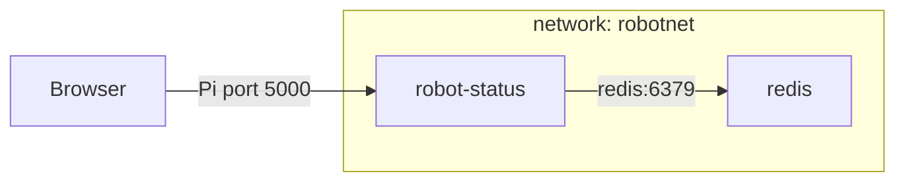

{:class="cover"}

---

By the end of this lesson you will be able to publish a container port, create a network, and connect two containers so they find each other by name.

## Two kinds of connection

Containers talk in two different ways, and it helps to keep them apart:

1. **Outside to container**: your browser reaches the web app. This is done by **publishing a port** with `-p`.
2. **Container to container**: the web app reaches its database. This is done by putting them on the same **network**.

## Port mapping

Each container has its own private network. A web server listening on port 5000 inside it can't be seen from outside until you map a port on the Pi to it.


The format is `-p HOST_PORT:CONTAINER_PORT`. The left number is on the Pi, the right number is inside the container. So `-p 8080:5000` means "traffic arriving at the Pi on 8080 goes to port 5000 in the container". The two numbers don't have to match, which lets you run several copies of the same app on different host ports.

> `EXPOSE 5000` in a Dockerfile only documents the port. Only `-p` (or `ports:` in Compose) actually publishes it.

## Network types

You can list your networks with:

```bash
docker network ls
```

You'll see `bridge`, `host` and `none`:

| Network | What it does |
| --- | --- |
| `bridge` | The default. Containers get private addresses and reach the internet through the host |
| `host` | The container shares the host's network directly, with no isolation and no port mapping |
| `none` | No networking at all |
{:class="table table-single"}

There's also an `overlay` type for linking Docker hosts together, which is used by Docker Swarm. You'll meet it in the [Docker Swarm course](/learn/docker_swarm/).

## Why make your own network

Containers on the default `bridge` can reach each other by IP address, but not by name, and the addresses change. A network you create yourself adds **name lookup**: a container called `redis` can be reached simply as `redis`.

Let's use that to give our robot a memory. First clear out the old container, then create a network:

```bash
docker rm -f robot-status
docker network create robotnet
```

Start Redis, a tiny fast key-value database, on that network. We don't publish any port for it, so only containers on `robotnet` can reach it:

```bash
docker run -d --name redis --network robotnet redis:7-alpine
```

Now start the robot status page on the same network and tell it where Redis lives, using the `REDIS_HOST` setting our app reads:

```bash
docker run -d --name robot-status --network robotnet -p 5000:5000 -e REDIS_HOST=redis robot-status
```

Check that the name `redis` resolves from inside the app container:

```bash
docker exec robot-status python -c "import socket; print(socket.gethostbyname('redis'))"
```

You'll see a private address such as `172.18.0.2`. Now open `http://localhost:5000` again. The page says the visits are "stored in redis". To see the same thing from the command line:

```bash
curl http://localhost:5000/status
```



Only the web container is reachable from outside. Redis is private to `robotnet`, which is exactly what you want for a database.

## Common Issues

- **Problem**: The page shows an error and `docker logs robot-status` mentions `Name or service not known` or a connection error to `redis`.
- **Solution**: Check both containers are on the same network with `docker network inspect robotnet`, and that Redis is running (`docker ps`).
- **Why**: Name lookup only works between containers on the same user-created network.

- **Problem**: Port 5000 doesn't respond from another computer.
- **Solution**: Use the Pi's address (`hostname -I` shows it) and check the container shows `0.0.0.0:5000->5000/tcp` in `docker ps`.
- **Why**: `localhost` always means "this machine", so from your laptop it points at the laptop.

- **Problem**: `network robotnet already exists`.
- **Solution**: That's harmless. Carry on, or remove it with `docker network rm robotnet` once no containers use it.
- **Why**: Network names must be unique.

> **Teachers**: Published ports are open to anyone on the same network, so a learner's page can be seen by the whole room. That is useful for demos, but remind learners not to publish databases such as Redis with `-p` on a school network.

## Try it Yourself

1. Run `docker network inspect robotnet` and find the two containers and their addresses.
2. Start a second copy of the web app named `robot2` on `robotnet`, with `-p 5001:5000`, `-e REDIS_HOST=redis` and `-e ROBOT_NAME=Wall-E`. Do both pages share the same visit counter? Why?
3. Challenge: run `docker run --rm alpine ping -c 1 redis`. It fails, because that container is on the default bridge. Run it again with `--network robotnet` added. What changed?

## Check your understanding


? In `-p 8080:5000`, which number is the container's port?
- [ ] 8080
- [x] 5000
- [ ] Both
> The format is `HOST_PORT:CONTAINER_PORT`, so 8080 is on the Pi and 5000 is inside the container.

? Why create your own network instead of using the default bridge?
- [x] Containers on it can find each other by name
- [ ] It makes the containers run faster
- [ ] It is the only way to get internet access
> User-created networks include name lookup, so `redis` resolves to the Redis container.

? Why didn't we publish a port for Redis?
- [ ] Redis doesn't use ports
- [ ] Docker forbids it
- [x] Only containers on robotnet need to reach it, so it stays private
> Containers on the same network can talk to each other without published ports. Publishing would open it to everyone.

