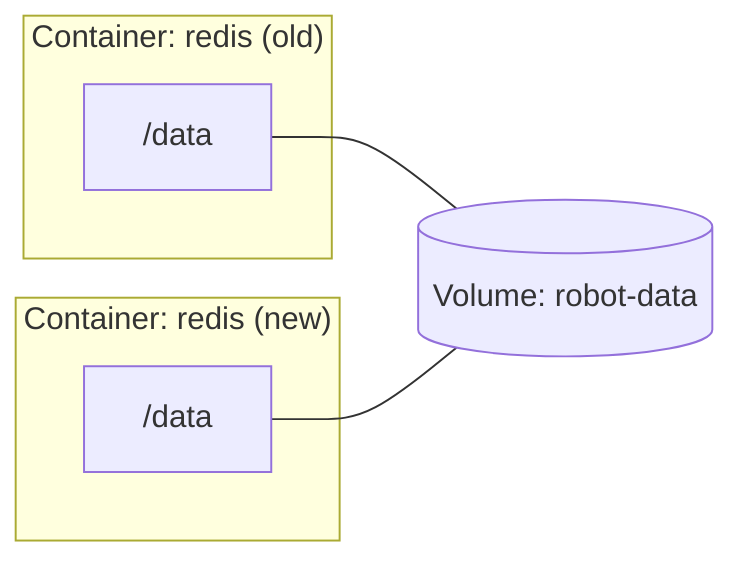

{:class="cover"}

---

By the end of this lesson you will be able to keep data alive after a container is removed, using a named volume, and know when to use a bind mount instead.

## Containers forget

A container's own files vanish when the container is removed. That's great for keeping things tidy, and terrible for a robot's visit counter, a sensor log or a database.

Let's see it happen. Your page has been counting visits in Redis. Visit it a few times, then throw Redis away and start a fresh one:

```bash
curl http://localhost:5000/status
docker rm -f redis
docker run -d --name redis --network robotnet redis:7-alpine
curl http://localhost:5000/status
```

The visit count has gone back to 1. (If the first `curl` after replacing Redis shows an error, wait a second and run it again while the app reconnects.) The data lived inside the old container, so it left with it.

## Volumes

A **volume** is a storage area that Docker manages, outside any one container. You attach it to a container at a path, and whatever the container writes there survives.



Redis keeps its files in `/data` inside its container. Let's create a volume and mount it there:

```bash
docker rm -f redis
docker volume create robot-data
docker run -d --name redis --network robotnet -v robot-data:/data redis:7-alpine redis-server --appendonly yes
```

Reading it piece by piece: `-v robot-data:/data` mounts the volume `robot-data` at `/data`. Everything after the image name is the command to run inside, here asking Redis to log every change to disk (`--appendonly yes`) so nothing is lost.

Now visit the page a few times, then repeat the experiment:

```bash
curl http://localhost:5000/status
docker rm -f redis
docker run -d --name redis --network robotnet -v robot-data:/data redis:7-alpine redis-server --appendonly yes
curl http://localhost:5000/status
```

This time the count carries on from where it was. The container was replaced, the data wasn't.

## Looking after volumes

```bash
docker volume ls
docker volume inspect robot-data
```

`inspect` shows where Docker keeps the data on the host. On Linux that's under `/var/lib/docker/volumes/`, which you normally leave alone. Remove a volume you no longer need with `docker volume rm robot-data`, but only when no container uses it, and remember that this deletes the data for good.

## Three kinds of storage

| Kind | Where it lives | Best for |
| --- | --- | --- |
| Named volume | Managed by Docker | Databases, logs, anything the app owns |
| Bind mount | A folder you choose on the host | Config files and code you edit yourself |
| `tmpfs` | Memory only | Temporary secrets or scratch data |
{:class="table table-single"}

A **bind mount** shares a host folder directly. This lists your project folder from inside a throwaway container, read-only (`:ro`) so the container can't change it:

```bash
cd ~/robot-status
docker run --rm -v "$(pwd)":/project:ro alpine ls /project
```

You'll see `app.py`, `Dockerfile` and `requirements.txt`. The `$(pwd)` is replaced with the full path of your current folder, because Docker needs an absolute path for a bind mount.

## Back up a volume

Because a volume is just files, a second throwaway container can pack it into a tar file in your current folder:

```bash
docker run --rm -v robot-data:/data -v "$(pwd)":/backup alpine tar czf /backup/robot-data.tgz -C /data .
ls -l robot-data.tgz
```

## Common Issues

- **Problem**: The data is still lost after replacing the container.
- **Solution**: Check you used the same volume name each time (`docker volume ls`) and mounted it at the path the app really uses, `/data` for Redis.
- **Why**: A typo creates a brand new, empty volume, and a wrong path means the app writes outside the volume.

- **Problem**: `Error response from daemon: remove robot-data: volume is in use`.
- **Solution**: Remove the container that uses it first (`docker rm -f redis`), then the volume.
- **Why**: Docker won't delete storage that something is still attached to.

- **Problem**: A bind mount gives `permission denied` inside the container.
- **Solution**: Check the folder's permissions with `ls -l`, or use a named volume instead.
- **Why**: A bind mount keeps the host's file ownership, which may not match the user inside the container.

> **Teachers**: A volume holds real data, and `docker volume rm` or `docker system prune --volumes` deletes it with no undo. On shared machines, make sure learners name volumes after themselves and never prune volumes without checking whose they are.

## Try it Yourself

1. Visit the page ten times, replace the Redis container, and confirm the count survives.
2. Run `docker volume inspect robot-data` and find its mountpoint.
3. Challenge: unpack your backup into a new volume. Create `robot-copy` with `docker volume create robot-copy`, then run `docker run --rm -v robot-copy:/data -v "$(pwd)":/backup alpine tar xzf /backup/robot-data.tgz -C /data`, and list it with `docker run --rm -v robot-copy:/data alpine ls /data`.

## Check your understanding


? What happens to files written inside a container when you remove it, if no volume is mounted?
- [ ] They are copied to the host automatically
- [x] They are lost along with the container
- [ ] They move to the image
> A container's own writable layer is deleted with it. Volumes are how you keep data.

? Which kind of storage is best for a database?
- [x] A named volume
- [ ] `tmpfs`
- [ ] The container's own filesystem
> Named volumes are managed by Docker and outlive containers. `tmpfs` is memory only and disappears on stop.

? In `-v robot-data:/data`, what is `/data`?
- [ ] The folder on the host
- [x] The path inside the container where the volume appears
- [ ] The name of the image
> The left side is the volume (or host folder) and the right side is the mount point inside the container.

