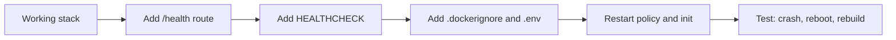

{:class="cover"}

---

By the end of this lesson you will be able to finish a containerised app so it checks its own health, restarts after a crash or reboot, and keeps its data.

You already have the pieces: an app, a Dockerfile, a Compose file, a network and a volume. Now we'll polish them into something you could leave running on a shelf next to your robot. We'll make four improvements:



## 1. A health route

A running container isn't always a healthy one. The app could be stuck while its process is still alive. Let's give Docker a cheap way to ask. Open `app.py` and add this route just above the `if __name__ == "__main__":` line at the bottom:

```python
@app.route("/health")
def health():
    return {"ok": True}
```
{: .no-snakie }

We use a separate route so the health check never bumps the visit counter. Your finished `app.py` now ends like this:

```python
@app.route("/status")
def status_json():
    return jsonify(status())


@app.route("/health")
def health():
    return {"ok": True}


if __name__ == "__main__":
    app.run(host="0.0.0.0", port=5000)
```
{: .no-snakie }

## 2. A HEALTHCHECK in the Dockerfile

Add this line to the `Dockerfile`, just above the `CMD` line:

```dockerfile
HEALTHCHECK --interval=30s --timeout=3s --start-period=5s --retries=3 \
  CMD ["python", "-c", "import urllib.request; urllib.request.urlopen('http://127.0.0.1:5000/health')"]
```

Every 30 seconds Docker runs that tiny Python command inside the container. If it fails three times in a row, the container is marked `unhealthy`. It uses Python's built-in `urllib`, so we don't need to install `curl` in a slim image.

## 3. Keep the build small and the settings separate

Create a file called `.dockerignore` so the build ignores things the image doesn't need:

```text
.git
.env
__pycache__
*.pyc
*.tgz
```

Docker sends the whole folder to the builder, so ignoring junk (like the backup we made in lesson 7) keeps builds quick and stops stray files ending up in the image.

Next, create a file called `.env` with your robot's name:

```text
ROBOT_NAME=Sparky
```

Compose automatically reads `.env` in the project folder and uses it to fill in `${...}` placeholders in `compose.yaml`. This keeps settings out of the file you share.

## 4. The finished compose.yaml

Replace your `compose.yaml` with this complete version:

```yaml
services:
  web:
    build: .
    ports:
      - "5000:5000"
    environment:
      REDIS_HOST: redis
      ROBOT_NAME: ${ROBOT_NAME:-Sparky}
    depends_on:
      - redis
    networks:
      - robotnet
    init: true
    restart: unless-stopped

  redis:
    image: redis:7-alpine
    command: redis-server --appendonly yes
    volumes:
      - redis-data:/data
    networks:
      - robotnet
    restart: unless-stopped

volumes:
  redis-data:

networks:
  robotnet:
```

What's new: `${ROBOT_NAME:-Sparky}` means "use `ROBOT_NAME` from `.env`, or `Sparky` if it isn't set". `init: true` fixes the slow `docker stop` we met in lesson 5. `restart: unless-stopped` brings both services back after a crash or a reboot.

## 5. Build and test

```bash
docker compose up -d --build
docker compose ps
```

Wait about 40 seconds and run `docker compose ps` again. The `web` service should now show `(healthy)`. Open the page and check the visit count, then put the stack through its paces:

1. **Crash test**: run `docker kill robot-status-web-1`. Docker's restart policy brings it back within seconds. Check with `docker compose ps`. (The container name is the project folder, the service and a number. `docker compose ps` shows the real name.)
2. **Data test**: run `docker compose down` then `docker compose up -d`. The visit count carries on.
3. **Reboot test**: run `sudo reboot`. When the Pi is back, the page should be there without you typing anything.

## Optional: share your image

If you have a free Docker Hub account, you can publish the image. Replace `yourname` with your Docker Hub username:

```bash
docker login
docker tag robot-status yourname/robot-status:1.0
docker push yourname/robot-status:1.0
```

Anyone can then run it with `docker run yourname/robot-status:1.0`. Never bake passwords or keys into an image you publish.

## Common Issues

- **Problem**: The service stays `unhealthy` or `starting`.
- **Solution**: Run `docker compose logs web` and check `/health` was added to `app.py` before the `if __name__` line, then rebuild with `docker compose up -d --build`.
- **Why**: The health check requests `/health`. If the route is missing the request fails, so Docker marks the container unhealthy.

- **Problem**: The robot keeps the old name after editing `.env`.
- **Solution**: Run `docker compose up -d` again so the containers are recreated with the new value.
- **Why**: Environment variables are fixed when a container is created, not read on the fly.

- **Problem**: `docker kill` complains `No such container`.
- **Solution**: Use the real name from `docker compose ps`, for example `docker compose kill web`.
- **Why**: Compose names containers after the folder, service and an index, which varies with your setup.

> **Teachers**: This project works well as an assessed task: ask learners to show the page, `docker compose ps` showing `healthy`, and an explanation of what survives `docker compose down` and what doesn't. Allow 90 minutes, mostly for the first build on a Pi. If several learners share one Pi, give each their own folder, port and Compose project name (`docker compose -p yourname up -d`) so stacks do not collide.

## Try it Yourself

1. Add a new field, such as `"python": platform.python_version()`, to the `status()` dictionary. Rebuild with `docker compose up -d --build` and find it in `/status`.
2. Change the host port to `8080` by editing `ports:` to `"8080:5000"`, and reach the page on the new port. Which side of the colon did you change?
3. Challenge: add a second web service called `web2` to `compose.yaml`, built from the same Dockerfile, with `ROBOT_NAME: Wall-E` and host port `5001`. Do both pages share one visit counter? Why?

## Check your understanding


? What does the HEALTHCHECK in our Dockerfile do?
- [ ] Restarts the container every 30 seconds
- [x] Regularly runs a command inside the container and marks it healthy or unhealthy
- [ ] Scans the image for viruses
> Docker runs the check on a schedule. After repeated failures the container shows as `unhealthy`.

? What is the `.dockerignore` file for?
- [x] Keeping files out of the build context and image
- [ ] Hiding containers from `docker ps`
- [ ] Ignoring Docker errors
> It works like `.gitignore`: listed files are not sent to the builder.

? After `docker compose down`, why does the visit count survive?
- [ ] Compose saves a copy to the image
- [x] The Redis data is in a named volume, and `down` does not remove volumes
- [ ] The web container is not removed
> Only `docker compose down -v` deletes the volumes.

