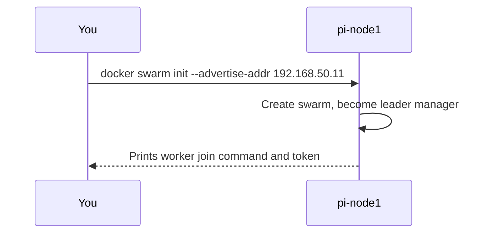

{:class="cover"}

---

By the end of this lesson you will be able to create a swarm on a Raspberry Pi with `docker swarm init` and explain what the join tokens are for.

---

## What does "initialising" do?

Right now each Pi runs Docker on its own. Running `docker swarm init` on one of them switches its Docker Engine into **swarm mode**. That Pi becomes the first manager (and the *leader*), creates the cluster's encryption keys and certificates, and starts listening on port 2377 for other nodes.

Nothing is installed: swarm mode is a feature of the Docker Engine you already have.



---

## Step 1: pick the first manager

Choose any Pi. We'll use `pi-node1` at `192.168.50.11`. SSH to it.

## Step 2: run the init command

```bash
docker swarm init --advertise-addr 192.168.50.11
```

Replace the address with your Pi's own fixed IP. `--advertise-addr` tells the swarm which address other nodes should use to reach this one.

You will see something like this:

```plaintext
Swarm initialized: current node (weot4gg43bm3j6il40skyczpn) is now a manager.

To add a worker to this swarm, run the following command:

    docker swarm join --token SWMTKN-1-<long-secret-string> 192.168.50.11:2377

To add a manager to this swarm, run 'docker swarm join-token manager' and follow the instructions.
```

The `SWMTKN-1-...` string is a **join token**. Anyone who has the token and can reach port 2377 can join your swarm, so treat it like a password. There are two separate tokens, one for workers and one for managers.

---

## Step 3: look at your one-node swarm

```bash
docker node ls
```

You should see a single row for `pi-node1`, marked `Leader` under MANAGER STATUS. A swarm of one is a perfectly valid swarm, and you can already deploy services to it.

---

## Getting the tokens back

Lost the output? Ask a manager:

```bash
docker swarm join-token worker
docker swarm join-token manager
```

If a token leaks, rotate it. Existing nodes stay in the swarm; only new joins need the new token:

```bash
docker swarm join-token --rotate worker
```

---

## Why `--advertise-addr` matters

If your Pi has more than one network connection, for example Ethernet and Wi-Fi both up, `docker swarm init` cannot guess which address to use and stops with an error asking you to choose. Even with one connection, giving the address explicitly is a good habit because the swarm is bound to it. Pick the Ethernet address of the Pi.

> **Teachers**: Join tokens are the "key to the building". If several groups share one network, each group's swarm listens on its own manager. Make sure groups only use their own tokens and addresses, or learners will accidentally join each other's clusters. Consider a different subnet or VLAN per group, or label each Pi.

---

## Try it Yourself

1. Run `docker swarm init` on your first Pi and capture the output in a notes file.
2. Run `docker info | grep -i swarm` and read the Swarm section. What does it report?
3. Challenge: rotate the worker token with `--rotate`. How does the printed token differ from before?

---

## Common Issues

- **Problem**: `Error response from daemon: could not choose an IP address to advertise`.
- **Solution**: Add `--advertise-addr` with your Pi's Ethernet IP address.
- **Why**: The Pi has more than one network interface, so Docker cannot tell which one the cluster should use.

- **Problem**: `This node is already part of a swarm`.
- **Solution**: Run `docker swarm leave --force` first if you really want to start over on this node.
- **Why**: A node can only belong to one swarm at a time.

---

## Check your understanding


? What does `docker swarm init` do?
- [ ] Installs Docker Swarm on the Pi
- [x] Switches this Docker Engine into swarm mode and makes it the first manager
- [ ] Joins the Pi to an existing swarm
> Swarm mode is already built into Docker Engine. `init` turns it on and creates the swarm.

? Why should a join token be kept private?
- [ ] It contains your Wi-Fi password
- [x] Anyone with it who can reach port 2377 can join your swarm
- [ ] It expires after one use
> The token authorises new nodes. Rotate it with `docker swarm join-token --rotate` if it leaks.

? What is the quickest way to see the worker join command again?
- [x] `docker swarm join-token worker` on a manager
- [ ] Re-run `docker swarm init`
- [ ] Reboot the manager
> The join-token command reprints the join command at any time.

