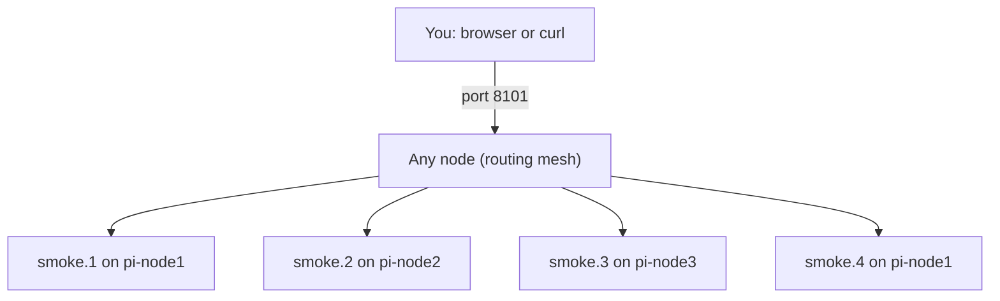

{:class="cover"}

---

By the end of this lesson you will be able to check a swarm's health with `docker node ls` and `docker node inspect`, and prove it works by running a test service and reaching it through any node.

---

## Step 1: are all the nodes there?

On a manager:

```bash
docker node ls
```

For a healthy three-node cluster, expect output along these lines:

```plaintext
ID                            HOSTNAME   STATUS   AVAILABILITY   MANAGER STATUS
x1a...  *                     pi-node1   Ready    Active         Leader
k9b...                        pi-node2   Ready    Active         Reachable
m3c...                        pi-node3   Ready    Active         Reachable
```

What to look for:

- **STATUS** should be `Ready`. `Down` means the manager cannot reach that node.
- **AVAILABILITY** should be `Active`. `Drain` or `Pause` means the node will not get new tasks (we meet drain in lesson 9).
- **MANAGER STATUS**: exactly one `Leader`, and the others `Reachable`. `Unreachable` means a manager has lost contact.

The `*` marks the node you are talking to.

---

## Step 2: look closer at a node

```bash
docker node inspect pi-node2 --pretty
```

This prints the node's hostname, role, availability, Docker Engine version, architecture (`aarch64` on a 64-bit Pi) and resources. It's the first place to look when one node behaves differently from the rest, for example a different Docker version.

---

## Step 3: run a real test service

A list of `Ready` nodes is encouraging, but let's prove the cluster can actually *do* something. Create a small nginx web service with four replicas:

```bash
docker service create --name smoke --replicas 4 --publish 8101:80 nginx:alpine
```

Watch where Swarm placed the containers (called *tasks*):

```bash
docker service ps smoke
```

You will see one row per task with the node it landed on. On a three-node cluster, the four tasks spread across the nodes. That spreading is Swarm's scheduler at work.



### The routing mesh

Because you *published* port 8101, every node in the swarm now listens on it, even nodes not running a task. Swarm calls this the **routing mesh**. From your computer, try each Pi's address:

```bash
curl -I http://192.168.50.11:8101
curl -I http://192.168.50.12:8101
curl -I http://192.168.50.13:8101
```

Each should answer `HTTP/1.1 200 OK` from the nginx container. That is real proof: the network, the overlay and the scheduler all work.

---

## Step 4: read the logs

```bash
docker service logs smoke
```

Your `curl` requests appear here, from whichever node served them. This one command gathers logs from every node.

---

## Step 5: tidy up

```bash
docker service rm smoke
```

---

## Try it Yourself

1. Run the smoke test and note which node each of the four tasks landed on.
2. Scale it up with `docker service scale smoke=8` and check `docker service ps smoke` again.
3. Challenge: switch off one worker Pi and watch `docker service ps smoke`. Where do its tasks go?

---

## Common Issues

- **Problem**: `curl` works against one node's IP but not the others.
- **Solution**: Open 7946 (tcp and udp) and 4789/udp between the nodes.
- **Why**: The routing mesh relays traffic over the overlay network, which uses those ports.

- **Problem**: `docker service ps` shows tasks stuck at `Pending` or repeatedly `Rejected`.
- **Solution**: Run `docker service ps --no-trunc smoke` and read the error column. Typical causes are no image for the platform, or no node with enough memory.
- **Why**: Swarm only schedules a task where it can run. The error text says what blocked it.

- **Problem**: A node shows `Down` right after joining.
- **Solution**: Check the node's clock and network, and that its Docker Engine is running.
- **Why**: Nodes prove themselves with certificates that depend on the correct time.

> **Teachers**: Learners often skip this verification step and then misdiagnose later problems. Make it a checkpoint: each group shows you a three-node `docker node ls` and a `200 OK` from every node before moving on.

---

## Check your understanding


? What does an `Unreachable` manager status mean?
- [ ] The node is a worker
- [x] The other managers have lost contact with that manager
- [ ] The node is paused
> `Reachable` is normal for non-leader managers. `Unreachable` means the others cannot contact it.

? Why does `curl` to a node that is not running a task still work?
- [ ] Docker copies the container to that node
- [x] The routing mesh forwards published-port traffic to a node that has a task
- [ ] It does not, that is a mistake
> Publishing a port opens it on every node, and the routing mesh relays requests to a running task.

? Which command gathers logs from all tasks of a service?
- [x] `docker service logs <name>`
- [ ] `docker logs <name>` on one node
- [ ] `docker node logs`
> `docker service logs` collects the output of every task in the service, from every node.

