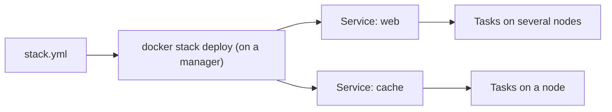

{:class="cover"}

---

By the end of this lesson you will be able to explain how `docker compose` and `docker stack deploy` differ, and why a multi-node swarm needs a registry for images you build yourself.

---

## One file, two commands

In the Docker course you wrote Compose files and ran `docker compose up`. Swarm uses the *same file format*, but a different command to launch it:

| | `docker compose up` | `docker stack deploy` |
| --- | --- | --- |
| Runs on | One machine | The whole swarm |
| Creates | Containers | Services made of tasks, spread over nodes |
| Reads | The `services:` keys | The same, plus the `deploy:` key |
| Builds images | Yes, with `build:` | No, it only pulls ready-made images |
{:class="table table-single"}

A **stack** is simply a group of services deployed together from one file, much as a Compose project is a group of containers. It is the right tool for the cluster you just built.



---

## What a stack ignores

Because a stack runs across several machines, some Compose keys no longer make sense. The ones to remember:

- **`build:` is ignored.** A stack cannot build on one node and ship the result to the others. Build your image first, push it to a registry, and refer to it with `image:`.
- **`depends_on:` is ignored.** Swarm starts all services at once, so your app must cope with a dependency that is not ready yet (retry the connection, or use a health check).
- **`container_name:` and some others are ignored** too. Swarm names tasks itself.

The `docker stack config` command previews how your file is read, which is handy for catching mistakes before you deploy.

Modern Compose files do not need a `version:` line at the top, so we leave it out.

---

## Why you need a registry for your own images

When you deploy `nginx:alpine`, every node pulls it from Docker Hub. But an image you built on `pi-node1` exists only on `pi-node1`. A task scheduled on `pi-node2` would fail with an image error.

The fix is a **registry**, a server every node can reach. You can use Docker Hub, GitHub's registry, or run your own small one on the cluster. Also, the image must be built for the Pi's CPU: build on a Pi, or use `docker buildx build --platform linux/arm64` on another computer.

```bash
docker build -t 192.168.50.11:5000/robot-web:1.0 .
docker push 192.168.50.11:5000/robot-web:1.0
```

Here `192.168.50.11:5000` is an example private registry on your own network. A plain HTTP registry like this has to be listed as an `insecure-registries` entry in `/etc/docker/daemon.json` on every node that pulls from it. It is fine on a home network and wrong on the internet.

---

## Updating a service to a newer image

A common stumbling block: you rebuild your image with the same tag, but the cluster keeps running the old one. The reliable way to roll out the new image is to tell the service explicitly:

```bash
docker service update --image 192.168.50.11:5000/robot-web:1.0 robot-web
```

Swarm resolves the tag to the image's exact content at the moment you run this, so if you pushed new content under the same tag, it notices the difference and replaces the tasks. Better still, use a **new version tag** for every release (`1.1`, `1.2`), so you always know what is running and can roll back to a known version.

Two options worth knowing:

- `--with-registry-auth` passes your registry login to the nodes, needed for private registries that require a password.
- `--update-parallelism 1 --update-delay 10s` replaces one task at a time, waiting ten seconds between each, so the service never goes fully offline.

> **Teachers**: A shared Docker Hub account or registry login should never be pasted into a classroom Pi. Use a local registry on the cluster, or public images only, and keep passwords out of lesson files.

---

## Try it Yourself

1. Write a tiny stack file with one service using `image: nginx:alpine` and a `deploy:` block with `replicas: 2`. Run `docker stack config -c <file>` and read the output.
2. Take a Compose file from the Docker course and list which of its keys a stack would ignore or need changing (look for `build`, `depends_on` and `container_name`).
3. Challenge: decide where you would host a private registry in your cluster, and which Pi must be reachable by all the others.

---

## Common Issues

- **Problem**: `No such image` or a task stuck in `Preparing`, then `Rejected`, on one node only.
- **Solution**: Push the image to a registry that every node can reach, then use that full name in `image:`.
- **Why**: Stacks do not copy images between nodes. Each node pulls for itself.

- **Problem**: `http: server gave HTTP response to HTTPS client` when pulling from your own registry.
- **Solution**: Add the registry to `insecure-registries` in `/etc/docker/daemon.json` on each node, then restart Docker.
- **Why**: Docker expects HTTPS from registries unless told otherwise.

- **Problem**: The image runs on your laptop but crashes with `exec format error` on the Pi.
- **Solution**: Rebuild for `linux/arm64`, or build directly on a Pi.
- **Why**: An image built for an Intel or AMD CPU cannot run on the Pi's ARM CPU.

---

## Check your understanding


? Which Compose key does `docker stack deploy` ignore?
- [ ] `image`
- [ ] `ports`
- [x] `build`
> Stacks only pull ready-made images, so build and push your image first.

? Why must your own images go to a registry before a stack deploy?
- [ ] Registries make images smaller
- [x] Every node pulls its own copy, and an image built on one Pi exists only there
- [ ] Swarm refuses local images for security
> The scheduler can place a task on any node, so every node must be able to fetch the image.

? What is a good habit for rolling out new versions?
- [ ] Always reuse the `latest` tag
- [x] Use a new version tag for every release
- [ ] Delete the old image first
> Version tags make it clear what is running and let you roll back to a known version.

