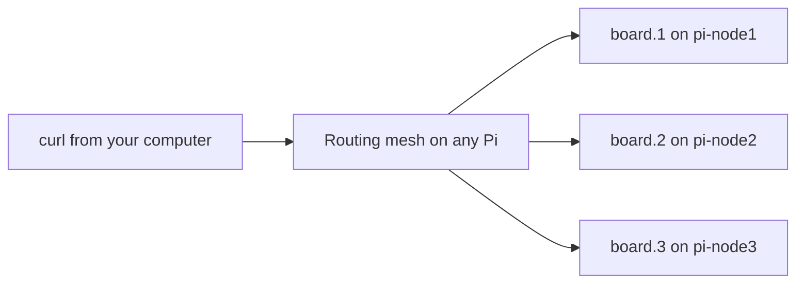

{:class="cover"}

---

By the end of this lesson you will be able to deploy a service that shows which Pi answered each request, prove the cluster survives a node failure, and plan your next swarm project.

---

## Capstone: the "who answered?" board

Let's build something that makes the cluster *visible*. We'll run six copies of a tiny web service. Each reply says which Pi served it, so you can watch requests spread across your nodes, then pull a power cable and watch the cluster heal itself.



We use only the official `nginx:alpine` image. Two Swarm features make it work: a **config**, which hands a small file to a container, and a **hostname template**, which sets each container's hostname to the name of the node it runs on.

### Step 1: the nginx config

On a manager, create `board.conf`:

```nginx
server {
    listen 80;
    location / {
        default_type text/plain;
        add_header X-Served-By $hostname always;
        return 200 "Hello from the cluster. Served by $hostname\n";
    }
}
```

nginx's built-in `$hostname` variable holds the machine name inside the container, which our template will set to the node's name.

### Step 2: the stack file

Create `board.yml`:


```yaml
services:
  board:
    image: nginx:alpine
    hostname: "{{.Node.Hostname}}"
    ports:
      - "8182:80"
    configs:
      - source: board_conf
        target: /etc/nginx/conf.d/default.conf
    deploy:
      replicas: 6
      update_config:
        parallelism: 1
        delay: 5s
        order: start-first
        failure_action: rollback
      restart_policy:
        condition: on-failure
      resources:
        limits:
          memory: 32M

configs:
  board_conf:
    file: ./board.conf
```


### Step 3: deploy and watch the spread

```bash
docker stack deploy -c board.yml board
docker stack ps board
```

Now hit it twelve times and count who answered (use any node's address):

```bash
for i in $(seq 1 12); do curl -s http://192.168.50.12:8182; done | sort | uniq -c
```

You should see the Pi names with counts that add up to twelve. That is the routing mesh sharing requests across your tasks.

### Step 4: break it

Time to see why we built a cluster. Switch off one *worker* Pi with `sudo poweroff` (or pull its power). Then, on a manager:

```bash
docker node ls
docker service ps board_board
```

Within a short time that node shows `Down`, and its tasks are started on the surviving Pis. Re-run the `curl` loop: still twelve good answers, with no mention of the dead node.

### Step 5: heal and rebalance

Power the Pi back on. When it shows `Ready`, it is empty (lesson 9). Rebalance:

```bash
docker service update --force board_board
```

Run the curl loop once more and the revived Pi is answering again.

### Step 6: update and roll back

```bash
docker service update --image nginx:1.27-alpine board_board
docker service rollback board_board
```

Watch `docker service ps` as one task at a time is replaced and then restored.

### Step 7: clean up

```bash
docker stack rm board
```

---

## Project ideas for your next build

Once you have the hang of it, here are projects that suit a Raspberry Pi cluster. They are listed from easiest to hardest.

- **A private registry**: run the official `registry` image on the swarm so that all your nodes pull your own images. Add a volume and a placement constraint so its data stays put.
- **A Portainer dashboard**: a friendly web view of your whole swarm.
- **A metrics dashboard**: Prometheus, Grafana and a Node Exporter on every Pi (global mode), graphing temperature and load.
- **A robot data hub**: an MQTT broker such as Mosquitto running on the swarm, with your Pico or Pi robots publishing sensor readings to it.
- **Your own website**: package a Jekyll or Flask site as an `arm64` image, push it to your registry and run three replicas behind the routing mesh.
- **A CI helper**: a small script on your computer that builds an image, pushes it and runs `docker service update --image` on the manager.

Avoid big-data stacks such as Kafka or Spark: they are designed for servers with far more RAM than a Pi has.

> **Teachers**: The capstone makes a great assessed practical. Ask each group to predict where the tasks will go, break one node, and write up what Swarm did. Allow about 90 minutes. Pulling power on a running Pi can corrupt its SD card, so let groups use `sudo poweroff` for the failure test unless you have spare cards.

---

## Try it Yourself

1. Change the response text in `board.conf` to include your robot's name. Remember: Swarm configs cannot be edited in place, so create a new config name such as `board_conf_v2` in the stack file and redeploy.
2. Change `replicas` to 9 and watch how the tasks are spread.
3. Add a `placement` constraint of `node.role == worker` so that the board only runs on worker nodes.
4. Challenge: design a project from the list above on paper, drawing the services, volumes, ports and which node each runs on.

---

## Common Issues

- **Problem**: `docker stack deploy` fails with `only updates to Labels are allowed` or a similar message after you edit `board.conf`.
- **Solution**: Give the config a new name (for example `board_conf_v2`), update the service to use it and redeploy.
- **Why**: Swarm configs are immutable, so a changed file needs a new config object.

- **Problem**: The reply always says the same name, or the name is a long hex ID.
- **Solution**: Check the `hostname:` line in `board.yml` matches the listing above exactly, and that the config is mounted at `/etc/nginx/conf.d/default.conf`.
- **Why**: Without the template, the container hostname is its container ID.

- **Problem**: `curl` shows only one Pi's name.
- **Solution**: Make sure you have more than one replica, spread over several nodes, and that 7946 and 4789/udp are open between nodes.
- **Why**: If tasks sit on one node, or the overlay is blocked, requests cannot spread.

---

## Check your understanding


? What does the node hostname template in the stack file do?
- [ ] Renames the Pi permanently
- [x] Sets each container's hostname to the name of the node it runs on
- [ ] Chooses the node for the task
> Swarm fills the template in per task, so each container reports its node.

? Why does a config need a new name when its contents change?
- [x] Swarm configs are immutable once created
- [ ] Config names expire daily
- [ ] nginx caches the old name
> You cannot edit a config in use. Create a new one and point the service at it.

? What did the failure test prove?
- [ ] That a Pi cannot be switched off
- [x] That Swarm restarts a dead node's tasks on the surviving nodes
- [ ] That nginx is fast
> The tasks reappeared on other nodes, and the service kept answering.

