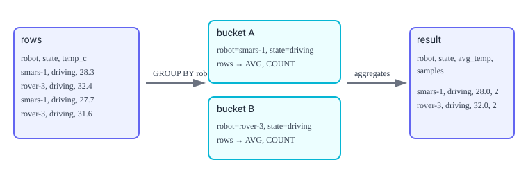

{:class="cover"}

---

By the end of this lesson you will be able to filter, sort, summarise and join tables in DuckDB to answer questions about your robots and your 3D printers.

Let's put the sample data to work. Everything here runs in the shell. Start it in your project folder with `duckdb robots.duckdb` (you made `readings` in lesson 1), then load the other two files:

```sql
CREATE OR REPLACE TABLE readings AS SELECT * FROM read_csv('data/readings.csv');
CREATE OR REPLACE TABLE print_jobs AS SELECT * FROM read_csv('data/print_jobs.csv');
CREATE OR REPLACE TABLE parts AS SELECT * FROM read_csv('data/parts.csv');
```

`read_csv` samples the file and infers the column types for you (older tutorials call it `read_csv_auto`, which still works). Saving into a table means later queries do not re-read the CSV.

## The five ideas

- A table is like a spreadsheet: columns (fields) and rows (records).
- `SELECT` chooses columns, `WHERE` chooses rows, `ORDER BY` sorts.
- `GROUP BY` collapses many rows into one summary row per group.
- `JOIN` stitches two tables together on a shared key.

These five cover most everyday analysis. Let's use each on a real question.

## Selecting and filtering

**Question: when did the rover run hottest while driving?**

```sql
SELECT robot, ts, temp_c, battery_v
FROM readings
WHERE state = 'driving' AND temp_c > 31
ORDER BY temp_c DESC
LIMIT 5;
```

```
┌─────────┬─────────────────────┬────────┬───────────┐
│  robot  │         ts          │ temp_c │ battery_v │
│ varchar │      timestamp      │ double │  double   │
├─────────┼─────────────────────┼────────┼───────────┤
│ rover-3 │ 2025-03-05 13:15:00 │  33.58 │      6.58 │
│ rover-3 │ 2025-03-05 19:30:00 │  33.56 │      7.49 │
│ rover-3 │ 2025-03-06 05:05:00 │  33.56 │      7.74 │
│ rover-3 │ 2025-03-04 18:05:00 │  33.32 │       8.2 │
│ rover-3 │ 2025-03-06 04:15:00 │  33.24 │      7.92 │
└─────────┴─────────────────────┴────────┴───────────┘
```

Text values use **single quotes** (`'driving'`). You can also compute new columns on the fly, such as the distance in metres:

```sql
SELECT ts, robot, distance_cm, ROUND(distance_cm / 100, 2) AS distance_m
FROM readings
WHERE state = 'driving'
LIMIT 5;
```

When the robot is idle, our log stores `400.0` as "nothing in range", which is why we filter to driving rows.

## Grouping and summarising



`GROUP BY` drops each row into a bucket, then an aggregate function (`COUNT`, `AVG`, `MIN`, `MAX`, `SUM`) summarises every bucket.

```sql
SELECT robot,
       ROUND(AVG(temp_c), 1) AS avg_temp,
       MIN(battery_v) AS lowest_battery,
       COUNT(*) AS samples
FROM readings
GROUP BY robot
ORDER BY robot;
```

```
┌─────────┬──────────┬────────────────┬─────────┐
│  robot  │ avg_temp │ lowest_battery │ samples │
│ varchar │  double  │     double     │  int64  │
├─────────┼──────────┼────────────────┼─────────┤
│ rover-3 │     29.1 │           6.57 │    1152 │
│ smars-1 │     25.2 │          6.585 │    1152 │
│ smars-2 │     27.2 │           6.58 │    1152 │
└─────────┴──────────┴────────────────┴─────────┘
```

Group by two columns to see how each robot spends its time:

```sql
SELECT robot, state, COUNT(*) AS samples
FROM readings
GROUP BY robot, state
ORDER BY robot, samples DESC;
```

To filter *after* grouping, use `HAVING`. Here we keep only robots whose average driving distance reading is above 59 cm:

```sql
SELECT robot, ROUND(AVG(distance_cm), 1) AS avg_distance
FROM readings
WHERE state = 'driving'
GROUP BY robot
HAVING AVG(distance_cm) > 59
ORDER BY robot;
```

`WHERE` filters rows *before* grouping; `HAVING` filters groups *after*.

## Joining tables

Our print history has a `printer` column but no running costs. Let's add a tiny lookup table of electricity cost per hour (invented numbers, swap in yours) and join it:

```sql
CREATE OR REPLACE TABLE printers(printer TEXT, cost_per_hour_gbp DOUBLE);
INSERT INTO printers VALUES
  ('ender-3', 0.08), ('prusa-mini', 0.10), ('bambu-a1', 0.12);

SELECT j.printer,
       COUNT(*) AS jobs,
       ROUND(SUM(j.hours), 1) AS hours,
       ROUND(SUM(j.hours * p.cost_per_hour_gbp), 2) AS power_cost_gbp
FROM print_jobs j
JOIN printers p ON p.printer = j.printer
GROUP BY j.printer
ORDER BY power_cost_gbp DESC;
```

```
┌────────────┬───────┬────────┬────────────────┐
│  printer   │ jobs  │ hours  │ power_cost_gbp │
│  varchar   │ int64 │ double │     double     │
├────────────┼───────┼────────┼────────────────┤
│ bambu-a1   │    24 │   69.4 │           8.33 │
│ prusa-mini │    18 │   48.9 │           4.89 │
│ ender-3    │    18 │   57.5 │            4.6 │
└────────────┴───────┴────────┴────────────────┘
```

`j` and `p` are short aliases so we can say which table a column comes from. A plain `JOIN` (an inner join) keeps only rows with a match on both sides. If a printer were missing from `printers`, its jobs would silently vanish. A `LEFT JOIN` keeps every row from the left table and fills the gaps with `NULL`:

```sql
SELECT j.printer, COUNT(*) AS jobs,
       ROUND(SUM(j.hours * p.cost_per_hour_gbp), 2) AS power_cost
FROM print_jobs j
LEFT JOIN (SELECT * FROM printers WHERE printer <> 'prusa-mini') p USING (printer)
GROUP BY j.printer
ORDER BY j.printer;
```

The `prusa-mini` row still appears, with a `NULL` cost, which is a loud hint that your lookup table is incomplete.

## NULLs and types

- `COALESCE(x, 0)` swaps a `NULL` for a default.
- `CAST('12' AS INTEGER)` or the shorthand `'12'::INTEGER` converts a type.
- `COUNT(column)` skips `NULL`s, while `COUNT(*)` counts every row.
- Aggregates such as `AVG` and `SUM` ignore `NULL`s.


SQL is written with `SELECT` first, but the engine works through the steps in the order above. That is why a plain aggregate cannot sit in `WHERE`: the groups do not exist yet.

## Try it Yourself

1. Show the five most valuable stock lines in `parts`, using `qty * unit_price_gbp AS stock_value` and `ORDER BY`.
2. Which robot spent the most samples in the `charging` state? Use `GROUP BY robot` with `WHERE state = 'charging'`.
3. List the parts with fewer than 4 in stock, lowest first (`WHERE qty < 4`), and add `WHERE part LIKE '%sensor%'` to a second query to find the sensors.
4. Challenge: join `print_jobs` to `printers` and compute the failure rate per printer. Hint: `AVG(CASE WHEN j.status = 'failed' THEN 1 ELSE 0 END)`.

## Common Issues

- **Problem**: `Binder Error: column "robot" must appear in the GROUP BY clause or must be part of an aggregate function.`
- **Solution**: Add `GROUP BY robot`, or wrap the column in an aggregate such as `MAX(robot)`.
- **Why**: Once you summarise, every selected column must be either a bucket label or a summary.

- **Problem**: `Binder Error: Referenced column "driving" not found in FROM clause!`
- **Solution**: Use single quotes for text: `state = 'driving'`.
- **Why**: Double quotes mean a column or table name in SQL, so `"driving"` looks like a column.

- **Problem**: `Binder Error: WHERE clause cannot contain aggregates!`
- **Solution**: Move the test to `HAVING`.
- **Why**: Aggregates only exist after grouping, and `WHERE` runs before it.

## Check your understanding


? Which clause filters groups after `GROUP BY` has run?
- [ ] WHERE
- [x] HAVING
- [ ] ORDER BY
> `HAVING` is applied to the grouped results, so it can use `AVG`, `COUNT` and friends.

? You inner `JOIN` jobs to a printers table that lacks one printer. What happens to that printer's jobs?
- [ ] They appear with NULL values
- [x] They disappear from the result
- [ ] DuckDB raises an error
> An inner join keeps only matches. Use `LEFT JOIN` to keep the unmatched rows.

? Which is the correct way to compare a text column to a value?
- [ ] `state = "driving"`
- [x] `state = 'driving'`
- [ ] `state == driving`
> Single quotes make a text value. Double quotes name columns.

