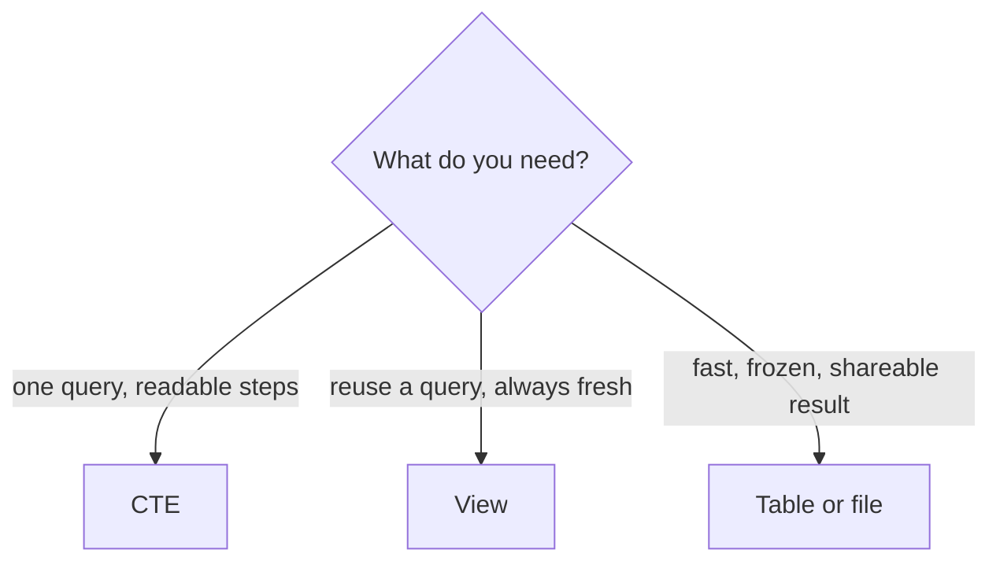

{:class="cover"}

---

By the end of this lesson you will be able to break a query into named steps with a CTE, save a query as a view, move data in and out with `COPY`, and check which extensions and settings DuckDB is using.

Last lesson every query was one big statement. Real analysis gets messy fast, so let's learn the tools that keep it tidy. Open your database again with `duckdb robots.duckdb`.

## CTEs: name your steps

A CTE (Common Table Expression) is a short-lived, named query you define at the top with `WITH`. Think of it as a temporary table that exists only for that one statement.

```sql
WITH daily AS (
  SELECT robot,
         CAST(ts AS DATE) AS day,
         MIN(battery_v) AS low_v,
         MAX(temp_c) AS peak_temp
  FROM readings
  GROUP BY robot, day
)
SELECT * FROM daily ORDER BY low_v LIMIT 3;
```

```
┌─────────┬────────────┬────────┬───────────┐
│  robot  │    day     │ low_v  │ peak_temp │
│ varchar │    date    │ double │  double   │
├─────────┼────────────┼────────┼───────────┤
│ rover-3 │ 2025-03-06 │   6.57 │     33.56 │
│ rover-3 │ 2025-03-03 │   6.57 │     33.16 │
│ rover-3 │ 2025-03-04 │   6.57 │     33.32 │
└─────────┴────────────┴────────┴───────────┘
```

Step one builds a daily summary per robot, step two reads from it. You can chain several, separated by commas, where later ones can use earlier ones:

```sql
WITH cleaned AS (
  SELECT * FROM readings WHERE battery_v > 0 AND temp_c BETWEEN -20 AND 80
),
daily AS (
  SELECT robot, CAST(ts AS DATE) AS day, MIN(battery_v) AS low_v
  FROM cleaned
  GROUP BY robot, day
)
SELECT robot, ROUND(AVG(low_v), 3) AS avg_daily_low FROM daily GROUP BY robot ORDER BY robot;
```

The `cleaned` step throws away impossible readings (a loose sensor wire can report nonsense), which is a good habit before any average. To debug, run each step on its own as a plain `SELECT`.

## Views: save a query

A view stores the *query*, not the data. Each time you read it, DuckDB runs the query again against the latest rows.

```sql
CREATE OR REPLACE VIEW v_hot AS
SELECT * FROM readings WHERE temp_c > 34;

SELECT COUNT(*) AS hot_rows FROM v_hot;
```

That prints `0`, because no reading is above 34 degrees yet. Add one and look again:

```sql
INSERT INTO readings VALUES ('2025-03-08 09:00:00', 'rover-3', 35.2, 20.0, 7.9, 'driving');
SELECT COUNT(*) AS hot_rows FROM v_hot;
```

Now it prints `1`: the view noticed the new row without being touched. Tidy up so your numbers still match the lessons:

```sql
DELETE FROM readings WHERE ts = '2025-03-08 09:00:00';
```



Pick a **CTE** for one-off readability, a **view** to reuse logic that should stay up to date, and a **table** when the result is slow to compute or should stay frozen. A table stores the answer, so it is fast to read but goes stale when the source changes.

## Persistence: database files

When you run `.open robots.duckdb` (or start the shell with `duckdb robots.duckdb`), tables and views are written into that single file. Copy the file and you have copied the whole database. Start the shell with no file name and you get a temporary in-memory database that disappears on `.quit`. `SHOW TABLES;` lists what is there.

## COPY: data in and out

`COPY` moves data between DuckDB and files. Make sure the `exports/` folder exists first (your `make_data.py` created it).

```sql
CREATE OR REPLACE VIEW v_daily AS
SELECT robot, CAST(ts AS DATE) AS day,
       ROUND(AVG(temp_c), 1) AS avg_temp,
       MIN(battery_v) AS low_v,
       COUNT(*) AS samples
FROM readings
GROUP BY robot, day;

COPY (SELECT * FROM v_daily) TO 'exports/daily.csv' (HEADER, DELIMITER ',');
COPY (SELECT * FROM v_daily) TO 'exports/daily.parquet' (FORMAT parquet);
COPY (SELECT robot, ROUND(AVG(temp_c), 1) AS avg_temp FROM readings GROUP BY robot ORDER BY robot)
  TO 'exports/robot_summary.json' (FORMAT json, ARRAY true);
```

Bring a file back in with a query or with `COPY ... FROM`:

```sql
CREATE OR REPLACE TABLE daily_back AS SELECT * FROM read_parquet('exports/daily.parquet');
SELECT COUNT(*) FROM daily_back;
```

The count is `15` (three robots, five calendar days). `COPY table FROM 'file.csv' (HEADER)` also works but *appends* to an existing table, so running it twice doubles your rows.

## Extensions and settings

Extensions add features to DuckDB. Ask what you have:

```sql
SELECT extension_name, loaded, installed
FROM duckdb_extensions()
WHERE extension_name IN ('json', 'parquet', 'httpfs', 'icu')
ORDER BY 1;
```

On my machine `json`, `parquet` and `icu` were already built in and loaded, while `httpfs` (reading from web addresses and S3) showed `false` for both columns. To use one that is not installed, run `INSTALL httpfs;` once (it downloads the extension, so it needs internet) and `LOAD httpfs;` in each session. DuckDB can also install and load known extensions automatically the first time a query needs them, which `SELECT name, value FROM duckdb_settings() WHERE name LIKE 'auto%known%'` will confirm (it showed `true` for both `autoinstall_known_extensions` and `autoload_known_extensions` here). That setting is why a remote `https://` file often just works, but it still needs internet, and you may want it switched off on a locked-down machine.

Settings control how DuckDB behaves:

```sql
SELECT current_setting('threads') AS threads;
SET threads = 2;
SELECT current_setting('memory_limit') AS memory_limit;
SET memory_limit = '1GB';
PRAGMA version;
```

`threads` is how many CPU cores DuckDB may use, and `memory_limit` caps its memory. The defaults suit most machines, and lesson 8 shows when to change them.

> **Teachers**: `INSTALL` downloads files from duckdb.org, which some school filters block. Everything in lessons 1 to 5 works with only the built-in extensions, so an offline class can skip `INSTALL` entirely.

## Try it Yourself

1. Write a CTE called `driving_only` that keeps rows where `state = 'driving'`, then select the average `distance_cm` per robot from it.
2. Export `v_daily` to `exports/daily_check.parquet`, read it back into a table called `daily_check`, and compare its row count with `SELECT COUNT(*) FROM v_daily`.
3. Create a view `v_low_battery` showing readings where `battery_v < 6.65`, and count the rows per robot.
4. Challenge: chain three CTEs (clean, enrich with a `temp_f` column, summarise) to get the average Fahrenheit temperature per robot.

## Common Issues

- **Problem**: `IO Error: Cannot open file "exports/daily.parquet": No such file or directory`
- **Solution**: Create the `exports` folder (`mkdir exports`) before the `COPY`.
- **Why**: DuckDB writes files but does not create the folders above them.

- **Problem**: A table has twice as many rows as expected after loading a file.
- **Solution**: Rebuild it with `CREATE OR REPLACE TABLE ... AS SELECT ...` rather than running `COPY ... FROM` again.
- **Why**: `COPY FROM` appends to an existing table, so a repeat load duplicates the rows.

- **Problem**: `INSTALL` fails with `Failed to download extension` and a connection error.
- **Solution**: Check your internet connection or proxy, or carry on with the built-in extensions.
- **Why**: Installing fetches the extension from DuckDB's servers once per version.

## Check your understanding


? What does a view store?
- [ ] A copy of the data at the time you made it
- [x] The query, which runs again each time you read the view
- [ ] A CSV file
> That is why `v_hot` went from 0 to 1 rows when we inserted a reading.

? Which is the best fit for a slow summary that you want frozen and fast to read?
- [ ] A CTE
- [ ] A view
- [x] A table or Parquet file
> Tables and files store the answer. CTEs and views recompute it every time.

? What happens if you run `COPY daily_back FROM 'exports/daily.csv' (HEADER)` twice?
- [ ] The second run replaces the data
- [x] The rows are appended twice, so the table doubles
- [ ] DuckDB refuses to run it
> `COPY FROM` adds to an existing table, which is the common cause of surprise duplicates.

