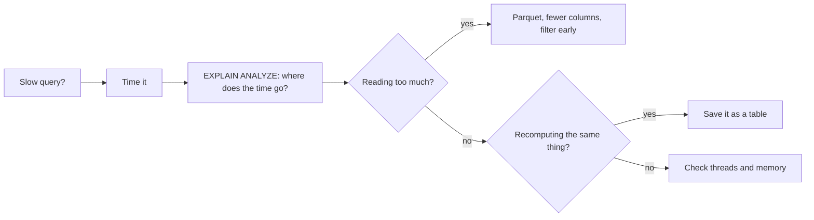

{:class="cover"}

---

By the end of this lesson you will be able to time a query fairly, read an `EXPLAIN ANALYZE` plan, record a profile, and choose between a CSV, a Parquet file, a view and a table.

Our robot log has 3,456 rows, which DuckDB chews through in a blink however you ask. To feel real differences we need more data. Let's make **two million readings** (a robot reporting every second for about three weeks) and measure. The golden rule of tuning: **measure first, then change one thing at a time.**



## Time it fairly

Save this as `bench.py` and run it from your project folder (the `exports/` folder must exist). It builds the big table, writes it as CSV and as Parquet, and times the same query on each. It takes the best of three runs, because the first run of anything is slower than the rest:

```python
import time

import duckdb

con = duckdb.connect()  # in-memory, nothing to clean up

# Make 2 million fake readings (about 23 days at one per second)
con.execute("""
    CREATE TABLE big AS
    SELECT
        TIMESTAMP '2025-01-01 00:00:00' + INTERVAL (i) SECOND AS ts,
        (['smars-1', 'smars-2', 'rover-3'])[1 + (i % 3)] AS robot,
        ROUND(24 + 6 * random(), 2) AS temp_c,
        ROUND(6.6 + 1.8 * random(), 3) AS battery_v
    FROM range(2000000) t(i)
""")
con.execute("COPY big TO 'exports/big.csv' (HEADER)")
con.execute("COPY big TO 'exports/big.parquet' (FORMAT parquet)")


def best_of(label, sql, repeats=3):
    """Run a query a few times and report the fastest, in milliseconds."""
    times = []
    for _ in range(repeats):
        start = time.perf_counter()
        con.execute(sql).fetchall()
        times.append(time.perf_counter() - start)
    print(f"{label:<28}{min(times) * 1000:8.1f} ms")


query = "SELECT robot, AVG(temp_c) FROM {} GROUP BY robot"
best_of("CSV file", query.format("'exports/big.csv'"))
best_of("Parquet file", query.format("'exports/big.parquet'"))
best_of("DuckDB table", query.format("big"))

con.execute("SET threads = 1")
best_of("table, 1 thread", query.format("big"))
con.execute("SET threads = 4")
best_of("table, 4 threads", query.format("big"))

# A view reruns its query every time; a table keeps the answer
con.execute("""
    CREATE VIEW v_daily AS
    SELECT CAST(ts AS DATE) AS day, robot, AVG(temp_c) AS avg_temp
    FROM big GROUP BY day, robot
""")
con.execute("CREATE TABLE daily AS SELECT * FROM v_daily")
best_of("view (recomputed)", "SELECT * FROM v_daily WHERE day = '2025-01-05'")
best_of("table (materialised)", "SELECT * FROM daily WHERE day = '2025-01-05'")
```

On my 4-core test machine it printed:

```
CSV file                       197.9 ms
Parquet file                     5.9 ms
DuckDB table                    18.1 ms
table, 1 thread                 60.7 ms
table, 4 threads                16.4 ms
view (recomputed)                5.7 ms
table (materialised)             0.8 ms
```

Your numbers will differ (that is the point: they depend on your machine), but the *shape* should match:

- **CSV is the slowest by a mile.** DuckDB must parse text and work out types every time. Here, about 30 times slower than Parquet. The CSV is also 79.6 MB against 17.7 MB for the Parquet file.
- **Parquet and tables are both fast.** Do not assume a table always beats a Parquet file: on this query Parquet won.
- **More threads helped.** One thread was about 4 times slower than four on four cores. Set `threads` to your core count or leave the default.
- **Saving the answer wins.** The materialised `daily` table was several times quicker than the view, which has to recompute its query.

> **Teachers**: The two data files add up to about 100 MB, so run the script from local disk rather than a network home folder, and delete `exports/big.csv` afterwards. Timings differ from machine to machine, which makes a good class discussion: collect everyone's results and ask why the order stayed the same. On a Raspberry Pi, expect all times to be larger, and use `range(500000)` if it runs low on memory.

## Read the plan with EXPLAIN ANALYZE

`EXPLAIN` shows the plan DuckDB intends to use. `EXPLAIN ANALYZE` actually runs the query and adds real row counts and timings. In the shell (`duckdb`, in the same folder):

```sql
EXPLAIN ANALYZE
SELECT robot, AVG(temp_c)
FROM 'exports/big.parquet'
WHERE temp_c > 29.5
GROUP BY robot;
```

Read the boxes from the bottom up. The `TABLE_SCAN` box at the bottom shows `Function: PARQUET_SCAN`, `Projections: temp_c, robot` (only two columns are read) and `Filters: temp_c>29.5` (the filter is applied inside the scan). It reports `165,338 rows`: of two million, only about 8 percent come out of the scan, and that is all the rest of the plan has to handle. If a scan returned millions of rows before a filter, you would know the filter was not being pushed down.

Add `.timer on` to the shell and it prints `Run Time (s): real ...` after every statement, a quick way to time things without Python.

## Record a profile

For more detail, turn on profiling and write it to a file:

```sql
PRAGMA enable_profiling = 'json';
PRAGMA profiling_output = 'exports/profile.json';

SELECT robot, AVG(temp_c)
FROM 'exports/big.parquet'
WHERE temp_c > 29.5
GROUP BY robot;

PRAGMA disable_profiling;
```

Open `exports/profile.json` in your editor. Near the top you will find `latency` (total time), `cpu_time`, `rows_returned` and the `query_name`, followed by a tree of the operators with their own timings. Look for the single slowest operator and fix that one first.

## Settings that matter

```sql
SET threads = 2;
SET memory_limit = '1GB';
SELECT current_setting('threads') AS threads, current_setting('memory_limit') AS memory_limit;
```

`threads` is how many cores DuckDB may use, and by default it uses them all. Lower it if the machine must stay responsive for other work. `memory_limit` caps memory use, which matters on a Raspberry Pi with 2 or 4 GB. (A `'1GB'` limit shows up as `953.6 MiB`, because GB means a thousand million bytes and MiB is binary.)

`ANALYZE;` recomputes table statistics. DuckDB keeps statistics up to date as you load data, so you rarely need it, but it is harmless after a big bulk load.

## A tuning checklist

1. Use **Parquet** instead of CSV for anything you query more than once.
2. **Select only the columns you need** and filter early.
3. **Partition** big datasets by something you filter on (lesson 6).
4. **Materialise** (save as a table) results you reuse.
5. **Measure** with timing, `EXPLAIN ANALYZE` or a profile before and after every change.

## Try it Yourself

1. Change `range(2000000)` to `range(200000)` and rerun `bench.py`. Does the CSV-to-Parquet gap shrink or grow?
2. Run `EXPLAIN ANALYZE` on `SELECT * FROM 'exports/big.parquet' WHERE temp_c > 29.5` and compare the `Projections` with the earlier plan.
3. Write the Parquet file again sorted by `robot, ts` (`ORDER BY robot, ts` inside the `COPY`) and compare the timing of a `WHERE robot = 'rover-3'` query.
4. Challenge: record a profile for a query with a `GROUP BY day, robot` and find the operator with the highest time in the JSON.

## Common Issues

- **Problem**: The first run of a query is much slower than the rest.
- **Solution**: Run it a few times and take the best, as `best_of` does.
- **Why**: The first run loads files into the operating system's cache and warms up memory.

- **Problem**: `Out of Memory Error` on a small machine.
- **Solution**: Select fewer columns, filter earlier, or lower the row count. Check your `memory_limit` setting is not too tight.
- **Why**: Big joins and group-bys hold data in memory, and a low limit or a 2 GB Pi can run out.

- **Problem**: A tweak seems to make no difference.
- **Solution**: Check the plan: the setting may not touch the slow part.
- **Why**: Tuning a part that takes 2 percent of the time gives at most a 2 percent gain.

## Check your understanding


? Why does `best_of` run each query three times and keep the fastest?
- [ ] DuckDB gives different answers each time
- [x] The first run is slowed by cold caches, so the best run is fairer
- [ ] It makes the query cheaper
> Cold files and caches slow the first run, so repeating and taking the minimum compares like with like.

? In `EXPLAIN ANALYZE`, what does `Filters: temp_c>29.5` inside the scan tell you?
- [ ] The query failed
- [x] The filter is applied while reading the file, so fewer rows move up the plan
- [ ] The column is missing
> A filter pushed into the scan means less data is passed to later steps.

? When is a table better than a view for a summary?
- [ ] When the summary is tiny and never reused
- [x] When the summary is slow to compute and you read it often
- [ ] Never, views are always faster
> A table stores the answer, so reading it is quick. A view recomputes the query each time.

