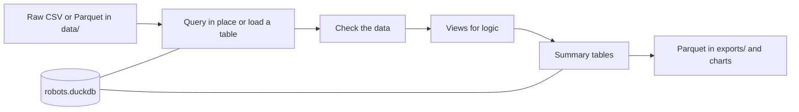

{:class="cover"}

---

By the end of this lesson you will be able to describe the workflow you learned, pick the right object (view, table or file) for a job, and choose what to study next.

Well done, makers! You started with three CSV files and ended with a workspace that can answer questions about robots, parts and printers in milliseconds, with no server in sight. Let's pull the threads together.

## The workflow in one picture

## Key takeaways

- DuckDB queries CSV and Parquet files directly, and works hand in hand with Python and Pandas.
- A single `.duckdb` file is a portable local database. Parquet files are the best way to share results.
- Views keep logic readable and fresh. Tables and Parquet files store answers you want fast and frozen.
- A folder of partitioned files is a data lake you can query as one table, skipping what the filter rules out.
- Measure before you tune: `EXPLAIN ANALYZE`, timings and profiles beat guessing.

## Turn it into a real project

1. **Skeleton**: folders `data/` (raw, never edited), `exports/` (outputs), `sql/` (saved queries) and a `robots.duckdb` file.
2. **Bring data in**: load once, convert CSV to Parquet if you will query it again.
3. **Build trusted views and tables**: views for logic you will tweak, tables for results you reuse.
4. **Analyse in SQL files**: short, commented scripts you can rerun with `.read sql/report.sql` in the shell, or from Python.
5. **Share**: `COPY` summaries to `exports/` as Parquet or CSV, and charts as PNG.
6. **Document**: a short `README.md` saying where the data came from and how to rerun everything.

## Beginner glossary: the language of data

- **Analytics (OLAP)**: asking questions about lots of rows at once, such as averages and totals. DuckDB is built for this.
- **Column pruning**: reading only the columns you select, so the rest of a Parquet file is never touched.
- **CTE (Common Table Expression)**: a named step in a query, written with `WITH`.
- **Hive partitioning**: folders named `column=value`, such as `robot=rover-3`, that DuckDB turns back into columns.
- **Manifest**: a table listing the files in a dataset and their row counts, so you can see what changed.
- **Materialise**: save the result of a query as a table or file instead of recomputing it.
- **Parquet**: a compressed, column-oriented file format that stores types and statistics.
- **Partition pruning**: skipping whole folders or files because their partition values cannot match your filter.
- **Persistence**: keeping data in a file so it survives after your program ends.
- **Predicate pushdown**: applying your `WHERE` filter inside the file reader so fewer rows are read.
- **PRAGMA and SET**: commands that change DuckDB settings or switch features such as profiling on.
- **Row group**: a chunk of rows inside a Parquet file, with minimum and maximum values stored for each column.
- **Schema evolution**: columns being added or changed over time, and how you cope when reading old and new files.
- **View**: a saved query that behaves like a table but stores no data of its own.
- **Window function**: a calculation such as `LAG` that looks at neighbouring rows without collapsing them.

## Where to go next

- **Learn more SQL**: the [SQL course](/learn/sql/) and the [SQLite course](/learn/sqlite3/) cover transactions and the kind of database you update row by row, which is the opposite job to DuckDB.
- **Dig into DataFrames**: [Pandas and NumPy](/learn/pandas_and_numpy/) pairs perfectly with the Python lessons here.
- **Try other data stores**: the [MongoDB](/learn/mongodb/) and [Redis](/learn/redis/) courses show document and in-memory databases.
- **Sharpen your Python**: the [Python course](/learn/python/) is a good companion if the scripts felt tricky.
- **Collect real data**: log your own Pico or Raspberry Pi sensors to a CSV (lesson 10 shows how), then point these queries at it.

## Try it Yourself

1. Write a three-line README for your project folder: what the data is, how to regenerate it (`python make_data.py`), and how to open the database.
2. Make a file `sql/report.sql` containing two queries from earlier lessons, then run it in the shell with `.read sql/report.sql`.
3. List the five terms from the glossary that you would still struggle to explain, and find them in earlier lessons.
4. Challenge: pick one lesson and rebuild its main example using your own data instead of the sample robots.

## Common Issues

- **Problem**: `.read sql/report.sql` says the file cannot be found.
- **Solution**: Start the shell from the project folder, or give the full path.
- **Why**: `.read` uses the folder the shell was started in, like every relative path.

- **Problem**: Old exports still appear after you changed a query.
- **Solution**: Delete or overwrite the old files, then rerun the `COPY`.
- **Why**: `COPY` overwrites a single file, but a partitioned folder may keep files from earlier runs.

## Check your understanding


? You have a slow summary that you read every day. What should you do with it?
- [ ] Keep it as a CTE
- [x] Save it as a table or a Parquet file
- [ ] Rerun the whole analysis each time
> Materialising stores the answer, so reads are quick and the result stays stable.

? Which of these is a good rule for sharing results with other tools?
- [ ] Always send the `.duckdb` file
- [x] Export Parquet or CSV files with `COPY`
- [ ] Paste results into a chat
> Parquet and CSV are understood by many programs, so they travel well.

? What is a partition column in a lake like `robot=rover-3/day=2025-03-04`?
- [ ] A column stored only in the first file
- [x] A column whose values come from the folder names
- [ ] A column that holds file sizes
> DuckDB reads the names `robot` and `day` and their values from the path.

