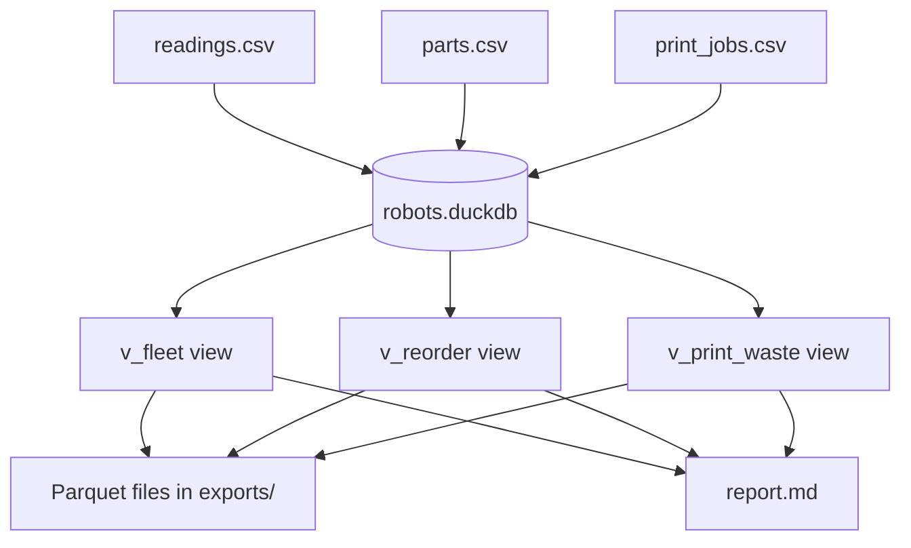

{:class="cover"}

---

By the end of this lesson you will be able to build a repeatable analytics script that ingests several files, answers three real questions, and writes both Parquet files and a text report.

Time for the finale. Imagine you run a small robot workshop. Every Friday you want to know three things: **how hard did the robots work, what parts do I need to order, and which 3D printer is wasting filament?** Your data lives in three CSV files, and you want one command that answers all three. That is exactly what DuckDB is good at.

## The plan



Each question becomes a **view**: a saved query that is always fresh. The script loads the data, builds the views, then exports each one as Parquet and as text.

## Step 1: check your starting point

You need the project folder from lesson 1, with `data/readings.csv`, `data/parts.csv`, `data/print_jobs.csv` and an `exports/` folder. If anything is missing, run `python make_data.py` again. It is safe to rerun because the random seed is fixed.

## Step 2: write the script

Save this as `report.py` and take a moment to read each numbered step before you run it:

```python
import duckdb

con = duckdb.connect("robots.duckdb")

# 1. Ingest: one table per CSV
for table, path in [
    ("readings", "data/readings.csv"),
    ("parts", "data/parts.csv"),
    ("print_jobs", "data/print_jobs.csv"),
]:
    con.execute(f"CREATE OR REPLACE TABLE {table} AS SELECT * FROM read_csv('{path}')")

# 2. Fleet summary: how hard does each robot work?
con.execute("""
    CREATE OR REPLACE VIEW v_fleet AS
    WITH flagged AS (
        SELECT robot, ts, state, temp_c,
               LAG(state) OVER (PARTITION BY robot ORDER BY ts) AS prev_state
        FROM readings
    )
    SELECT robot,
           ROUND(COUNT(*) FILTER (WHERE state = 'driving') * 5 / 60.0, 1) AS driving_hours,
           ROUND(AVG(temp_c) FILTER (WHERE state = 'driving'), 1) AS avg_temp_driving,
           COUNT(*) FILTER (WHERE state = 'charging' AND prev_state <> 'charging') AS charge_sessions
    FROM flagged
    GROUP BY robot
""")

# 3. Parts to reorder: anything below 6 in stock, topped up to 6
con.execute("""
    CREATE OR REPLACE VIEW v_reorder AS
    SELECT part, supplier, qty, 6 - qty AS to_order,
           ROUND((6 - qty) * unit_price_gbp, 2) AS cost_gbp
    FROM parts
    WHERE qty < 6
""")

# 4. Print waste: grams of filament lost to failed or cancelled jobs
con.execute("""
    CREATE OR REPLACE VIEW v_print_waste AS
    SELECT printer,
           COUNT(*) AS jobs,
           COUNT(*) FILTER (WHERE status <> 'done') AS lost_jobs,
           ROUND(SUM(grams) FILTER (WHERE status <> 'done'), 1) AS grams_wasted,
           ROUND(100.0 * COUNT(*) FILTER (WHERE status <> 'done') / COUNT(*), 1) AS pct_lost
    FROM print_jobs
    GROUP BY printer
""")

# 5. Export each report as Parquet, and print them as a text report
lines = ["# Workshop report", ""]
for view, title in [
    ("v_fleet", "Robot fleet"),
    ("v_reorder", "Parts to reorder"),
    ("v_print_waste", "Print waste"),
]:
    con.execute(f"COPY (SELECT * FROM {view} ORDER BY 1) TO 'exports/{view}.parquet' (FORMAT parquet)")
    df = con.execute(f"SELECT * FROM {view} ORDER BY 1").df()
    lines += [f"## {title}", "", df.to_string(index=False), ""]

report = "\n".join(lines)
with open("exports/report.md", "w") as f:
    f.write(report)
print(report)

con.close()
```

New syntax worth a second look: `COUNT(*) FILTER (WHERE ...)` counts only rows that pass a test, which lets you compute several conditional counts in one pass over the data. `LAG` is the window function from lesson 5, and each robot's `driving_hours` is the number of driving samples times five minutes, divided by 60.

## Step 3: run it and check the answers

```bash
python report.py
```

You should see:

```
# Workshop report

## Robot fleet

  robot  driving_hours  avg_temp_driving  charge_sessions
rover-3           25.6              32.0                9
smars-1           29.2              28.0                5
smars-2           29.3              30.0                6

## Parts to reorder

             part   supplier  qty  to_order  cost_gbp
2S battery holder   CellMart    5         1       0.9
     DHT22 sensor     PiBits    3         3      14.7
    PLA 1kg, grey FilamentCo    3         3      52.5
           Pico W     PiBits    2         4      22.4
    TB6612 driver     PiBits    5         1       4.2
   VL53L0X sensor     PiBits    4         2      11.6

## Print waste

   printer  jobs  lost_jobs  grams_wasted  pct_lost
  bambu-a1    24          4         231.1      16.7
   ender-3    18          7         370.6      38.9
prusa-mini    18          9         388.2      50.0
```

Read the story in the numbers. The rover drives the fewest hours but charges the most, so its battery is the weak link. A shopping list of about £106 would restock the six low parts, and the `prusa-mini` throws away half its jobs while the `bambu-a1` loses one in six. (Remember the data is invented, so do not draw conclusions about real printers!) The folder `exports/` now has a Parquet file per view and `report.md` for sharing.

## Checkpoints

- Open `exports/v_fleet.parquet` with `SELECT * FROM 'exports/v_fleet.parquet'`. How many rows does it have? (Three, one per robot.)
- Delete the files inside `exports/` and rerun `report.py`. Everything should come back, because the script is repeatable.
- Open `robots.duckdb` in the shell and run `SHOW TABLES;`. You should see your tables and three views.

## Going further

- Add a fourth view that finds the hottest hour of the day for each robot, and add it to the report.
- Draw the battery chart from lesson 5 at the end of the script and save it into `exports/`.
- Write the report tables to a partitioned lake as in lesson 6, and query one slice.
- Time the script and use `EXPLAIN ANALYZE` on the slowest view.

> **Teachers**: This works well as an assessed mini-project. Give learners the three CSVs and ask for a fourth question of their own to add. Marking is straightforward because the printed report above is the same for every learner who uses the fixed-seed data. Allow about an hour. Remind pupils that prices and printer behaviour here are invented, so nobody should treat the figures as real.

## Try it Yourself

1. Change the reorder threshold from `6` to `8` and see how the shopping list and cost change.
2. Add a column to `v_print_waste` showing the average `hours` of failed jobs.
3. Add a view `v_hot_days` listing each robot's hottest day (`ts` cast to a date, `MAX(temp_c)`).
4. Challenge: replace `df.to_string(...)` with code that writes each view out as a Markdown table.

## Common Issues

- **Problem**: `Catalog Error: Table with name readings does not exist!`
- **Solution**: Run the whole script, including step 1, rather than just a later block.
- **Why**: The views read from the tables that step 1 creates.

- **Problem**: `IO Error: Could not set lock on file "robots.duckdb"`
- **Solution**: Close any shell or notebook that still has `robots.duckdb` open, then rerun.
- **Why**: Only one program can write to a database file at a time.

- **Problem**: Numbers do not match the report above.
- **Solution**: Rerun `python make_data.py` to regenerate the files, and make sure you did not edit the CSVs.
- **Why**: The fixed random seed only gives the same data if the script and files are untouched.

## Check your understanding


? Why are the three questions written as views instead of one big query?
- [ ] Views are faster than queries
- [x] Each is a named, reusable, always-fresh query that is easy to test on its own
- [ ] DuckDB can only export views
> Small named steps are easier to read, debug and reuse in exports.

? What does `COUNT(*) FILTER (WHERE status <> 'done')` do?
- [ ] Deletes rows that are not done
- [x] Counts only the rows where the status is not `done`
- [ ] Filters the whole result
> `FILTER` applies a condition to a single aggregate, so one query can hold several conditional counts.

? Why can you delete the files in `exports/` and run the script again safely?
- [x] Every output is rebuilt from the original data by the script
- [ ] The files are backed up automatically
- [ ] DuckDB caches them
> A repeatable pipeline treats outputs as disposable and the raw data as the truth.

