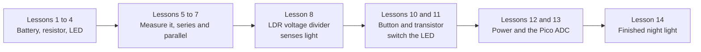

{:class="cover"}

---

By the end of this lesson you will know what the course covers, what kit to gather, and how the night light project ties every lesson together.

## Overview

Every robot you will ever build is a pile of electronics with a brain on top. Motors, sensors, LEDs and the Pico itself all follow the same few rules, and once you know them, wiring stops being scary guesswork and becomes something you can reason about.

In this course we learn those rules by building one thing: a **light-sensing night light**. It starts as a handful of parts on a breadboard, an LED, a resistor and a battery pack. Lesson by lesson we add a light dependent resistor (LDR), a voltage divider, a transistor and a button, and in the last lessons we hand the whole thing to a Raspberry Pi Pico that watches the room and switches the light on when it gets dark.

You do not need any electronics experience. If you can plug a USB cable in, you can do this course.

## Before you start

No electronics experience is needed. Two other courses make good companions:

- [Robotics 101](/learn/robotics_101/) gives the big picture of what a robot is made of. Read it first if you like to see where you are heading.
- [Learn MicroPython - The basics](/learn/micropython/) helps with the last three lessons, where the Pico reads sensors and runs the finished night light.

You can do lessons 1 to 12 with nothing but a battery pack, a breadboard and a multimeter. The Pico only arrives in lesson 13.

## The night light, stage by stage

Each part of the course adds one stage to the finished project:

## Course Content

- Voltage, current and resistance, explained with a water pipe
- Ohm's law and how to use it for real calculations
- Breadboards and building your first LED circuit
- Using a multimeter to measure voltage, current and resistance
- Series and parallel circuits
- Voltage dividers with potentiometers and LDRs
- Reading datasheets and resistor colour codes
- Switches, pull-up and pull-down resistors
- Transistors as switches
- Powering projects: batteries, regulators, 3.3V versus 5V, common ground
- Connecting circuits to the Pico: GPIO limits and the ADC
- The finished night light, with MicroPython code

## Key Results

After completing this course, you will:

- Pick the right resistor for an LED using Ohm's law
- Build and debug circuits on a breadboard
- Measure what a circuit is actually doing with a multimeter
- Build a voltage divider and read it with the Pico ADC
- Switch an LED with a transistor, and know why motors need more
- Power a project safely and share a ground between supplies
- Have a working night light you built and understand end to end

## What you'll need

- A solderless breadboard and a set of male to male jumper wires
- A pack of assorted LEDs and a resistor kit (E12 values, 100 ohm to 100k ohm)
- A light dependent resistor (LDR), a 10k potentiometer and a push button
- An NPN transistor such as a 2N2222 or BC547
- A cheap multimeter
- An AA battery pack (3 x AA with leads)
- A Raspberry Pi Pico with headers soldered on, and a USB cable
- A computer with [Thonny](https://thonny.org/) (or any MicroPython editor) installed

Everything here is cheap. A starter kit from most electronics shops covers nearly the whole list.

> **Teachers**: the course suits ages 11 and up, or any beginner, and each lesson takes 30 to 45 minutes (the project lesson, 14, needs a full session). Per learner or pair you need a breadboard, jumpers, a resistor and LED kit, a multimeter and a 3 x AA battery pack; the Pico is only needed from lesson 13. With no hardware at all, learners can still do the calculations and the computer-side Python scripts in lessons 1 to 12, and a free online circuit simulator can stand in for the breadboard. Multimeters are the item most often short in a class, so plan to share them in groups of three or four.

## How the course works

Each lesson introduces one idea, shows it on a real circuit, and ends with a **Try it Yourself** section and a **Common Issues** section. Do the exercises. Electronics is a hands-on skill, and a circuit you have built yourself sticks in your head far better than one you have read about.

The maths is kept gentle. Where a calculation matters, you will see it written out in plain text and as a short Python snippet. Snippets marked as "run on your computer or the Pico" use only standard Python, so you can paste them into any Python prompt or into Thonny with the Pico connected. Snippets that touch hardware are MicroPython for the Pico.

A few conventions:

- Pin numbers like **GP26** mean the Pico's GPIO numbers, not the physical pin positions. We give the physical pin too where it helps.
- Pico pins in this course avoid GP0 to GP7, which the [MicroPython Robotics](/learn/micropython_robotics/) course uses for motor drivers, so you can keep both projects on the same board later.
- Safety notes are short and practical. Nothing here is dangerous at these voltages, but batteries deserve respect, and we will tell you why.

New to the Pico? You can start right away, but the [Learn MicroPython - The basics](/learn/micropython/) course is a good companion for the later lessons. Want the big picture of robots first? Have a look at [Robotics 101](/learn/robotics_101/).

Ready? Grab your breadboard and let's build something that glows.

## Check your understanding


? What do you build across the whole course?
- [x] A light-sensing night light controlled by a Pico
- [ ] A line-following robot
- [ ] A motor driver board
> The course builds one project, a night light, adding one stage per lesson.

? Why does the course avoid pins GP0 to GP7?
- [ ] They cannot be used as outputs
- [x] The MicroPython Robotics course uses them for motor drivers
- [ ] They are reserved for USB
> Keeping GP0 to GP7 free means you can add the motor driver from that course later without rewiring.

? In which lesson does the Raspberry Pi Pico first appear?
- [ ] Lesson 1
- [x] Lesson 13, after the breadboard circuits
- [ ] Lesson 4
> Lessons 1 to 12 need only a battery pack, breadboard and multimeter. The Pico arrives in lesson 13.

