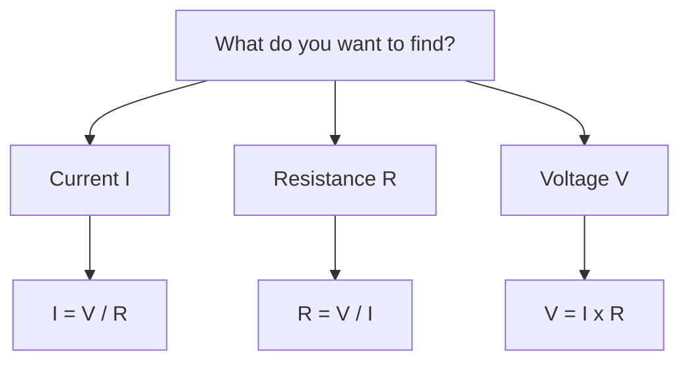

{:class="cover"}

---

By the end of this lesson you will be able to use Ohm's law to find the current, voltage or resistance in a simple circuit, and check the power a resistor must handle.

## Overview

Ohm's law ties voltage, current and resistance together in one tidy relationship. If you know any two, you can work out the third. It is the formula you will use most in your whole electronics life, and it is the key to choosing the resistor for our night light's LED.

## The law

In plain text:

```text
V = I x R      voltage (volts) = current (amps) x resistance (ohms)
I = V / R      current = voltage divided by resistance
R = V / I      resistance = voltage divided by current
```

The classic memory trick is a triangle with V on top and I and R along the bottom. Cover the thing you want, and the triangle shows you the formula.

One thing to watch: the units must be **volts, amps and ohms**. If you have milliamps, divide by 1000 first. 10 mA is 0.010 A. Mixing mA into the formula is the number one source of wrong answers.

Not sure which version of the formula to use? Start from what you know:



## Worked examples

**Example 1: how much current?** A 4.5 V battery pack across a 270 ohm resistor.

```text
I = V / R = 4.5 / 270 = 0.0167 A = 16.7 mA
```

**Example 2: what resistor do I need?** We want 10 mA from a 4.5 V supply through a resistor alone (ignore the LED for now).

```text
R = V / I = 4.5 / 0.010 = 450 ohm
```

**Example 3: how much voltage across it?** 0.3 mA flowing through a 10k resistor.

```text
V = I x R = 0.0003 x 10000 = 3.0 V
```

A good habit: always ask whether the answer is plausible for your supply. If this had come out at 50 V on a 4.5 V battery pack, you would know you had made a mistake somewhere.

## Power: how hot will it get?

When current flows through a resistance it makes heat. The power in watts is:

```text
P = V x I       power = voltage x current
```

Most resistors in kits are rated 1/4 watt (0.25 W). Our LED resistor will dissipate only a few milliwatts, so we are safe, but motors and bigger loads can melt things.

## Let the computer do it

Here is a small calculator we will reuse throughout the course. Save it as `ohms.py`, or paste it into a Python prompt.

```python
# Run on your computer or the Pico
# A small Ohm's law helper, standard library only

def current(volts, ohms):
    """Amps flowing through a resistance with a given voltage across it."""
    return volts / ohms

def resistance(volts, amps):
    """Resistance needed to pass the given current at the given voltage."""
    return volts / amps

def voltage(amps, ohms):
    """Volts across a resistance with the given current through it."""
    return amps * ohms

def power(volts, amps):
    """Watts of heat produced."""
    return volts * amps

i = current(4.5, 270)
print(f"Current: {i * 1000:.1f} mA")
print(f"Resistance for 10 mA at 4.5 V: {resistance(4.5, 0.010):.0f} ohm")
print(f"Voltage across 10k at 0.3 mA: {voltage(0.0003, 10000):.1f} V")
print(f"Power in the 270 ohm resistor: {power(4.5, i) * 1000:.1f} mW")
```

Output:

```text
Current: 16.7 mA
Resistance for 10 mA at 4.5 V: 450 ohm
Voltage across 10k at 0.3 mA: 3.0 V
Power in the 270 ohm resistor: 75.0 mW
```

Notice 75 mW is far below the 250 mW a quarter-watt resistor can handle. Plenty of margin.

Now try a harsher case. A 100 ohm resistor on 4.5 V passes 4.5 / 100 = 0.045 A (45 mA), so the power is 4.5 x 0.045 = 0.2 W, or 203 mW. That is just under the quarter-watt rating, so the resistor would run hot. Smaller resistance on the same voltage means much more heat.

**Why this matters:** every time you wire up a new part, Ohm's law answers "how much current will this draw?" and "what resistor protects it?" before you ever switch on.

**Common mistakes:**

- Using mA in the formula. Convert to amps first.
- Forgetting that an LED is not a resistor. Ohm's law applies to the resistor next to it. We handle that in lesson 4.

## Try it Yourself

1. Use the helper to find the current through a 1k resistor on the Pico's 3.3 V.
2. How much power does a 100 ohm resistor dissipate on 4.5 V? Is that safe for a 1/4 W resistor?
3. Challenge: write a loop that prints the resistor needed for 5, 10, 15 and 20 mA from 4.5 V.

## Common Issues

- **Problem**: My answer is 1000 times too big or too small.
- **Solution**: Check you converted mA to A and k to thousands.
- **Why**: The formula wants base units. 10 mA is 0.01, and 4.7k is 4700.

- **Problem**: The calculator says 0 or crashes with ZeroDivisionError.
- **Solution**: You divided by a resistance of 0.
- **Why**: A resistance of zero is a short circuit, which in real life means huge current. Treat the error as a warning.

## Check your understanding


? A 4.7k resistor has 3.3 V across it. What current flows?
- [ ] About 7 mA
- [ ] About 1.4 A
- [x] About 0.7 mA
> I = V / R = 3.3 / 4700 = 0.0007 A, which is 0.7 mA.

? Before using a current of 10 mA in V = I x R, what must you do?
- [ ] Multiply it by 1000
- [x] Convert it to 0.010 A
- [ ] Nothing, mA works as it is
> The formula wants volts, amps and ohms, so 10 mA becomes 0.010 A.

? Which formula gives the heat a resistor produces?
- [x] P = V x I
- [ ] R = V / I
- [ ] V = I x R
> Power in watts is voltage times current. Most kit resistors are rated at 1/4 watt (0.25 W).

