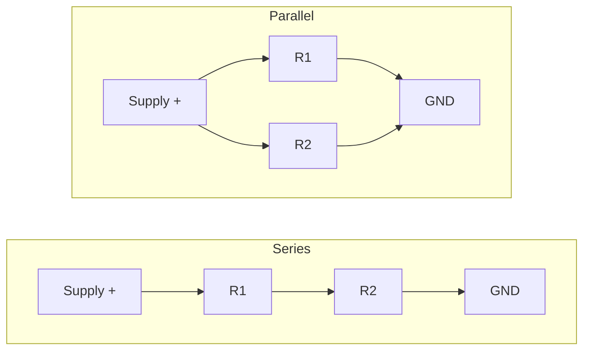

{:class="cover"}

---

By the end of this lesson you will be able to tell series from parallel circuits and calculate the total resistance and current of each.

## Overview

So far every circuit has had one path. Real robots join parts together, and there are only two ways to do it: one after another (series) or side by side (parallel). Knowing both lets you build the voltage divider at the heart of our night light's light sensor in the next lesson.

The two patterns side by side:



## Series: one path

Parts in series share the same current, because there is only one route. Resistances add up:

```text
R total = R1 + R2 + R3
```

The supply voltage is shared between the parts, each taking a slice in proportion to its resistance.

Robot example: two red LEDs in series on 4.5 V. Each drops 2.0 V, so together 4.0 V, leaving 0.5 V for the resistor. For 10 mA:

```text
R = 0.5 / 0.010 = 50 ohm  (use 56 ohm from the E12 series)
```

Both LEDs share the same 10 mA, so they glow equally. If one LED fails open, both go out, because the loop is broken.

## Parallel: many paths

Parts in parallel share the same voltage, because they connect to the same two points. The current splits between them, and the more paths you add, the less total resistance:

```text
1 / R total = 1 / R1 + 1 / R2 + 1 / R3
```

Two equal resistors in parallel give half the resistance. Three equal ones give a third.

Robot example: two LEDs side by side, **each with its own resistor**. Each branch draws its own 10 mA, so the battery supplies 20 mA in total. If one LED fails, the other keeps shining.

Why not share one resistor? Even slightly different LEDs would hog the current, and one could get too much. Give each branch its own resistor.

## Calculating combinations

```python
# Run on your computer or the Pico
# Series and parallel resistor calculators

def series(*resistors):
    return sum(resistors)

def parallel(*resistors):
    return 1 / sum(1 / r for r in resistors)

print("1k + 2.2k in series:       ", series(1000, 2200), "ohm")
print("1k || 1k in parallel:      ", parallel(1000, 1000), "ohm")
print("10k x 3 in parallel:       ", round(parallel(10000, 10000, 10000), 1), "ohm")
print("Two LEDs, 20 mA from 4.5 V:", 2 * 10, "mA total from the battery")
```

Output:

```text
1k + 2.2k in series:        3200 ohm
1k || 1k in parallel:       500.0 ohm
10k x 3 in parallel:        3333.3 ohm
Two LEDs, 20 mA from 4.5 V: 20 mA total from the battery
```

A handy trick: if you are short of a value, combine what you have. Need 5k? Two 10k in parallel. Need 20k? Two 10k in series.

**Why this matters:** the night light's sensor is two resistances in series (the LDR and a fixed resistor), and the sensor and the LED branch are two separate paths in parallel across the same supply. Every circuit in this course is made of these two patterns.

**Common mistakes:**

- Putting LEDs in parallel with one shared resistor.
- Forgetting that the supply voltage has to be higher than the sum of LED forward voltages in series. Three red LEDs (6 V) will not light from a 4.5 V pack.
- Using the parallel formula for series, and vice versa. Series adds, parallel shrinks.

> **Teachers**: the series LED exercise needs a supply above 4 V, so it works with the 3 x AA pack but not on 3.3 V. If you only have USB or Pico power in your room, run the parallel exercise and use the calculator helper for the series one.

## Try it Yourself

1. Build two LED and resistor branches in parallel on your breadboard. Measure the current through each with the meter (lesson 6), and the total from the battery.
2. Put two LEDs in series with a 56 ohm resistor on 4.5 V. Do they both light?
3. Challenge: use the `parallel()` helper to find which two E12 resistors in parallel get closest to 150 ohm.

## Common Issues

- **Problem**: Two LEDs in series do not light from my 3.3 V supply.
- **Solution**: Use them in parallel with their own resistors, or use a higher voltage.
- **Why**: Their forward voltages add up to about 4 V, more than the supply has.

- **Problem**: One of my parallel LEDs is much brighter than the other.
- **Solution**: Check both resistors have the same value, and the LEDs are the same colour.
- **Why**: Different colours have different forward voltages, so the current is different.

## Check your understanding


? Two 1k resistors are in parallel. What is the total resistance?
- [x] 500 ohm
- [ ] 2k
- [ ] 1k
> Two equal resistors in parallel give half the resistance, so 500 ohm. In series they would add to 2k.

? Why give each parallel LED its own resistor?
- [x] Slightly different LEDs would otherwise hog the current
- [ ] It makes the battery last longer
- [ ] Parallel LEDs will not light otherwise
> With one shared resistor, one LED could take too much current. Each branch gets its own resistor.

? Three red LEDs (about 2.0 V each) in series on a 4.5 V pack. What happens?
- [ ] They light brightly
- [x] They will not light, as 6 V is more than the supply
- [ ] They light dimly but evenly at 4.5 V
> The forward voltages add up to about 6 V, which is more than the pack can provide.

