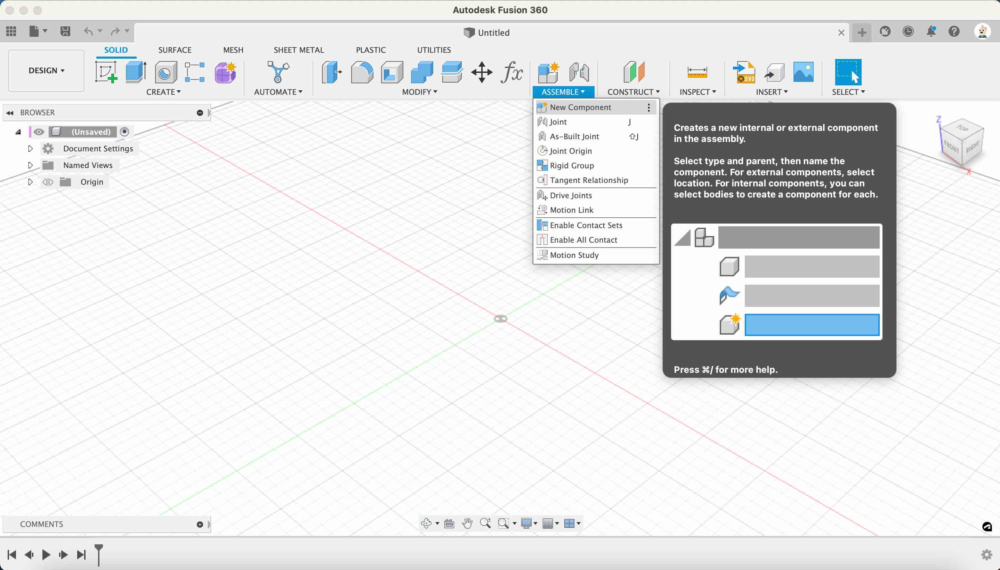
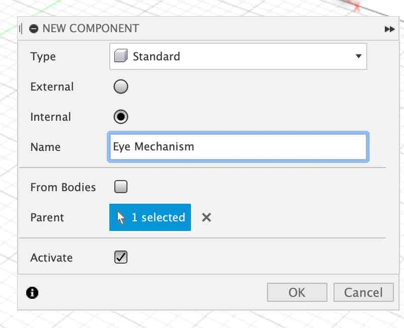
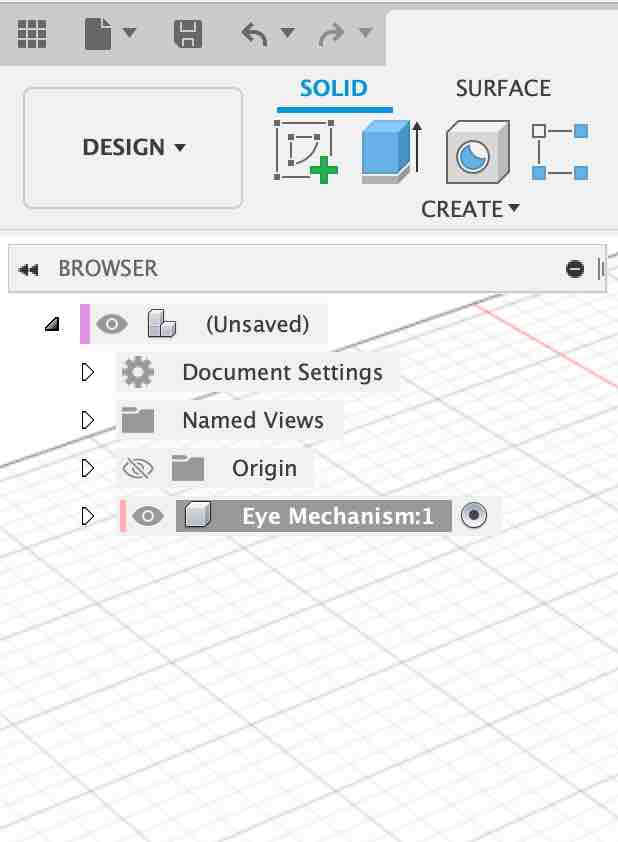
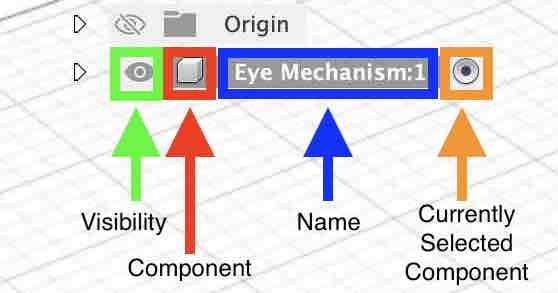

{:class="cover"}

---

By the end of this lesson you will be able to start a Fusion 360 design, save it and create your first component.

## Open Fusion 360

* **Launch Fusion 360** - Open the Fusion 360 Application

It will open on a fresh new blank design

* **Save Design** - Click on `File` from the file menu, and then `Save`, and give your design a name such as `eye mechanism`

---

## Create a Component

* **Click Assemble** - Click on the Assemble dropdown button on the toolbar

{:class="img-fluid w-100"}

---

* **Click Create Component** - Click on the Create Component button on the toolbar

{:class="img-fluid w-50"}

* **Click Ok** - Click on the ok button

---

* **Look at the Browser** - Check that the new component has been created in the browser on the left hand side of the screen

{:class="img-fluid w-50"}

* **Notice the different parts of the component** - Expand the component in the browser. You will see folders for the `Origin` (the three planes and three axes we will sketch on), `Bodies` and `Sketches`. They are empty for now and fill up as we build.

## Why use components?

An eye mechanism is made of parts that must move independently, such as an upper and a lower eyelid. In Fusion 360 a **component** is a container for one part, with its own bodies and sketches. Keeping each moving part in its own component means we can join them with joints later and test the movement before anything is printed. It is much easier to start tidy than to untangle one big lump of geometry afterwards.

> **Teachers**: Fusion 360 needs an Autodesk account, and the free educational licence is applied to the learner's own account, so set these up before the lesson. Fusion 360 also needs a reasonably modern computer and an internet connection, which school networks sometimes restrict, so test it on one machine first. Each learner needs their own seat, but pairs can share one machine and swap the mouse every few steps. Allow about 30 minutes.
{:class="bg-blue"}

{:class="img-fluid w-50"}

---

## Try it Yourself

1. Rename the component in the browser to `Upper Eyelid` (right-click it and choose Rename).
2. Save your design, close it, then reopen it and check that the component is still there.
3. Challenge: create a second empty component, then work out which component is active by looking at the browser.

## Common Issues

- **Problem**: The Create Component button is not on the toolbar.
- **Solution**: Make sure the `ASSEMBLE` menu of the toolbar is open in the Design workspace.
- **Why**: Fusion only shows the tools for the workspace and menu you are in.

- **Problem**: Your sketches or bodies end up in the wrong component later on.
- **Solution**: Check that the component you want is the active one before you start a sketch.
- **Why**: New geometry is created inside the active component.

## Check your understanding


? Which toolbar menu do you use to create a component?
- [x] ASSEMBLE
- [ ] INSPECT
- [ ] RENDER
> Create Component is in the ASSEMBLE menu.

? Why do we save the design right at the start?
- [x] So Fusion keeps a version each time we save as we work
- [ ] Fusion cannot sketch until a file is saved
- [ ] Saving makes the eyelid print faster
> Every save makes a new version, so you can go back if a step goes wrong.

? Where do you check that your new component exists?
- [x] The browser on the left of the screen
- [ ] The ViewCube
- [ ] Nowhere, you cannot check
> The browser lists every component in the design.

