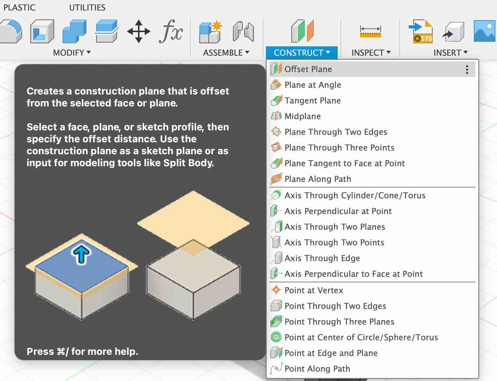
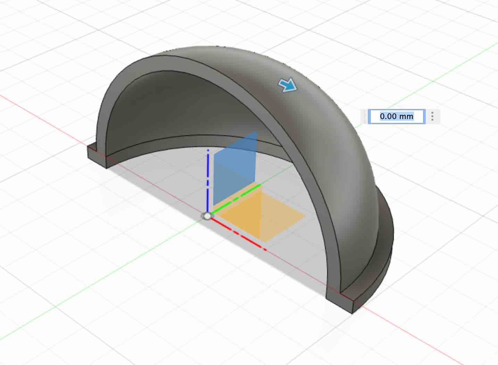
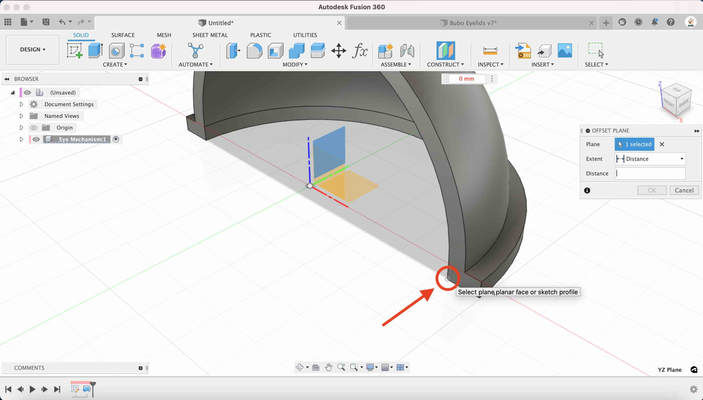
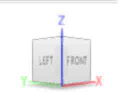
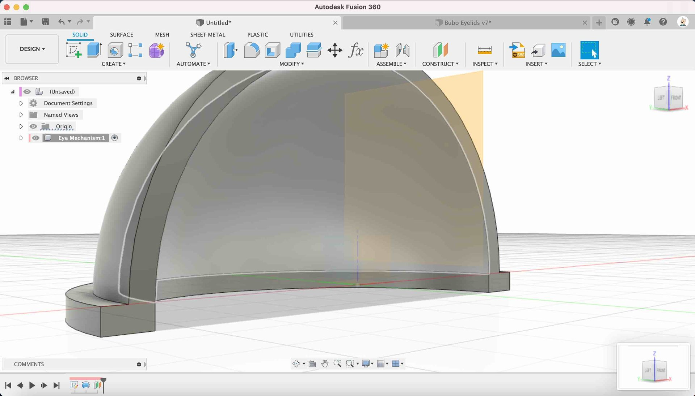
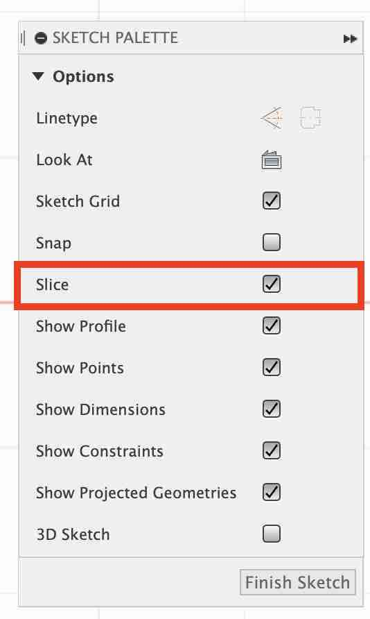
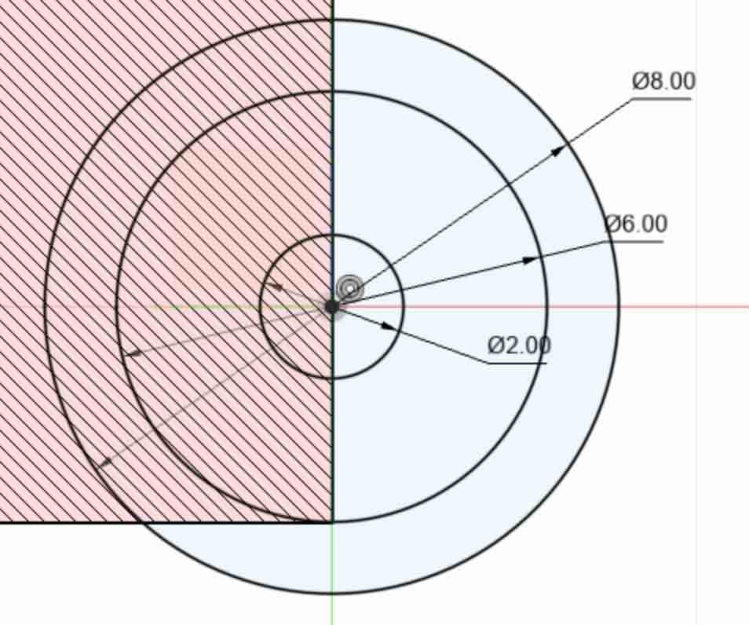
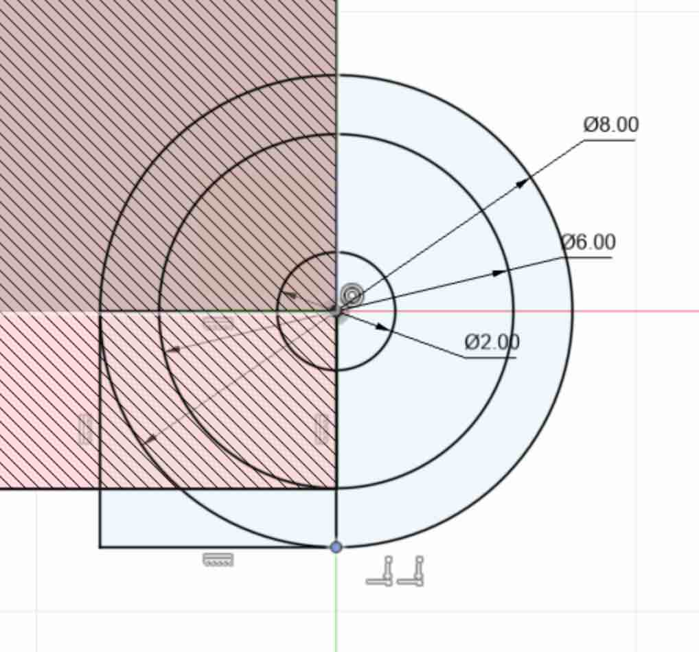
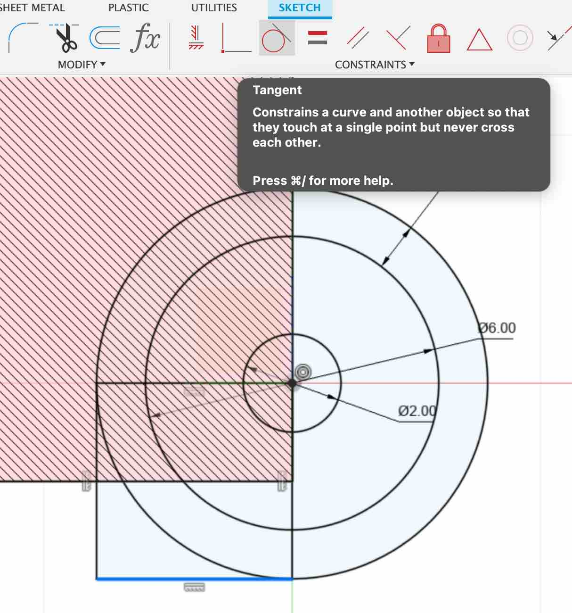

{:class="cover"}

---

By the end of this lesson you will be able to create an offset plane and sketch the hinge profile on it using circles, a rectangle and constraints.

* **Create new Sketch** - Create a new sketch on the edge of the eyelid by clicking the `CONSTRUCT` Menu and selecting the `offset plane` option.

{:class="img-fluid w-50"}

---

* **Select the `YZ` plane** - select the `YZ` plane, this is the one that is facing the right side of our model.

{:class="img-fluid w-50"}

---

* **Click on the point side the eyelid** - Click on the point that's highlighted in the image below. The new plane should then be offset by `20mm` from the `YZ` plane.

{:class="img-fluid w-100"}

---

* **Create the hinge profile** - Select the newly created offset plane and click on the `Create Sketch` button to create a new sketch on this plane.

> ## The ViewCube
>
> It's best to move the camera rotation to inside the eyelid so you create the sketch in the correct orientation. Move the camera by using the `viewcube`.
>
> {:class="img-fluid w-50"}

---

{:class="img-fluid w-50"}

---

* **Slice** - Click on the `Slice` option from the `Sketch Palette`. Slice will remove the parts of the model that are between the camera and the selected sketch profile. This allows us to see inside of the model.

{:class="img-fluid w-50"}

---

* **Create three circles** - Using the circle creation mode (press `c`), create three circles:

  * one that is 2mm
  * one that is 6mm
  * one that is 8mm
  
The origin of each circle is the point where the horizontal and vertical lines of our profile meet (the origin).

{:class="img-fluid w-50"}

---

* **Create a square** - Use the rectangle drawing mode by pressing `r`. Start the rectangle at the origin, and drag it until the bottom line touches the bottom of the circle, and the leftmost side touches the left side of the circle. You can also use the Tangent tool to ensure the line and circles are aligned.

{:class="img-fluid w-50"}

> ### The `Tangent` Tool
>
> * **Select the line** - Select the left line of the rectangle
> * **Click Tangent** - and then click the `tangent` tool button from the toolbar.
> * **Select the circle** - Select the circle to create the tangent constraint which aligns the line to the circle.

{:class="img-fluid w-50"}

---

> ## Constraints
>
> Constraints **allow you to relate one sketch entity to another sketch entity**. If you look at the constraint icons in the sketch palette you'll see that the sketch constraints use geometric expressions, with the exception of fix/unfix.
{:class="bg-blue"}

---

* **Finish Sketch** - Click the `Finish Sketch` button

---

## Try it Yourself

1. Turn Slice off and on again and orbit the view to see what changes.
2. Add a tangent constraint between one more line and a circle, and watch the sketch colour.
3. Challenge: change the 8mm circle to 9mm. Which later features would you need to check, and why?

## Common Issues

- **Problem**: The offset plane is created in the wrong place.
- **Solution**: Edit the feature in the timeline and pick the point on the eyelid again, then check the 20mm offset.
- **Why**: The plane is positioned from the plane and the point you pick.

- **Problem**: You cannot see the sketch because the eyelid is in the way.
- **Solution**: Use Slice from the Sketch Palette and move the camera inside the eyelid with the ViewCube.
- **Why**: Slice hides the part of the model between you and the sketch plane.

## Check your understanding


? What does the Tangent constraint do?
- [x] Makes a line touch a circle at one point so they line up
- [ ] Makes two circles the same size
- [ ] Fixes the sketch so it cannot be edited
> Tangent keeps the rectangle edge touching the circle.

? What is a constraint?
- [x] A rule that relates one sketch entity to another
- [ ] A 3D printer setting
- [ ] A length in millimetres
> Constraints use geometric expressions to keep a sketch in shape.

? What does the ViewCube let you do?
- [x] Move the camera around the model
- [ ] Change the units
- [ ] Export the model
> We use it to look from inside the eyelid when sketching.

