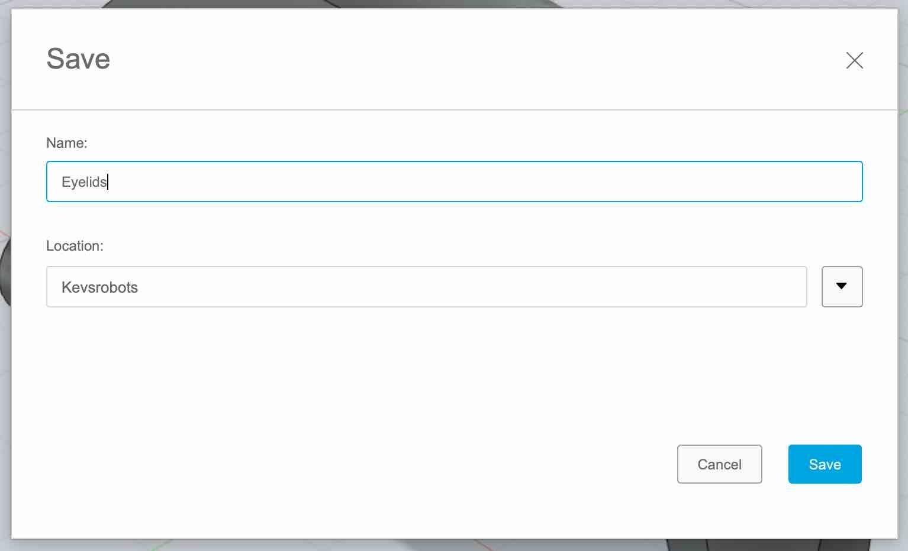
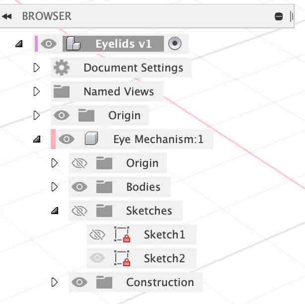
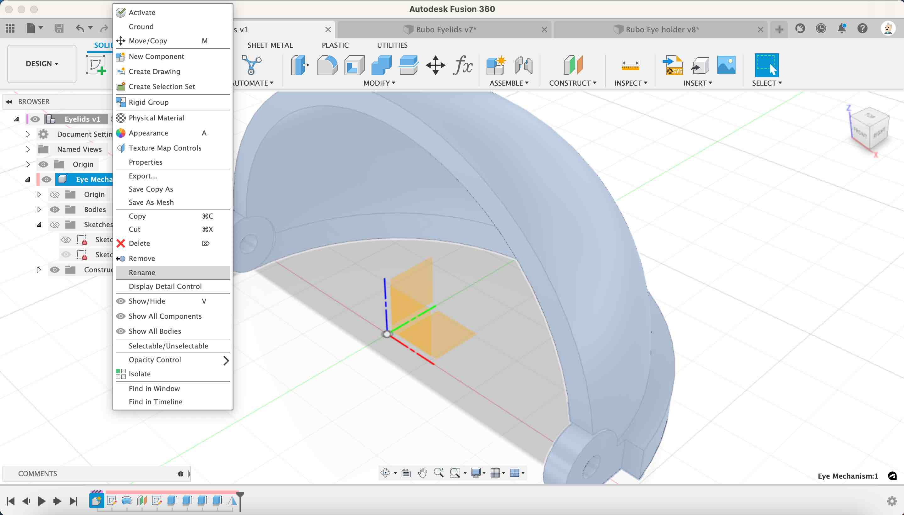
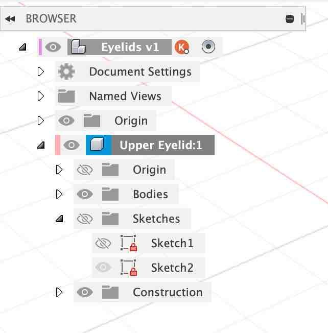
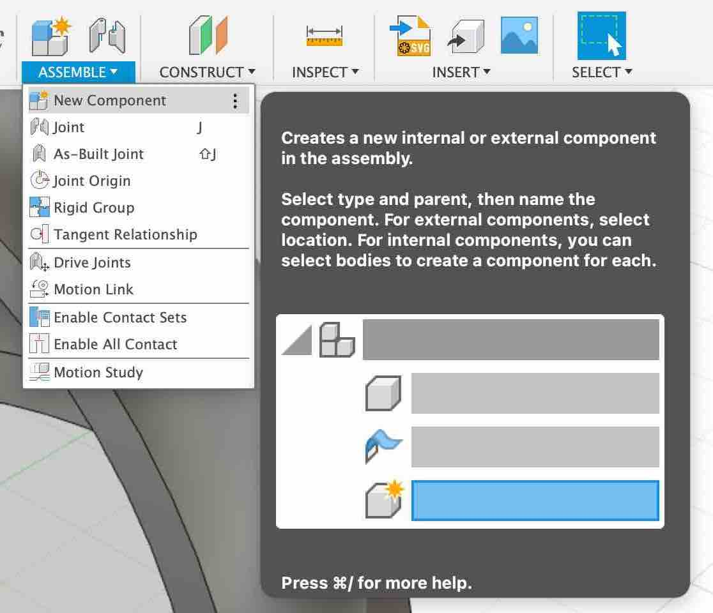
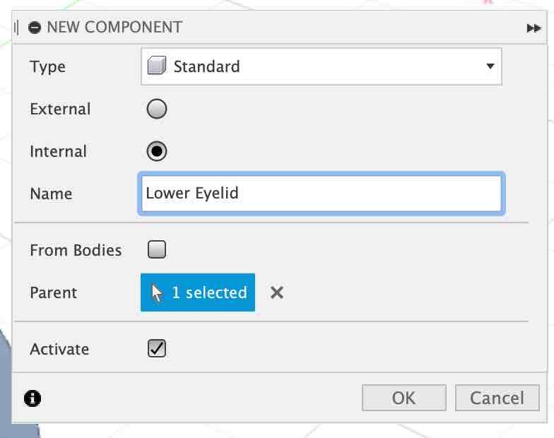

{:class="cover"}

> ## Components
>
> It's good practice to separate each part of our model into different components. This will make it possible to attach them together later with articulated joints.

---

> ## Save our design
>
> Oops, we forgot to do something quite important; Save our design.
>
> Fusion saves a new version of our model each time we click the save button. This helps when we're working on one part of the design in one file, and assemble the parts in another file - Fusion will know if there is a newer version of the part and ask you to update the assembled version.
>
> Let's do this now.
>
> {:class="img-fluid w-100"}
{:class="bg-blue"}

* **Save the model** - Click on the Save command from the File menu, and give your model a name such as `eyelids`.

---

## New Component

We want to create the new component at the same level as the original component we created. This will allow us to join them together later.

* **Select the root component** - Click on the `Eyelids` component at the root (the radio button to the right of the component name to select it.)

{:class="img-fluid w-50"}

---

{:class="img-fluid w-100"}

* **Rename Component** - rename the existing component to Upper Eyelid

The result should look like this:

{:class="img-fluid w-100"}

---

* **Create a new Component** - Click the `ASSEMBLE` toolbar menu item then click `Create New Component`

{:class="img-fluid w-100"}

---

* **Name the Component** - Name the new component `Lower Eyelid`

{:class="img-fluid w-50"}

---

## Try it Yourself

1. Rename the root component and check the browser to see the new name.
2. Switch the active component between Upper Eyelid and Lower Eyelid and notice which one is highlighted.
3. Challenge: create a third empty component called `Eyeball` for the exercise in the last lesson.

## Common Issues

- **Problem**: Your new component ends up inside the Upper Eyelid.
- **Solution**: Make the root component active first, then create the new component.
- **Why**: Components are nested inside whichever component is active, and we want the two eyelids side by side.

## Check your understanding


? Why do we keep each part in its own component?
- [x] So we can connect them with joints later
- [ ] It makes the eyelid smaller
- [ ] Fusion can only print components
> Joints connect components, so each moving part needs its own.

? Why do we save regularly?
- [x] Fusion makes a new version each time we save
- [ ] Saving rotates the model
- [ ] Saving closes the sketch
> Each save is a version you can return to.

? Which component should be active before you create the Lower Eyelid component?
- [x] The root component
- [ ] The Upper Eyelid
- [ ] None of them
> We create it at the same level as the original component.

