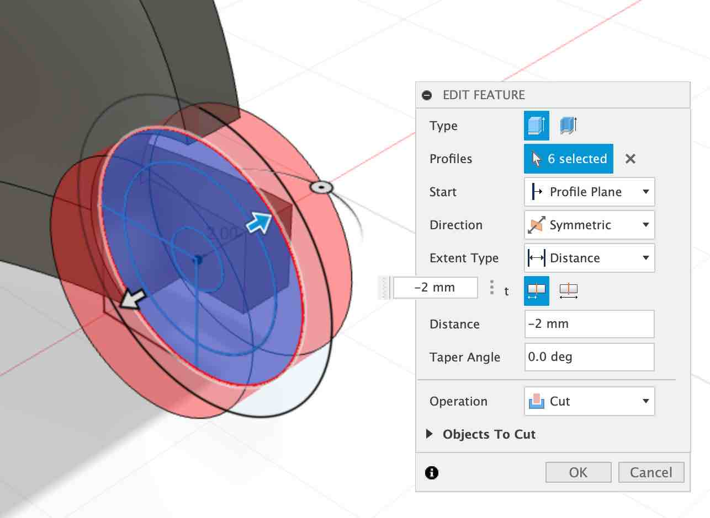
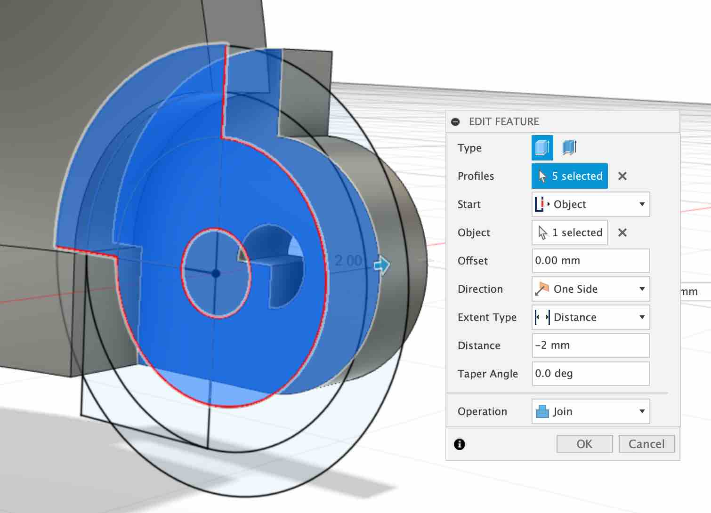
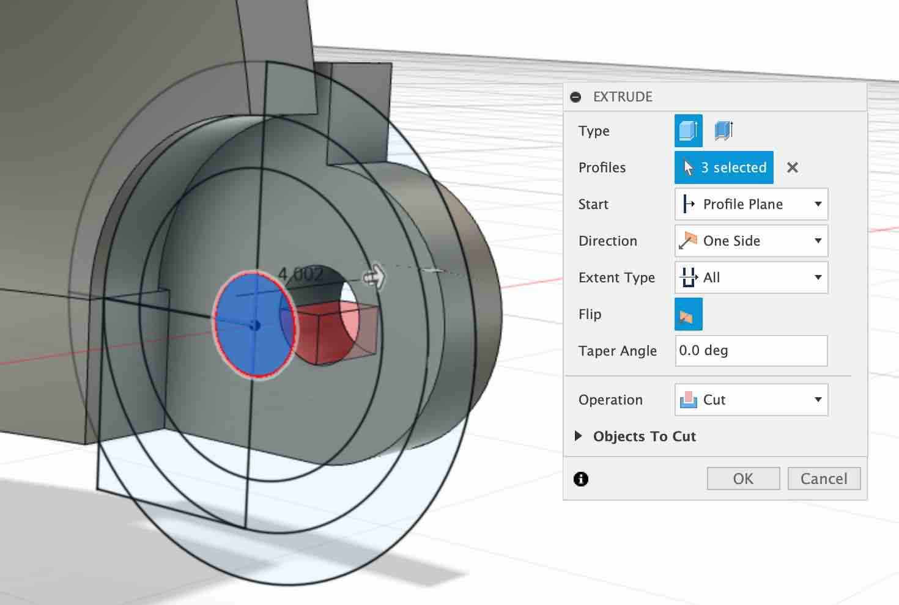
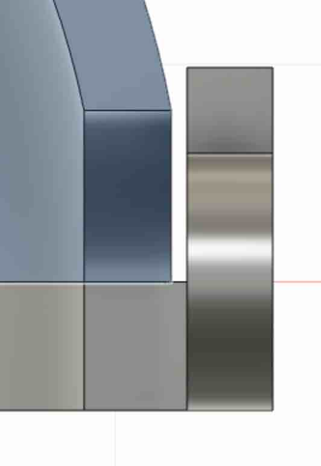
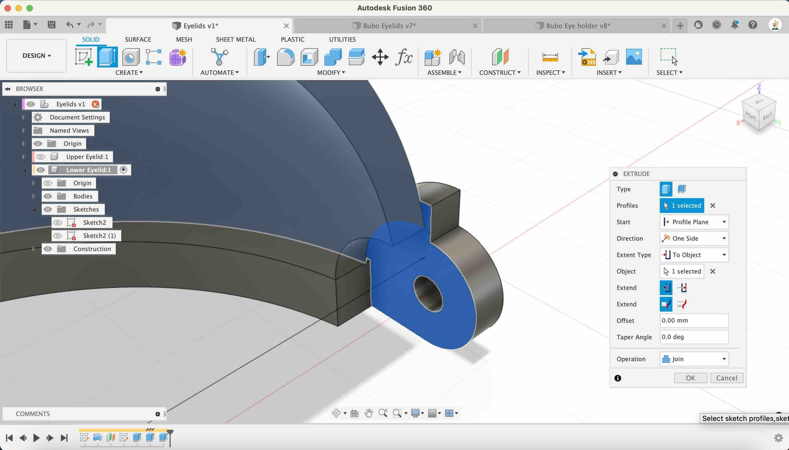
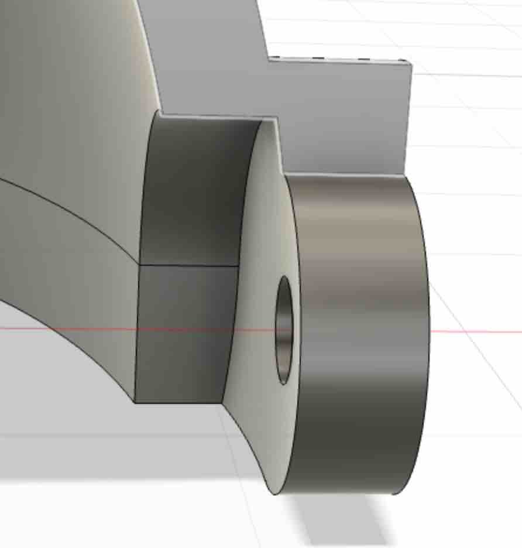

{:class="cover"}

---

By the end of this lesson you will be able to extrude a lower hinge that fits over the upper one, and use Extrude to Object to close a gap.

## Lower Hinge

The lower eyelid hinge needs to fit over the upper eyelid hinge, so we can use that to extrude from.

---

* **Extrude** - Select the circle profiles and extrude by 2mm symmetrically.

{:class="img-fluid w-50"}

---

* **Join** - Extrude the profile below by -2mm:
  
  * Set the `start` to `object`, and use the flat section as the new `object` profile

{:class="img-fluid w-50"}

---

* **Extrude the screw hole** - extrude the middle screw hole profile, setting the distance to `all`

{:class="img-fluid w-50"}

---

## Extrude to Object

There is a small gap between our parts that we need to fill.

{:class="img-fluid w-50"}

Fusion has a handy feature for this in the extrude dialog box in the extent type called `to object`.

{:class="img-fluid w-100"}

{:class="img-fluid w-50"}

---

## Mirror

Let's mirror this new feature.

* **Mirror** - Click on the `CREATE` and Mirror function, then select the 4 features that have just been created and the origin as the mirror plane.

---

## Try it Yourself

1. Use Extrude to Object on a different gap and notice how the end face is chosen.
2. Hide the Upper Eyelid and look at the lower hinge on its own.
3. Challenge: explain in your own words why the lower hinge circles are larger than the upper ones.

## Common Issues

- **Problem**: There is still a gap between the hinges.
- **Solution**: Use Extrude with the extent type `To Object` and pick the face of the upper hinge.
- **Why**: To Object stops the extrusion exactly at the chosen face instead of at a typed distance.

## Check your understanding


? Why is the lower eyelid made as a separate **component**?
- [ ] Fusion 360 can only have one body per component
- [x] So the eyelids can be joined later and move independently
- [ ] To make the file smaller
> Joints connect components, so each moving part needs its own component.

? The lower eyelid hinge has a 10mm circle as well. Why is it bigger than the upper hinge?
- [x] It fits over the outside of the upper eyelid's hinge
- [ ] It holds the servo
- [ ] To make the eyelid heavier

? What does the extent type `To Object` do?
- [x] Stops the extrusion exactly at a face you pick
- [ ] Extrudes by a fixed 2mm
- [ ] Mirrors the feature
> It closes the small gap between the parts without you measuring it.

