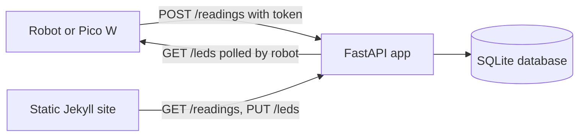

{:class="cover"}

---

Ahoy there makers! Have you ever wanted a web page that shows what your robot is sensing, and lets you switch its LEDs on from your phone, but only if you are logged in? That is exactly what we are going to build, using Python and FastAPI.

## Overview

FastAPI is a modern Python framework for building web APIs. You describe your routes with ordinary functions and type hints, and FastAPI checks incoming data, converts it and writes interactive documentation for you.

Through this course we build one project, the **Robot Telemetry API**:

- a Pico, or any robot, posts sensor readings to the API
- anyone can read the latest readings
- only logged-in users can post readings and switch the robot's LEDs
- the first person to register becomes the admin, who can list and remove users
- a static Jekyll page shows the readings and has a login form

Here is the big picture. The static site never touches the database. It only talks to the API.

## Course Content

- Setting up Python, a virtual environment and FastAPI
- Routes, path and query parameters, and request bodies
- How password hashing and signed tokens work
- Pydantic v2 models, SQLite storage and lifespan handlers
- Registration, login and protected routes
- User management and admin-only routes
- Letting a static Jekyll site call the API (CORS)
- Settings, secrets and deployment

## Key Results

After completing this course, you will:

- Build and run a FastAPI app with `fastapi dev` and `uvicorn`
- Validate requests with Pydantic v2 models and `Annotated` parameters
- Store users safely, with hashed passwords and signed login tokens
- Protect routes so only the right people can reach them
- Call your API from a static website without opening it to everyone
- Configure and deploy the app without leaving secrets in your code

## What you'll need

- A computer with Python 3.10 or newer (the examples were run on Python 3.13)
- A terminal and a text editor, such as Thonny, VS Code or Snakie
- A web browser
- Optional: a Raspberry Pi Pico W or other robot that can make HTTP requests. A small script on your computer stands in for the robot, so no hardware is needed
- Optional: a Jekyll site (see the [Jekyll course](/learn/jekyll/))

## How the course works

Each lesson teaches one idea, then adds one piece to the Robot Telemetry API. Code blocks are complete files unless the lesson says "add this". Terminal commands start with `$`, and any output we show is real output from the versions below.

The code was tested with FastAPI 0.165, Pydantic 2.14 (Pydantic v2) and Starlette 1.10. Newer versions should behave the same, but if something looks different, check the FastAPI release notes.

Every lesson ends with exercises, common problems and a short quiz. New to Pydantic? The [Pydantic course](/learn/pydantic/) goes much deeper than we need here, and the [SQLite3 course](/learn/sqlite3/) covers the database side.

> **Teachers**: This course suits students aged 14 and over who already write Python functions and dictionaries. Allow 45 to 60 minutes per lesson, or two lessons for the longer ones (5 to 7). Everything runs on a laptop, so each learner or pair needs only a computer that lets them install Python packages. If a school machine blocks `pip`, ask IT to set up one virtual environment in advance. No robot is needed: a short script plays the part of the robot. Avoid asking learners to use real passwords or real email addresses when they test registration.

## Prerequisites

- Comfortable with Python basics: functions, dictionaries, `import`
- Helpful: [Mastering Pydantic for Robust Data Validation](/learn/pydantic/) and [Create Databases with Python and SQLite3](/learn/sqlite3/)
- Helpful: [Learn MicroPython - The basics](/learn/micropython/) if you want a real Pico to be the robot
