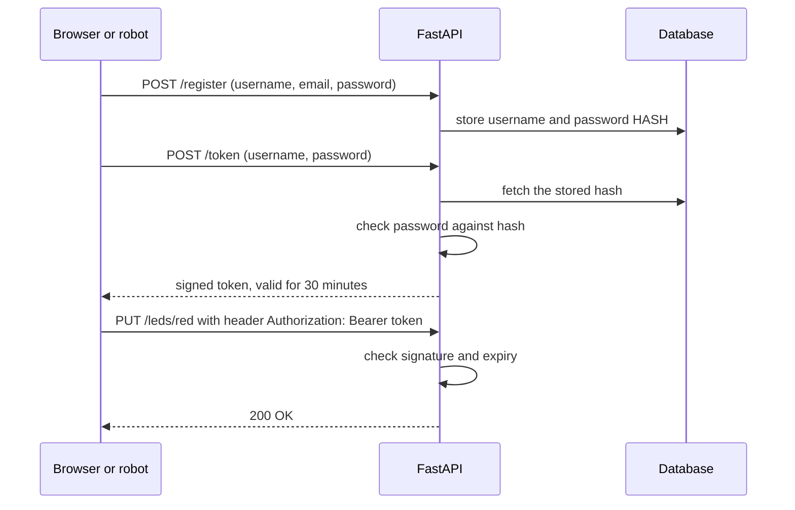

{:class="cover"}

---

By the end of this lesson you will be able to explain the login flow, hash and check a password, and create and verify a signed token.

## Who is knocking?

Right now anyone who can reach our API can post fake readings. Before we lock the door, let's understand the lock. Two different questions are involved:

- **Authentication**: who are you?
- **Authorisation**: what are you allowed to do?

Logging in answers the first. Checking the user's role before deleting someone answers the second. We will build both.

## The flow

A static site cannot keep a session on the server, because there is no server code in it. Instead, the API gives the browser a **token** after login, and the browser shows it with every later request.



## Never store the password itself

If your database leaks and holds plain passwords, every user is in trouble, especially because people reuse passwords. So we store a **hash**: a scrambled version that cannot be turned back into the password. To check a login, we hash what the user typed and compare. Good password hashes are deliberately slow, so guessing millions of passwords is expensive.

We will use `pwdlib`, the library the FastAPI documentation now recommends, with the Argon2 hashing method. Older tutorials use `passlib`, which is no longer maintained. For tokens we use `PyJWT`. Install both in your virtual environment:

```bash
$ pip install "pwdlib[argon2]" PyJWT
```

## Tokens that cannot be forged

A JWT (JSON Web Token) is a small signed note. It holds claims, such as `sub` (the subject, our username) and `exp` (when it stops working), and a signature made with a secret key only the server knows. Anyone can read a token, so never put secrets in it. But nobody can change it without breaking the signature.

Save this as `auth_demo.py` and run it with `python auth_demo.py`:

```python
from datetime import datetime, timedelta, timezone

import jwt
from pwdlib import PasswordHash

# 1. Hashing: turn a password into something we can store safely.
hasher = PasswordHash.recommended()
stored = hasher.hash("correct-horse-battery")
print("Stored in the database:", stored[:30], "...")
print("Right password:", hasher.verify("correct-horse-battery", stored))
print("Wrong password:", hasher.verify("letmein123", stored))

# 2. Tokens: a signed note saying who you are and when it expires.
SECRET = "a-demo-secret-that-is-at-least-32-bytes-long"
claims = {"sub": "kev", "exp": datetime.now(timezone.utc) + timedelta(minutes=30)}
token = jwt.encode(claims, SECRET, algorithm="HS256")
print("Token:", token[:40], "...")

print("Decoded:", jwt.decode(token, SECRET, algorithms=["HS256"])["sub"])

# 3. Tampering is caught: a different key cannot verify the signature.
try:
    jwt.decode(token, "someone-elses-key-which-is-also-long-enough", algorithms=["HS256"])
except jwt.InvalidTokenError as error:
    print("Rejected:", type(error).__name__)
```
{: .no-snakie }

This is real output from running it:

```
Stored in the database: $argon2id$v=19$m=65536,t=3,p=4 ...
Right password: True
Wrong password: False
Token: eyJhbGciOiJIUzI1NiIsInR5cCI6IkpXVCJ9.eyJ ...
Decoded: kev
Rejected: InvalidSignatureError
```

The `algorithms=["HS256"]` list is not decoration. Always tell the decoder which algorithms to accept. The secret must be long: PyJWT warns about keys shorter than 32 bytes for HS256.

> **Teachers**: Passwords and email addresses are personal data. In a class, have learners use made-up passwords and addresses at example.com, never their real ones, and delete the test database afterwards. If you run a public API for learners under 13 you may have legal duties about collecting any personal data at all, so check your school's policy first.

## Where the token lives

A token in `localStorage` can be stolen by any script on your page. One in `sessionStorage` disappears when the tab closes, which is the choice we make in lesson 8. Cookies with `HttpOnly` are safer still, but need extra settings when the site and API sit on different domains. The trade-off is yours to weigh, and the exercises below ask you to think about it.

## Try it Yourself

1. Run `auth_demo.py`, then change `timedelta(minutes=30)` to `timedelta(seconds=-1)` and see what `jwt.decode` raises.
2. Hash the same password twice and print both. Why are the hashes different, yet both verify?
3. Print `jwt.decode(token, options={"verify_signature": False})` to read a token without the key. What does this tell you about secrets in tokens?
4. Challenge: add a `role` claim to the token. Why should the server still look the user up in the database rather than trust the role in the token?

## Common Issues

- **Problem**: `ModuleNotFoundError: No module named 'jwt'`
- **Solution**: Install `PyJWT` (`pip install PyJWT`), not `jwt`. Import it as `import jwt`.
- **Why**: A different package called `jwt` exists on PyPI, and it has a different API.

- **Problem**: `InsecureKeyLengthWarning` or a short-key warning when encoding
- **Solution**: Use a secret of at least 32 characters, ideally random.
- **Why**: A short key is easier to guess, which would let an attacker forge tokens.

- **Problem**: `jwt.exceptions.ExpiredSignatureError`
- **Solution**: Log in again to get a fresh token, and catch `jwt.InvalidTokenError` in your code.
- **Why**: Tokens carry an expiry on purpose, so a stolen one stops working eventually.

## Check your understanding


? Why do we store a password hash instead of the password?
- [ ] Hashes take up less space
- [x] A leaked database does not reveal the passwords, because a hash cannot be turned back
- [ ] It makes logging in faster
> A hash is one way. We hash the login attempt and compare, so the real password is never stored.

? What stops a user changing the username inside their token?
- [ ] The token is encrypted
- [x] The signature would no longer match, because only the server knows the secret key
- [ ] Nothing, so we never trust tokens
> A JWT is signed rather than encrypted. Its contents are readable, but any change breaks the signature.

? What is the difference between authentication and authorisation?
- [x] Authentication says who you are, authorisation says what you may do
- [ ] They are two words for the same thing
- [ ] Authorisation happens before the user logs in
> Login proves identity (authentication). Checking a role before an action is authorisation.

