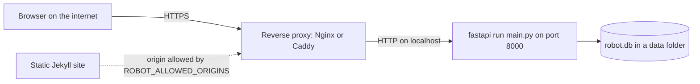

{:class="cover"}

---

By the end of this lesson you will be able to load settings from environment variables, run the API in production mode, and describe two ways to keep it running on a Raspberry Pi.

## Settings belong outside the code

So far the secret key has a development fallback sitting in the source. That is fine on your desk and dangerous on the internet, because anyone who reads the code could forge tokens. Let's fix that with `pydantic-settings`, a small package from the Pydantic team that reads settings from environment variables and `.env` files and validates them like any other model.

```bash
$ pip install pydantic-settings
```

Create `settings.py`:

```python
from functools import lru_cache
from pathlib import Path

from pydantic import Field
from pydantic_settings import BaseSettings, SettingsConfigDict


class Settings(BaseSettings):
    """Every value can be overridden with an ROBOT_ environment variable."""
    model_config = SettingsConfigDict(env_prefix="ROBOT_", env_file=".env", extra="ignore")

    # No default on purpose: the app refuses to start without a real secret.
    secret: str = Field(min_length=32)
    token_minutes: int = Field(default=30, ge=1)
    database_path: Path = Path("robot.db")
    allowed_origins: list[str] = ["http://localhost:4000", "http://127.0.0.1:4000"]


@lru_cache
def get_settings() -> Settings:
    return Settings()
```
{: .no-snakie }

`env_prefix="ROBOT_"` means the field `secret` is read from `ROBOT_SECRET`, `allowed_origins` from `ROBOT_ALLOWED_ORIGINS`, and so on. `secret` has **no default**, and must be at least 32 characters, so the app refuses to start without a real one. We tested this, and a missing secret gives:

```
pydantic_core._pydantic_core.ValidationError: 1 validation error for Settings
secret
  Field required [type=missing, input_value={}, input_type=dict]
```

A short secret fails too, with `String should have at least 32 characters`. Failing loudly at start-up is much kinder than failing mysteriously later.

`@lru_cache` makes `get_settings()` read the environment once and reuse the result. List values are written as JSON in the environment:

```bash
$ export ROBOT_SECRET="$(python3 -c 'import secrets; print(secrets.token_urlsafe(32))')"
$ export ROBOT_ALLOWED_ORIGINS='["https://www.example.com"]'
$ export ROBOT_DATABASE_PATH=/home/pi/robot-data/robot.db
```

Or put the same lines, without `export`, in a file called `.env` next to `main.py`. **Add `.env` and `robot.db` to `.gitignore`.** Never commit a secret.

## Using the settings

Three files change. In `db.py`, replace the `DB_PATH` constant by reading `get_settings().database_path` in `init_db` and `get_db`. In `security.py`, delete `SECRET_KEY` and `TOKEN_MINUTES`, and read `settings.secret` and `settings.token_minutes` inside the functions. In `main.py`, use `allow_origins=get_settings().allowed_origins`. Here are the new `main.py` and `security.py` in full:

```python
from contextlib import asynccontextmanager

from fastapi import FastAPI
from fastapi.middleware.cors import CORSMiddleware

import auth
import leds
import readings
import users
from db import init_db
from settings import get_settings


@asynccontextmanager
async def lifespan(app: FastAPI):
    init_db()
    yield


app = FastAPI(title="Robot Telemetry API", lifespan=lifespan)

# Only the websites listed in ROBOT_ALLOWED_ORIGINS may call the API from a browser.
app.add_middleware(
    CORSMiddleware,
    allow_origins=get_settings().allowed_origins,
    allow_methods=["GET", "POST", "PUT", "PATCH", "DELETE"],
    allow_headers=["Authorization", "Content-Type"],
)

app.include_router(auth.router)
app.include_router(users.router)
app.include_router(readings.router)
app.include_router(leds.router)


@app.get("/")
def status():
    return {"robot": "pico-bot", "status": "online"}
```

```python
from datetime import datetime, timedelta, timezone

import jwt
from pwdlib import PasswordHash

from settings import get_settings

ALGORITHM = "HS256"

hasher = PasswordHash.recommended()
# A real hash of a throwaway password. We check against it when the username
# does not exist, so a wrong username takes as long as a wrong password.
DUMMY_HASH = hasher.hash("not-a-real-password")


def hash_password(password: str) -> str:
    return hasher.hash(password)


def verify_password(password: str, password_hash: str) -> bool:
    return hasher.verify(password, password_hash)


def create_access_token(username: str) -> str:
    settings = get_settings()
    expires = datetime.now(timezone.utc) + timedelta(minutes=settings.token_minutes)
    return jwt.encode({"sub": username, "exp": expires}, settings.secret, algorithm=ALGORITHM)


def decode_access_token(token: str) -> str | None:
    """Return the username inside a valid token, or None if it is bad or expired."""
    try:
        payload = jwt.decode(token, get_settings().secret, algorithms=[ALGORITHM])
    except jwt.InvalidTokenError:
        return None
    return payload.get("sub")
```
{: .no-snakie }

The full `db.py` is the one from lesson 5 with those two reads changed. Notice that the other routers did not change at all, because they only ever used `DB`.

## fastapi dev versus fastapi run

```bash
$ fastapi run main.py
```

`fastapi run` is production mode: no auto-reload, and it listens on all network addresses (`0.0.0.0`) so other computers can reach it. We ran it and saw `Starting FastAPI in production mode` and `Server started at http://0.0.0.0:8000`. Running Uvicorn directly is equivalent:

```bash
$ uvicorn main:app --host 0.0.0.0 --port 8000
```

Both listen on every interface, so put a reverse proxy such as Nginx or Caddy in front of it to provide HTTPS. Passwords and tokens travel in plain text over plain `http`, which anyone on the same network could read. Never log in over a connection that is not HTTPS.



## Keeping it running on a Pi

You have two sensible options.

**A systemd service** restarts the API at boot and after crashes. Save this as `/etc/systemd/system/robot-api.service`, changing the paths and user to match your Pi. Because `WorkingDirectory` is your project folder, the app finds its `.env` file there by itself:

```ini
[Unit]
Description=Robot Telemetry API
After=network.target

[Service]
User=pi
WorkingDirectory=/home/pi/robot-api
ExecStart=/home/pi/robot-api/.venv/bin/fastapi run main.py --port 8000
Restart=on-failure

[Install]
WantedBy=multi-user.target
```

Then run `sudo systemctl daemon-reload`, `sudo systemctl enable --now robot-api` and check it with `systemctl status robot-api`. We could not test the service file here without a Pi, so check it on yours.

**Docker** packages Python and your app together. Put a `requirements.txt` next to the code:

```text
fastapi[standard]==0.165.0
pydantic-settings==2.16.3
pwdlib[argon2]==0.4.2
PyJWT==2.15.1
```

and a `Dockerfile`:

```dockerfile
FROM python:3.13-slim

WORKDIR /app

# Install packages first, so Docker can cache this layer between code changes.
COPY requirements.txt .
RUN pip install --no-cache-dir -r requirements.txt

COPY *.py ./

# The database lives in /data, which we mount as a volume when we run it.
ENV ROBOT_DATABASE_PATH=/data/robot.db
VOLUME /data

EXPOSE 8000
CMD ["fastapi", "run", "main.py", "--port", "8000"]
```

```bash
$ docker build -t robot-api .
$ docker run -d -p 8000:8000 -v robot-data:/data \
    -e ROBOT_SECRET="$(python3 -c 'import secrets; print(secrets.token_urlsafe(32))')" \
    robot-api
```

The `-v robot-data:/data` volume keeps the database when the container is replaced. We pulled the base image and copied the files when testing, but our sandbox blocked the package download, so we have not run this exact image end to end. If it fails on your machine, the [Docker course](/learn/docker/) covers troubleshooting. This image is for a single worker, which is plenty for a robot and a few users.

> **Teachers**: Putting an API on the public internet creates accounts, passwords and a database you are responsible for. For a class, keep the API on the school network or on each learner's own computer, and check your school's policy before publishing it. Free hosting tiers and domain names can need an adult's account or a payment card, so plan for that. Remember that a machine wiped between lessons also loses the database.

## Try it Yourself

1. Create a `.env` file with a secret and run `fastapi run main.py`. Then rename the file and watch the app refuse to start.
2. Change `token_minutes` to 5 using an environment variable, with no code change, and confirm a token expires faster.
3. Run the API with `uvicorn main:app --host 127.0.0.1` and try to reach it from another computer. Now run it with `--host 0.0.0.0` and try again.
4. Challenge: add a `GET /health` route that returns `{"ok": true}`, then use it as the health check for a Docker container or an uptime monitor.

## Common Issues

- **Problem**: `ValidationError ... secret Field required` when starting the app.
- **Solution**: Export `ROBOT_SECRET` (at least 32 characters), or put it in `.env` in the folder you start from.
- **Why**: The setting has no default on purpose, so a missing secret stops the app instead of silently using a weak one.

- **Problem**: `error parsing value for field "allowed_origins"`
- **Solution**: Write the list as JSON, with double quotes: `ROBOT_ALLOWED_ORIGINS='["https://www.example.com"]'`.
- **Why**: List fields are decoded as JSON when read from the environment.

- **Problem**: The page works on your laptop but fails once deployed, with a CORS error.
- **Solution**: Add the real website address, with `https://` and no trailing slash, to `ROBOT_ALLOWED_ORIGINS`, and update the `API` address in `dashboard.html`.
- **Why**: Origins must match exactly, and our development list only mentions `localhost:4000`.

## Check your understanding


? Why does the `secret` setting have no default value?
- [ ] Pydantic does not allow defaults
- [x] So the app refuses to start unless a real secret is provided
- [ ] Because tokens do not need a secret
> A built-in fallback secret would be known to anyone who reads the code, so we fail at start-up instead.

? What is the difference between `fastapi dev` and `fastapi run`?
- [x] `dev` auto-reloads and listens locally, `run` is for production and listens on all addresses
- [ ] `run` is slower
- [ ] They are the same command
> `dev` is for development on your own computer. `run` has no auto-reload and listens on `0.0.0.0`.

? Why put a reverse proxy in front of the API?
- [ ] To make Python faster
- [x] To provide HTTPS, so passwords and tokens are not sent in plain text
- [ ] FastAPI cannot answer requests on its own
> Over plain HTTP anyone on the network could read the login. The proxy handles HTTPS and forwards requests to the app.

