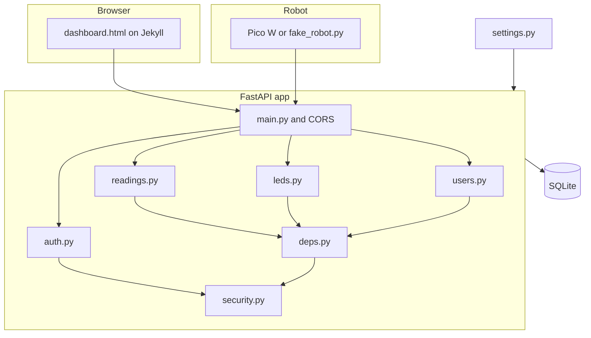

{:class="cover"}

---

By the end of this lesson you will be able to describe how every part of the Robot Telemetry API fits together, and choose what to build or learn next.

## What you built

Well done makers, you now have a real, protected web API. Here is the whole project, file by file:

| File | Job | Lesson |
|---|---|---|
| `main.py` | Creates the app, lifespan, CORS and plugs in the routers | 2, 5, 8 |
| `models.py` | Pydantic v2 models for readings, users, tokens and LED commands | 3, 5 |
| `db.py` | SQLite tables and the `get_db` dependency | 5 |
| `security.py` | Password hashing and signed tokens | 4, 6 |
| `deps.py` | `CurrentUser` and `AdminUser` dependencies | 6 |
| `auth.py` | `/register` and `/token` | 6 |
| `readings.py`, `leds.py`, `users.py` | The robot's data, the robot's LEDs and user management | 3, 7 |
| `settings.py` | Secrets and options from the environment | 9 |
| `dashboard.html` | A static page that talks to the API | 8 |
{:class="table table-single"}

## The habits worth keeping

- **Validate at the edge.** Pydantic models and `Annotated` rules stop bad data before your code sees it.
- **Separate input and output models,** so passwords and hashes cannot leak.
- **Hash passwords and sign tokens.** Never store or log the real password.
- **Let dependencies do the guarding.** `CurrentUser` and `AdminUser` keep routes short, and make forgetting a check hard.
- **Keep secrets in the environment.** Fail at start-up if they are missing.
- **Be narrow with CORS,** and use HTTPS everywhere outside your own desk.

> **Teachers**: This summary works well as a short review session of 30 to 45 minutes. Ask groups to explain one request, such as "a learner switches on the red LED", by tracing it through the files in the table above. Marking is easier if you ask for a diagram, not code.

## Where to go next

- Learn the data side properly in [Mastering Pydantic for Robust Data Validation](/learn/pydantic/)
- Go deeper on the database side in [Create Databases with Python and SQLite3](/learn/sqlite3/)
- Build the front end with [Building Websites with Jekyll](/learn/jekyll/)
- Package and run the API anywhere with the [Docker course](/learn/docker/)
- Put a real Pico W on the other end of the API with [Learn MicroPython - The basics](/learn/micropython/)
- Get comfortable on the Pi with [Introduction to the Linux Command Line on Raspberry Pi OS](/learn/linux_intro/)

The official [FastAPI documentation](https://fastapi.tiangolo.com/) has excellent guides on background tasks, WebSockets and testing, all of which suit robot projects.

## Try it Yourself

1. Write down the files a `PUT /leds/red` request passes through, in order, from the browser to the response.
2. Add a `GET /readings/summary` route returning the minimum, maximum and average value per sensor.
3. Use `TestClient` from `fastapi.testclient` to write a test that checks `POST /readings` with no token returns 401.
4. Challenge: add a WebSocket route so the dashboard gets new readings instantly, instead of polling every five seconds.

## Common Issues

- **Problem**: You are stuck and the error message does not help.
- **Solution**: Read the whole traceback from the bottom up, then try the failing route in `/docs`, where you see the exact request and response.
- **Why**: The last lines of a traceback name the real error, and `/docs` shows what the server received.

- **Problem**: Something that worked last week fails after upgrading packages.
- **Solution**: Pin versions in `requirements.txt` (as in lesson 9) and upgrade one package at a time.
- **Why**: Libraries change, and pinned versions let you tell which change broke you.

## Check your understanding


? Which file turns a token into the logged-in user?
- [ ] `models.py`
- [x] `deps.py`
- [ ] `settings.py`
> `get_current_user` in `deps.py` decodes the token and looks the user up. `security.py` only checks the token itself.

? Which is the safest place for the secret key?
- [ ] A constant in `security.py`
- [x] An environment variable or a `.env` file that is not committed
- [ ] The dashboard page
> Anything in the source or the page can be read by other people, and a leaked secret lets them forge tokens.

? A robot sends a valid token for a user who has since been deleted. What happens?
- [x] It gets a 401, because `get_current_user` looks the user up on every request
- [ ] It keeps working until the token expires
- [ ] The server crashes
> The user lookup happens on every request, so deleting a user cuts off their tokens straight away.

