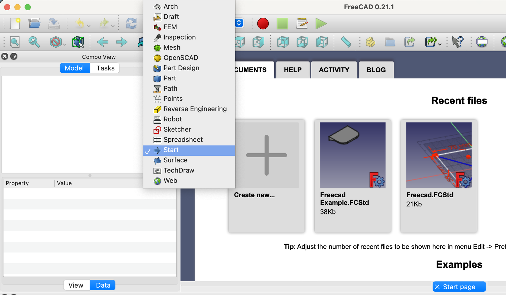
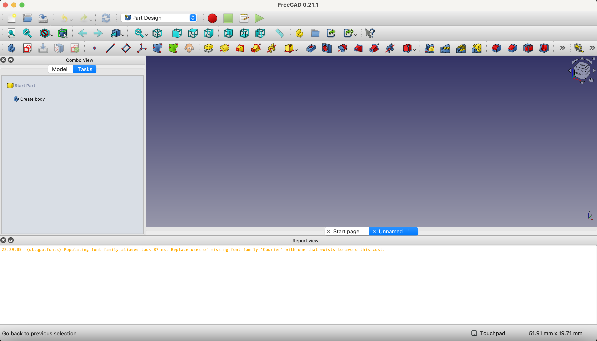
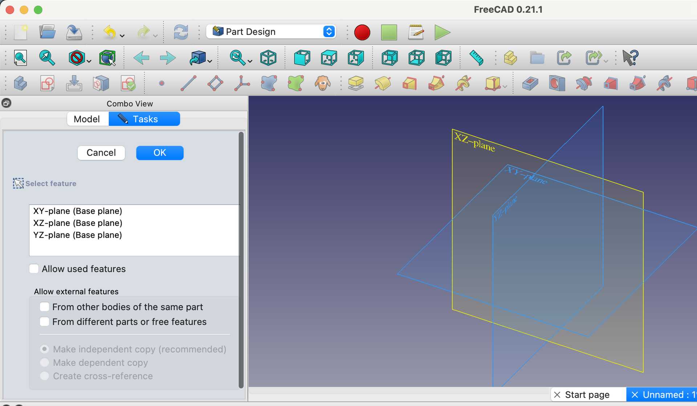
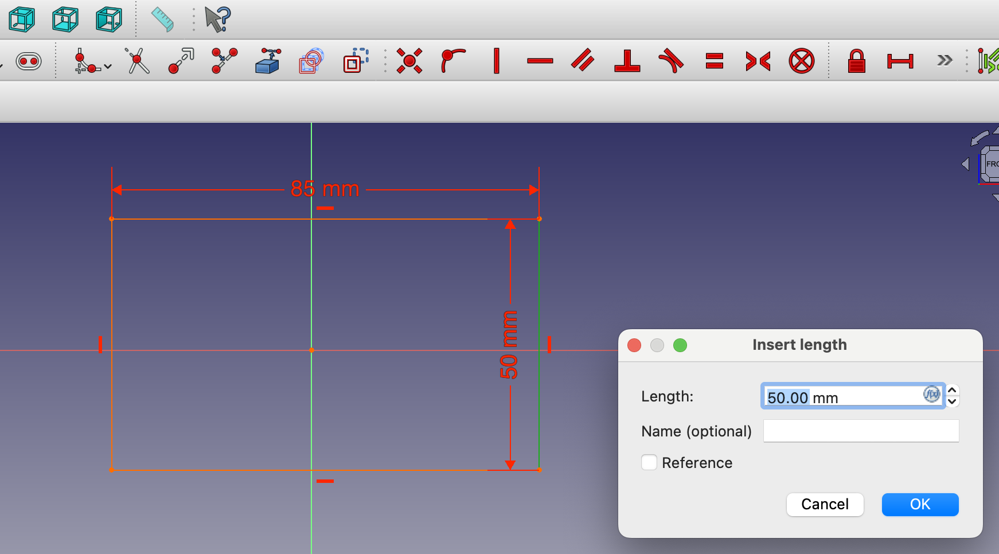

{:class="cover"}

---

By the end of this lesson you will be able to explain what FreeCAD and parametric modeling are, and name the main parts of the FreeCAD window.

In this video I design a SMARS robot chassis in FreeCAD. It shows where this course is heading.



Ahoy there makers! If you want to build robots, you need to design the parts. FreeCAD is a free, open-source way to do exactly that, and in this course we'll learn it step by step.

> **Teachers**: This course suits ages 11 and up, working alone or in pairs. Each lesson takes about 45 to 60 minutes, so plan one lesson per session. Each learner needs a computer that can run FreeCAD and a mouse with a scroll wheel. If installing is not allowed on your machines, ask IT early (see the installing lesson). Without any software, learners can still read the lessons and sketch designs on paper. A 3D printer is only needed for the optional last step of the exporting lesson.

---

## Overview

FreeCAD is an open-source parametric 3D modeler made to design real-life objects of any size. Parametric modeling means the model remembers how you built it, so you can go back into its history and change a number, such as a hole diameter, and the model updates.

This course takes you from opening FreeCAD for the first time to exporting a model you can 3D print. When you want to put it into practice on a real robot, carry on with [Building SMARS with FreeCAD](/learn/freecad_smars/).

---

## Course Content

- Installing FreeCAD and finding your way around
- Creating and moving basic shapes
- Modifying objects and using Boolean operations
- Assemblies and technical drawings
- Checking, exporting and sharing models for 3D printing
- Practical examples and good habits

---

## Key Results

After completing this course, you will:

- Describe what parametric modeling is and why it helps
- Navigate the FreeCAD interface and change the view
- Build a simple model from boxes, cylinders, spheres and cones
- Combine and cut shapes with Fuse, Cut and Common
- Export a model as STL for 3D printing

---

## What you'll need

- A computer running Windows, macOS or Linux
- FreeCAD, free from the FreeCAD website (we install it in the next lesson)
- A mouse with a scroll wheel
- Optional, a 3D printer for the final export step

---

## How the course works

Each lesson teaches one idea, then gives you a short "Try it Yourself" exercise, a list of common problems, and a quick quiz. Tool names are shown in `code style`. FreeCAD changes between versions, and version 1.0 (released in late 2024) renamed and moved some things, so if a button is not exactly where we say, look for the same name in the menus. Prefer a project to follow? [Building SMARS with FreeCAD](/learn/freecad_smars/) builds a real robot chassis.

---

## Workspaces

Open FreeCAD and notice that it has different workspaces (also called workbenches) for different jobs.

> ### Workspaces
>
> {:class="img-fluid w-100 rounded-3 shadow-lg"}
>
> Workspaces are collections of tools and commands that are grouped together for specific tasks. For example, the Part Design workspace is used for creating mechanical parts.
> Choose the 'Part Design' workspace and explore the tools available.

---

## Brief History

FreeCAD began in 2002 and is developed by a community of users and developers. Because it is open source it keeps evolving, and it is used in engineering, architecture and product design.

---

## Key Features of FreeCAD

- **Modular Architecture:** You can customize it to add or remove features.
- **Sketcher:** It has a powerful sketcher to draw 2D shapes.
- **Many workbenches:** Separate workbenches cover areas such as part design, technical drawings, architecture and simulation. The exact list depends on your version.

---

## Visual Tour

Here are some screenshots to guide you through the main areas of the FreeCAD interface.

{:class="img-fluid w-100 rounded-3 shadow-lg"}

{:class="img-fluid w-100 rounded-3 shadow-lg"}

{:class="img-fluid w-100 rounded-3 shadow-lg"}

---

## Why Use FreeCAD?

- **Accessibility:** It's free and open-source, so there is nothing to pay for at home or in school.
- **Community:** A large community offers tutorials, forums and shared projects.
- **Parametric:** Change a dimension later and the model follows, which is perfect when a robot part does not quite fit the first time.

---

## Practical Applications

- **Engineering:** Used for creating mechanical parts and assemblies.
- **Architecture:** Helps in designing architectural layouts with precision.
- **Robotics:** Chassis, brackets and wheels that you then 3D print.

---

## Get Involved

Join the FreeCAD forum to connect with other users and expand your learning: [FreeCAD Community Forums](https://forum.freecad.org/)

---

## Try it Yourself

1. Open FreeCAD and use the workspace selector to switch to three different workspaces. Notice how the toolbars change.
2. Find the workspace called Part Design and list three tools you can see.
3. Challenge: think of a robot part you would like to design, and write down its rough size in millimetres.

---

## Common Issues

- **Problem**: A workspace I expect is missing from the selector.
- **Solution**: Check your FreeCAD version and look in the menus for a similar name.
- **Why**: Workspace names and the default list change between FreeCAD versions.

---

## Check your understanding


? What does "parametric" mean in FreeCAD?
- [ ] The model can only be viewed, not edited
- [x] The model remembers how it was built, so you can change its parameters later
- [ ] The model is made of paper
> Parametric modeling lets you go back into the model history and change a number.

? What is a workspace (workbench)?
- [x] A collection of tools grouped for a specific task
- [ ] A folder on your computer
- [ ] A type of 3D printer
> Workspaces group tools for jobs such as part design.

? Why is FreeCAD a good choice for a school or hobby project?
- [ ] It only works with one type of printer
- [x] It is free and open source
- [ ] It cannot export files
> It costs nothing and has a large community.


---

## Additional Resources

- [Getting Started with FreeCAD](https://wiki.freecad.org/Basic_Part_Design_Tutorial)
- [FreeCAD YouTube Channel for Beginners](https://www.youtube.com/user/FreeCADHowTos)
