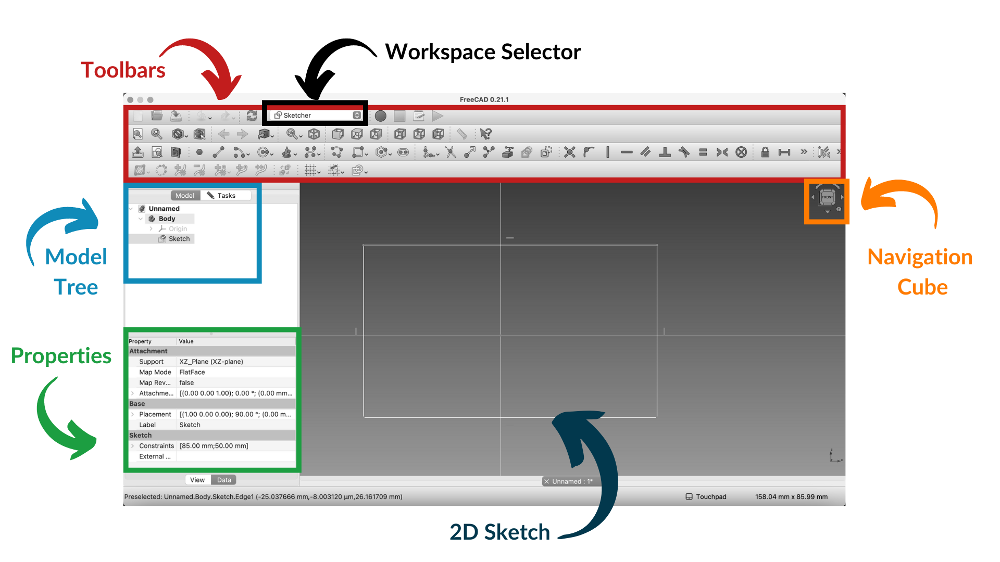

{:class="cover"}

By the end of this lesson you will be able to name the main areas of the FreeCAD window and change the view of a model.

## Welcome to the FreeCAD Interface

Understanding the layout of the FreeCAD interface is essential for efficient modeling. Think of it like learning where everything lives in your workshop before you start building. Interface names can differ slightly between FreeCAD versions, so match what you see on screen with the descriptions below.

---

## Exploring the Main Elements

{:class="img-fluid w-100"}

1. **Workspace Selector:**
   - This is where you can switch between different workspaces tailored for specific tasks like drafting, modeling, or analysis.

2. **Toolbars and Commands:**
   - The toolbars change with the workspace, so a Part toolbar and a Draft toolbar look different.

3. **Property Editor:**
   - This area displays the properties of the selected object (called the Property view in some versions), allowing you to make precise adjustments such as a box's length, width and height.

4. **Navigation Cube:**
   - A small, interactive cube that helps with orienting the view of your model in the workspace. Click its faces to jump to front, top or side views.

---

## Navigating the Interface

- **Zoom, Pan, and Rotate:** Practise these essential controls to view your models from different angles. Which mouse buttons do what depends on the navigation style in your preferences, so check the style you have chosen.
- **Standard Views:** With the 3D view selected, the number keys give quick views: 0 is isometric, 1 is front, 2 is top and 3 is right. Use these to check a model from every side.

---

## Customizing the Interface

- **Adjusting Toolbars:** Customize which tools are visible and how they are arranged to streamline your workflow.
- **Setting Preferences:** Modify preferences to suit your design habits, including unit display and default file locations.
- **Saving your work:** FreeCAD files end in `.FCStd`. Press Ctrl+S early and often.

---

### Mini-Tasks

- Rearrange your toolbar to better suit the way you work.
- Try changing the interface theme in the preferences (the available themes depend on your version).

---

## Try it Yourself

1. Open FreeCAD and find all four areas listed above. Point to each one.
2. Press the number keys 0 to 3 over the 3D view and note what each view shows.
3. Challenge: create a simple sketch using the tools from a toolbar you have customized, then save it as a `.FCStd` file.

---

## Common Issues

- **Problem**: The Property editor or model tree is missing.
- **Solution**: Look in the View menu for a Panels entry and switch the panel back on.
- **Why**: Panels can be closed by accident and the menu brings them back.

- **Problem**: Mouse rotation feels backwards.
- **Solution**: Change the navigation style in the preferences.
- **Why**: Each style maps the mouse buttons differently.

---

## Check your understanding


? Which part of the interface shows the dimensions of the selected object?
- [ ] Navigation cube
- [x] Property editor
- [ ] Workspace selector
> The Property editor displays the properties of the selected object.

? What does the navigation cube help you do?
- [x] Orient the view of your model
- [ ] Save the file
- [ ] Install add-ons
> It is a small interactive cube for changing the view.

? What file extension does FreeCAD use for its own files?
- [ ] `.stl`
- [x] `.FCStd`
- [ ] `.pdf`
> FreeCAD saves native files as `.FCStd`.


---

## Additional Resources

- [Detailed Guide to the FreeCAD Interface](https://wiki.freecad.org/Interface)
- [Customizing FreeCAD](https://wiki.freecad.org/Interface_Customization)
