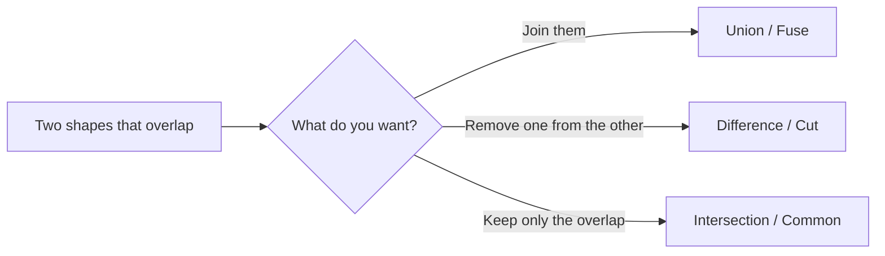

{:class="cover"}

By the end of this lesson you will be able to choose between Union, Difference and Intersection, and use them to build a simple toolbox.

## Introduction to Boolean Operations

Boolean operations are fundamental in CAD modeling for creating complex forms by combining simpler ones. In FreeCAD, you can use them to merge, cut and intersect 3D shapes. Think of a hole in a robot chassis: you do not draw a hole, you subtract a cylinder from a box. Menu names vary a little by version (Fuse, Cut and Common are the Part workbench names).

---

## Understanding Boolean Tools

1. **Union (Fuse):**
   - Combines two or more objects into one continuous shape, merging their volumes.

2. **Difference (Cut):**
   - Subtracts the volume of one object from another, useful for creating holes or slots. Select the shape to keep first, then the shape to remove, then apply the operation. If the result is wrong, you picked them the wrong way round.

3. **Intersection (Common):**
   - Generates a shape from the overlapping volume of two objects, useful for creating complex matched interfaces.

---

## Practical Application of Boolean Operations

### Example Project: A Simple Toolbox

- **Objective:** Use Boolean operations to build a toolbox from simple shapes.
- **Components:**
  - Base box for the body.
  - Smaller boxes for compartments, and a cylinder for the handle.

---

### Steps to Create the Toolbox

1. **Create the Base:**
   - Use the `Box` tool to create the main body of the toolbox.

2. **Add Compartments:**
   - Create smaller boxes that sit inside the main box and poke slightly above its top.
   - Use `Difference` to cut them out of the body. Each cut leaves an empty compartment.

3. **Form the Handle:**
   - Create a cylinder for the handle and lay it across the top of the toolbox.
   - Use `Union` to fuse it to the body.

4. **Refine the Design:**
   - Use `Intersection` on a copy if you want to trim a shape to a matching size, then fuse the finished parts.

---

## Try it Yourself

1. Make a box and cut a cylinder hole through it using `Difference`.
2. Make two overlapping spheres and compare the result of Union and Intersection.
3. Challenge: design a birdhouse with an entrance hole and a perch, using only boxes, cones and cylinders.

---

## Common Issues

- **Problem**: Difference removed the wrong shape.
- **Solution**: Undo, then select the shape to keep first and the cutting shape second.
- **Why**: The first selected shape is the one that stays.

- **Problem**: A cut leaves a thin paper-like skin.
- **Solution**: Make the cutting shape stick out past the face you are cutting through.
- **Why**: Faces that exactly line up can cause errors or leftover slivers.

---

## Check your understanding


? Which Boolean operation makes a hole?
- [ ] Union
- [x] Difference
- [ ] Placement
> Difference subtracts one shape's volume from another.

? Which operation keeps only the overlapping volume?
- [ ] Union
- [x] Intersection
- [ ] Difference
> Intersection (Common) keeps what the shapes share.

? In a Difference, which shape do you select first?
- [x] The shape you want to keep
- [ ] The cutter
- [ ] Either one
> The first selected shape is kept and the second is removed.


---

## Additional Resources

- [FreeCAD Documentation on Boolean Operations](https://wiki.freecad.org/Part_Boolean)
- [Step-by-Step Video Tutorials on Boolean Operations in FreeCAD](https://www.youtube.com/results?search_query=freecad+boolean+operations+tutorial)
