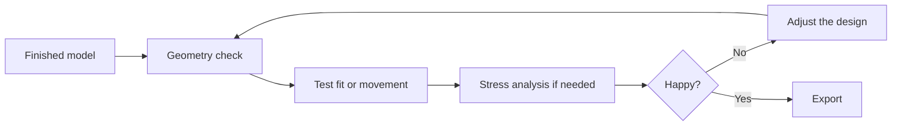

{:class="cover"}

By the end of this lesson you will be able to check a model for geometry problems and describe how you would test a part before printing it.

## Introduction to Local Testing

Testing a model on screen is much cheaper than printing it and finding out it does not fit. This lesson covers the kinds of checks FreeCAD offers. Workbench and tool names vary by version, and some tools (such as rendering) may need an add-on.

---

## Key Testing Tools in FreeCAD

1. **Simulation Tools:**
   - FreeCAD includes the FEM (Finite Element Method) workbench for stress analysis.

2. **Rendering and Visualization:**
   - Rendering shows your model with realistic lighting and materials. In some versions this is an add-on you install separately.

3. **Model Checking and Validation:**
   - Use the built-in geometry checking tool to find errors such as invalid shapes or self-intersecting faces.

---

## Steps to Test a Model

### Example Project: Verifying a Mechanical Joint

- **Component:** A hinge mechanism.

---

### Testing Process

1. **Geometry Check:**
   - Run a geometry check to ensure all parts are valid and fit together without overlaps or gaps that are not part of the design.

2. **Movement Test:**
   - Move the hinge through its range to check the motion is smooth and clear of collisions.

3. **Stress Analysis:**
   - Use the FEM workbench to look at how the hinge copes under expected loads. This takes more setup than the other checks, so treat it as an advanced step.

4. **Adjustments:**
   - Based on the results, adjust the design and run the checks again.

---

## Practical Exercise: Building and Testing a Gearbox

- **Objective:** Construct a gearbox assembly and run a series of checks.
- **Steps:**
  - Assemble the gearbox using the skills learned in previous lessons.
  - Check for geometric accuracy.
  - Test that the gears mesh correctly without misalignment.

---

## Try it Yourself

1. Run the geometry check on a model you built earlier and read the result.
2. Move one part of a hinge to see where it collides, then fix it by adding a gap of 0.5 mm.
3. Challenge: write a short checklist of your own tests to run before every print.

---

## Common Issues

- **Problem**: The geometry check reports errors on a Boolean result.
- **Solution**: Undo the last operation and make the shapes overlap clearly rather than just touching.
- **Why**: Shapes that only share an edge or face can produce invalid geometry.

- **Problem**: Parts fit on screen but not after printing.
- **Solution**: Add a small clearance between moving parts.
- **Why**: A 3D printer is never perfectly exact, so parts need a little room.

---

## Check your understanding


? Which workbench is used for stress analysis?
- [ ] TechDraw
- [x] FEM
- [ ] Draft
> The lesson names the FEM workbench for stress analysis.

? Why add clearance between moving parts?
- [x] Printers are not perfectly exact
- [ ] It saves filament
- [ ] It changes the file format
> A little room stops parts jamming after printing.

? What does a geometry check look for?
- [ ] Spelling mistakes
- [x] Errors such as invalid shapes or self-intersecting faces
- [ ] Missing colours
> It validates the geometry.


---

## Additional Resources

- [FreeCAD FEM Workbench Guide](https://wiki.freecad.org/FEM_Workbench)
- [FreeCAD community forums](https://forum.freecad.org/)
