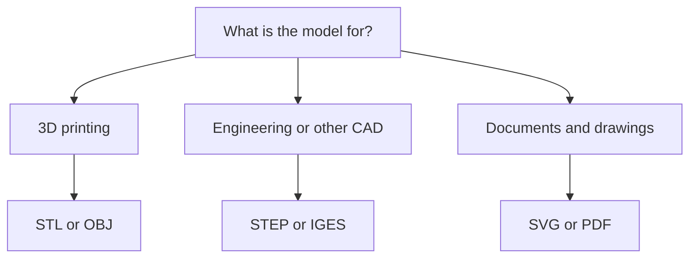

{:class="cover"}

By the end of this lesson you will be able to pick the right export format for a job and export a model as STL for 3D printing.

> **Teachers**: 3D printing is slow, so book printer time in advance. Even a small part can take an hour or more, so print only one or two chosen designs per class rather than one per learner. Printers have hot nozzles and moving parts, so learners should not touch a printer while it runs and an adult should supervise. Also agree a way for learners to hand in the exported files, and check that file sharing is allowed on the school network.

## Introduction to Exporting and Sharing

Exporting is how your design leaves FreeCAD and becomes a printed robot part, a file for a friend, or a picture for your documentation.

---

## Key Export Formats

1. **STL and OBJ:**
   - Commonly used for 3D printing. These formats describe the model's surface only.

2. **STEP and IGES:**
   - Suitable for professional engineering, where precise geometry is necessary, and for opening your model in other CAD software.

3. **SVG and PDF:**
   - Best for documentation, as they are ideal for 2D representations such as technical drawings.

---

## Preparing Your Model for Export

1. **Check Geometry:**
   - Make sure there are no errors in your model (see the previous lesson).

2. **Simplify Design:**
   - Reduce complexity where possible to keep file sizes small.

3. **Select what to export:**
   - Click the object (or objects) in the model tree before exporting, otherwise unwanted helper objects may come along.

---

## Steps to Export a Model

### Example Project: Exporting a Customized Gear

---

### Export Process

1. **Select the object** in the model tree.

2. **Export the Model:**
   - Use the File menu's export option, then choose the format (such as STL) from the file type list and pick a name and folder.

3. **Verify the Export:**
   - Open the exported file in a viewer or your 3D printer's slicing software to ensure it appears as intended and at the right size.

For viewing in a web browser, FreeCAD may offer a web-based (WebGL) export in some versions. Check the list of export types in your version. The 3MF format is another mesh format used for printing, not for web viewing.

---

## Practical Exercise: Exporting for Different Applications

- **Objective:** Prepare and export a previously designed model for different uses.
- **Steps:**
  - Export it as STL for 3D printing.
  - Export it as STEP and check that another program can open it.

---

## Try it Yourself

1. Export a box as an STL file and note the file size.
2. Open the STL in a viewer or slicer and check the dimensions match your design.
3. Challenge: export the same model as STEP and compare the two files.

---

## Common Issues

- **Problem**: The STL is huge or very tiny when opened in the slicer.
- **Solution**: Check the units in FreeCAD and the slicer.
- **Why**: A unit mismatch, such as millimetres versus metres, changes the size.

- **Problem**: The export contains extra objects.
- **Solution**: Select only the final object before exporting.
- **Why**: Exports include whatever is selected, or everything if nothing is.

---

## Check your understanding


? Which format is commonly used for 3D printing?
- [ ] PDF
- [x] STL
- [ ] SVG
> STL and OBJ are the printing formats in this lesson.

? Which format is best for sharing precise geometry with other CAD programs?
- [x] STEP
- [ ] STL
- [ ] SVG
> STEP and IGES keep precise geometry.

? What should you do before exporting?
- [ ] Close FreeCAD
- [x] Select the final object in the model tree
- [ ] Delete the sketch
> Selecting the object avoids exporting extra items.


---

## Additional Resources

- [Guide to Exporting Models in FreeCAD](https://wiki.freecad.org/Export_to_other_file_formats)
- [Tips for Preparing Models for 3D Printing](https://wiki.freecad.org/3D_printing)
