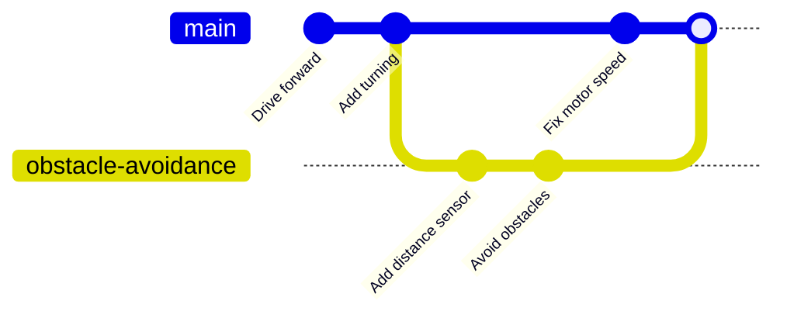

## The problem Git solves

Imagine you're writing the code for a two-wheeled robot. It drives forward nicely. You add obstacle avoidance, and now it just spins on the spot. What did you change? Which version worked? If you're lucky you made a copy first. If you're like most of us, you didn't.

People usually invent their own version control without realising it:

```text
robot.py
robot_old.py
robot_v2.py
robot_v2_working.py
robot_final.py
robot_final_FIXED.py
```

This works until it doesn't. You can't tell what's different between the files, why you made each change, or which one is actually the latest.

---

## What Git does

**Git is a version control system.** It keeps a complete history of your project in a hidden folder, and lets you:

* **Save snapshots** of your whole project whenever you reach a good point
* **See what changed** between any two snapshots, line by line
* **Go back** to any earlier snapshot
* **Try ideas safely** on a separate branch, without touching the working version
* **Share and sync** your project with other people and other computers

You keep just one `robot.py`. Git remembers every version of it for you.

---

## The key words

Git has some vocabulary that's worth learning now, because you'll see it everywhere.

**Repository (or "repo")**: a project folder that Git is tracking. It holds your files plus a hidden `.git` folder where Git stores the history.

**Commit**: a snapshot of your project at a moment in time. Each commit records which files changed, a message saying why, who made it, and when. Commits are the "save points" of your project.

**Branch**: a separate line of commits. The main line is usually called `main`. You can create a branch to work on something new, and merge it back when it's ready.

**Remote**: a copy of your repository somewhere else, usually on a website such as GitHub. You *push* your commits to it and *pull* other people's commits from it.

Here's a picture of a small project's history. Each circle is a commit, and time flows from left to right:



The robot's obstacle avoidance was built on its own branch while a motor fix went onto `main`, and then the two were joined back together. You'll be doing exactly this by module 9.

---

## Git is not GitHub

This trips up almost everyone at first.

* **Git** is the program that runs on your computer and tracks your files. It works completely offline and doesn't need an account.
* **GitHub** is a website that hosts Git repositories online, so you can back them up, share them and work with other people. [GitLab](https://gitlab.com), [Bitbucket](https://bitbucket.org) and [Codeberg](https://codeberg.org) do the same job.

You can use Git for years without ever touching GitHub. But once you have commits, putting them on GitHub takes one command, and it's how most open source projects (including the code for this website) are shared.

---

## Why makers love Git

* **Fearless experimenting**: break things on a branch, and your working code is still safe on `main`.
* **A project diary**: your commit messages tell the story of the build, which is brilliant when you come back to a project months later.
* **Easy sharing**: put your robot's code on GitHub and anyone can download it with one command.
* **Multiple machines**: write code on your laptop, push it, and pull it onto your Raspberry Pi.
* **It's not just for code**: Git happily tracks Markdown notes, config files, KiCad and FreeCAD projects, and documentation. It works best with text files, because it can show you exactly which lines changed.

---

## Try it yourself

Have a look at a real Git project on GitHub, for example the [MicroPython repository](https://github.com/micropython/micropython). Find the **commits** link near the top of the file list and click it. Each entry is a commit: notice the message, the author and the date. Click one to see the exact lines that changed.

---

## Check your understanding


? What is a commit?
- [ ] A file that has been deleted
- [x] A saved snapshot of your project, with a message describing the change
- [ ] A copy of your project on GitHub
> Commits are save points. Each one records what changed, who changed it, when, and why.

? Which statement about Git and GitHub is true?
- [ ] You need a GitHub account to use Git
- [ ] Git and GitHub are two names for the same thing
- [x] Git runs on your computer; GitHub is a website that hosts Git repositories
> Git works entirely offline. GitHub is one of several places you can store a copy of a repository online.

? Where does Git store the history of a repository?
- [ ] On GitHub's servers
- [x] In a hidden `.git` folder inside the project
- [ ] In your home folder
> Everything Git knows about your project lives in the `.git` folder. Delete it and the history is gone, but your files stay.


---
