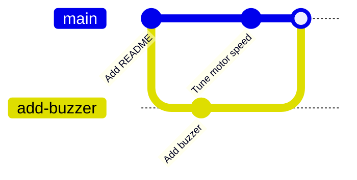

## Merging a branch

Your `obstacle-avoidance` branch works. Time to bring it into `main`. Merging always works the same way: **switch to the branch you want to merge into**, then merge the other branch in.

```bash
git switch main
git merge obstacle-avoidance
```

```text
Updating 9d3f6a8..4e8a1c2
Fast-forward
 sensor.py | 14 ++++++++++++++
 1 file changed, 14 insertions(+)
 create mode 100644 sensor.py
```

`sensor.py` is now on `main`. Delete the branch, since its work is done:

```bash
git branch -d obstacle-avoidance
```

---

## Fast-forward or merge commit?

You'll see two kinds of merge.

**Fast-forward**: if `main` hasn't changed since you made the branch, Git simply slides the `main` label forward to the branch's latest commit. No new commit is needed. That's what happened above.

**Merge commit**: if both branches have new commits, Git combines them and makes a special **merge commit** with two parents:



When this happens, Git opens your editor with a message like `Merge branch 'add-buzzer'`. Just save and close it.

---

## Merge conflicts

Most of the time Git merges automatically, even when both branches changed the same file, as long as they changed different lines. But if both branches changed **the same lines**, Git can't know which version you want. That's a **merge conflict**, and you have to choose.

Conflicts sound scary but they're completely normal. Let's make one on purpose.

On `main`, set the robot's speed. Add this line to the end of `main.py`, then commit:

```python
SPEED = 50
```

```bash
git commit -am "Set speed to 50"
```

(`-a` stages every tracked file that has changed, so you can skip `git add`. It doesn't add new, untracked files.)

Now make a branch from the commit *before* that one, and change the same line differently:

```bash
git switch -c faster HEAD~1
```

Add `SPEED = 80` to the end of `main.py` and commit:

```bash
git commit -am "Set speed to 80"
```

Now try to merge:

```bash
git switch main
git merge faster
```

```text
Auto-merging main.py
CONFLICT (content): Merge conflict in main.py
Automatic merge failed; fix conflicts and then commit the result.
```

---

## Fixing the conflict

Open `main.py`. At the end you'll find this:

```text
<<<<<<< HEAD
SPEED = 50
=======
SPEED = 80
>>>>>>> faster
```

Git has put both versions in the file between **conflict markers**:

* Between `<<<<<<< HEAD` and `=======` is the version from the branch you're on (`main`)
* Between `=======` and `>>>>>>> faster` is the version from the branch you're merging in

To fix it, edit the file so it looks exactly how you want, and **delete all three marker lines**. You can keep one side, the other, or write something new:

```python
SPEED = 65  # a compromise
```

Then tell Git it's fixed by staging the file, and commit:

```bash
git add main.py
git commit -m "Merge branch 'faster'"
```

That's it, conflict resolved. Run `git log --oneline --graph` to see the two lines of history joining together.

> ## Your editor can help
>
> VS Code highlights conflicts in colour and adds buttons above each one: **Accept Current Change**, **Accept Incoming Change** and **Accept Both Changes**. It's the same thing as editing by hand, just quicker.

---

## Getting out of a merge

If a merge goes wrong and you'd rather start again, cancel it:

```bash
git merge --abort
```

Everything goes back to how it was just before you ran `git merge`.

---

## Try it yourself

1. Merge `obstacle-avoidance` into `main` and delete the branch.
2. Create the `SPEED` conflict above and resolve it.
3. Create the conflict again with a new value, then cancel it with `git merge --abort`.
4. Challenge: make two branches that change **different** lines of `main.py`, merge both into `main` and notice there's no conflict.

---

## Common issues

- **Problem**: You committed the conflict markers by mistake, and now the code won't run
- **Solution**: Remove the `<<<<<<<`, `=======` and `>>>>>>>` lines, then commit again. Search for `<<<<<<<` before committing a merge.
- **Why**: Git trusts you when you run `git add`; it doesn't check the markers are gone.

- **Problem**: `error: Merging is not possible because you have unmerged files`
- **Solution**: Finish the merge in progress (fix the files, `git add`, `git commit`) or run `git merge --abort`.
- **Why**: You're still in the middle of an earlier merge.

- **Problem**: You merged the wrong way round
- **Solution**: Remember: switch to the branch that should **receive** the changes first, then `git merge <other-branch>`.
- **Why**: `git merge` always brings the named branch into the branch you're on.

---

## Check your understanding


? You want to bring the `add-display` branch into `main`. What do you run?
- [x] `git switch main` then `git merge add-display`
- [ ] `git switch add-display` then `git merge main`
- [ ] `git merge main add-display`
> Switch to the branch receiving the changes, then merge the other branch into it.

? When does a merge conflict happen?
- [ ] Every time you merge
- [ ] When two branches change different files
- [x] When two branches change the same lines in different ways
> Git merges different lines automatically. It only asks you when both sides changed the same lines.

? What tells Git you've finished fixing a conflict in `main.py`?
- [ ] Saving the file
- [x] `git add main.py`, then `git commit`
- [ ] `git merge --abort`
> Staging the file marks it as resolved. Committing completes the merge.


---
