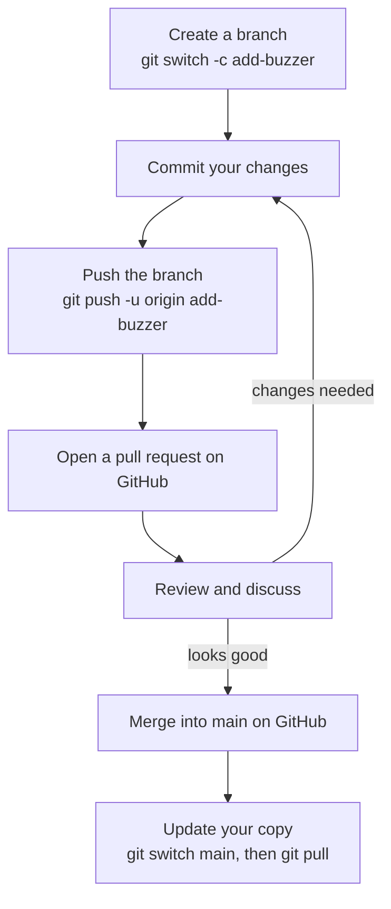

## Keeping copies in sync

Once your project lives on GitHub, there can be several copies of it: one on your laptop, one on your Raspberry Pi, and maybe some on your friends' computers. When someone pushes new commits, everyone else needs to bring them down. There are two commands for that:

* `git fetch` downloads new commits from the remote, but **doesn't change your files**
* `git pull` downloads new commits **and** merges them into your current branch

---

## git fetch: have a look first

```bash
git fetch
git status
```

```text
On branch main
Your branch is behind 'origin/main' by 2 commits, and can be fast-forwarded.
  (use "git pull" to update your local branch)
```

`origin/main` is your computer's record of where `main` is on GitHub. Fetching updates it. You can see what's new before you take it:

```bash
git log --oneline main..origin/main
```

```text
f2b9d31 (origin/main) Add OLED display
a87c5e0 Show distance on screen
```

That means "commits on `origin/main` that aren't on my `main`".

---

## git pull: bring them in

```bash
git pull
```

```text
Updating c7d2e19..f2b9d31
Fast-forward
 display.py | 22 ++++++++++++++++++++++
 main.py    |  4 +++-
 2 files changed, 25 insertions(+), 1 deletion(-)
```

Your files now include the new commits. `git pull` is really just `git fetch` followed by `git merge origin/main`, so everything you learned about merging, including conflicts, applies here too.

> ## Pull before you start
>
> Make it a habit: **pull when you sit down to work, and push when you finish.** The more often you sync, the smaller and rarer conflicts are.

---

## When both sides have new commits

If you've committed on your laptop **and** someone else has pushed to GitHub, your histories have split. Your push gets rejected:

```text
 ! [rejected]        main -> main (fetch first)
error: failed to push some refs to 'https://github.com/your-username/pico-bot.git'
hint: Updates were rejected because the remote contains work that you do not
hint: have locally.
```

The fix is to pull first, so Git can combine the two, and then push:

```bash
git pull
git push
```

Recent versions of Git may stop and ask how you want to combine the branches:

```text
fatal: Need to specify how to reconcile divergent branches.
```

Tell Git once to use a normal merge, which is what this course teaches:

```bash
git config --global pull.rebase false
```

Then run `git pull` again. (*Rebase* is a different way of combining branches that rewrites your commits on top of the new ones. It's worth learning later, but you don't need it now.)

---

## Pull requests

When people work together on GitHub, they usually don't push straight to `main`. Instead they use a **pull request** (or PR): a request to merge one branch into another, with a page where people can see the changes, discuss them and suggest fixes before anything is merged.

Here's the flow:



After you push a branch, GitHub shows a **Compare & pull request** button on the repository page. Click it, write a short description of what you changed and why, and click **Create pull request**. When it's merged, switch back to `main` and pull so your copy has the merged code.

Pull requests are useful even on your own projects: they give you one tidy page per feature, showing everything that changed.

---

## Contributing to someone else's project

You can't push to other people's repositories. Instead you **fork** it: click **Fork** on GitHub to make your own copy under your account. Clone your fork, make a branch, commit, push it to your fork, and open a pull request back to the original project. That's how almost all open source contributions work.

---

## Try it yourself

1. Edit `README.md` directly on GitHub (click the file, then the pencil icon) and commit it there.
2. On your computer, run `git fetch` and `git status`. Then `git pull`.
3. Create a branch, commit a change, push it, and open a pull request on your own repository. Merge it on GitHub, then pull `main` locally.
4. Challenge: edit the same line of `README.md` on GitHub and locally, commit both, then `git pull`. Resolve the conflict and push.

---

## Common issues

- **Problem**: `fatal: Need to specify how to reconcile divergent branches.`
- **Solution**: Run `git config --global pull.rebase false`, then `git pull` again.
- **Why**: Git wants you to choose between merging and rebasing when both sides have new commits.

- **Problem**: `git pull` reports a merge conflict
- **Solution**: Fix it exactly as in module 9: edit the file, remove the markers, `git add`, `git commit`, then `git push`.
- **Why**: Your commits and the remote's commits changed the same lines.

- **Problem**: `There is no tracking information for the current branch`
- **Solution**: Run `git push -u origin <branch-name>` once, or `git branch --set-upstream-to=origin/<branch-name>`.
- **Why**: Git doesn't know which remote branch your local branch goes with.

---

## Check your understanding


? What's the difference between `git fetch` and `git pull`?
- [ ] There is no difference
- [x] `fetch` only downloads new commits; `pull` downloads and merges them into your branch
- [ ] `fetch` uploads commits; `pull` downloads them
> `git pull` is `git fetch` followed by a merge.

? Your `git push` is rejected because the remote has work you don't have. What do you do?
- [ ] Delete the repository on GitHub and push again
- [x] `git pull`, fix any conflicts, then `git push`
- [ ] Run `git push` again until it works
> Pulling combines the remote's commits with yours, then your push can go through.

? What is a pull request?
- [ ] A command that downloads code
- [x] A request on GitHub to merge one branch into another, with a page for reviewing the changes
- [ ] A way to delete a branch
> Pull requests let people see, discuss and approve changes before they're merged.


---
