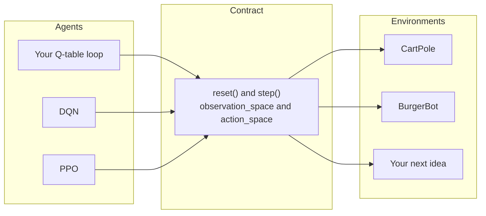

{:class="cover"}

---

By the end of this lesson you will be able to explain what a standard environment API is for, and tell old OpenAI Gym code from current Gymnasium code.

---

## What you built last time

In the previous course you wrote a `GridWorld` class with a small set of methods, and a training loop that talked to it:

```python
world = GridWorld()
state = world.reset()
state, reward, done = world.step(action)
```
{: .no-snakie }

That was deliberate. By coding every line yourself, the obstacle check, the sensor and the reward function, you could see exactly where each number came from.

The downside is that your agent and your environment are tangled together. Try a different algorithm and you may rewrite the training loop. Swap the grid for a simulated arm and you rewrite the loop again. Nobody else's code can plug into yours either, because nobody else's `GridWorld` returns the same three values in the same order.

## What a standard API buys you

A standard API is a contract. As long as both sides follow the same rules, either side can be swapped without the other noticing.



With Gymnasium the contract looks like this:

```python
obs, info = env.reset()
obs, reward, terminated, truncated, info = env.step(action)
```
{: .no-snakie }

Any environment that provides those two methods, plus an `observation_space` and an `action_space`, can be used by any agent that expects the same interface. In practice that means you can train DQN on CartPole today and on BurgerBot tomorrow by changing one line, and you can swap DQN for PPO without touching the environment. The contract separates the problem (the environment) from the solution (the algorithm).

## A brief history: Gym to Gymnasium

OpenAI released Gym in 2016 as an open-source toolkit for comparing reinforcement learning algorithms. For years, any RL tutorial you found started with `import gym`.

Active development of Gym then wound down. Its last big release, 0.26, changed the API: `reset()` started returning `(observation, info)` and `step()` started returning five values, with the single `done` flag split into `terminated` and `truncated`. The [Farama Foundation](https://farama.org/), a non-profit that looks after open RL tools, took over the project and continued it as **Gymnasium**. Gymnasium 1.0 followed in 2024, and the library is still maintained.

> **Note**: If you see an older tutorial with `import gym`, `obs = env.reset()` or `obs, reward, done, info = env.step(a)`, it targets the old API. The code usually needs only small changes, and you will learn them over the next few lessons.

## What Gymnasium is, and is not

Gymnasium defines the interface and ships a set of classic environments such as CartPole and MountainCar. It does not include:

- **Learning algorithms**. Those come from libraries such as Stable-Baselines3, CleanRL or RLlib.
- **Heavy physics engines**. Some Gymnasium environments need an extra package, such as Box2D or MuJoCo, installed separately.
- **Multi-agent support**. Farama's PettingZoo library covers that.

Think of Gymnasium as the standard for plugs and sockets. It does not do the computing; it makes sure every piece fits together.

## The Farama family

- **Gymnasium**: the core API and classic environments
- **PettingZoo**: multi-agent environments
- **Minari**: datasets of recorded trajectories for offline RL
- **Shimmy**: compatibility wrappers for third-party environments

You will spend this course in the first of those, plus Stable-Baselines3, which is a separate project that uses Gymnasium.

## Try it Yourself

1. Which parts of your old `GridWorld` class would change if the grid became 10 by 10? List them. Then list which parts of the Q-learning training loop would change. The second list should be shorter.
2. Look at the environments listed at [gymnasium.farama.org](https://gymnasium.farama.org/). Pick one you find interesting and find out what its observation space and action space are.
3. Find an old Gym tutorial online and mark every line that would break under Gymnasium. Write down the new version of each.

## Common Issues

- **Problem**: A tutorial says `import gym` and your code fails with `ValueError: too many values to unpack`.
- **Solution**: Use `import gymnasium as gym` and unpack five values from `step()` and two from `reset()`.
- **Why**: The old library returned four values from `step()` and one from `reset()`. The packages are separate: installing `gymnasium` does not install `gym`.

## Check your understanding


? What is the main benefit of a standard environment API?
- [ ] It makes the environment run faster
- [x] Any compatible agent can be used with any compatible environment
- [ ] It removes the need for a reward function
> The contract separates the environment from the algorithm, so either can be swapped without rewriting the other.

? Which project maintains Gymnasium today?
- [ ] OpenAI
- [x] The Farama Foundation
- [ ] Stable-Baselines3
> Farama took over the project from Gym and continued it as Gymnasium.

? What does Gymnasium itself NOT provide?
- [ ] A common interface for environments
- [x] Learning algorithms such as DQN and PPO
- [ ] Classic environments such as CartPole
> Algorithms come from other libraries, such as Stable-Baselines3.

? Which line is the old Gym style of calling step?
- [x] `obs, reward, done, info = env.step(a)`
- [ ] `obs, reward, terminated, truncated, info = env.step(a)`
> Four return values is the old API. Gymnasium returns five.

