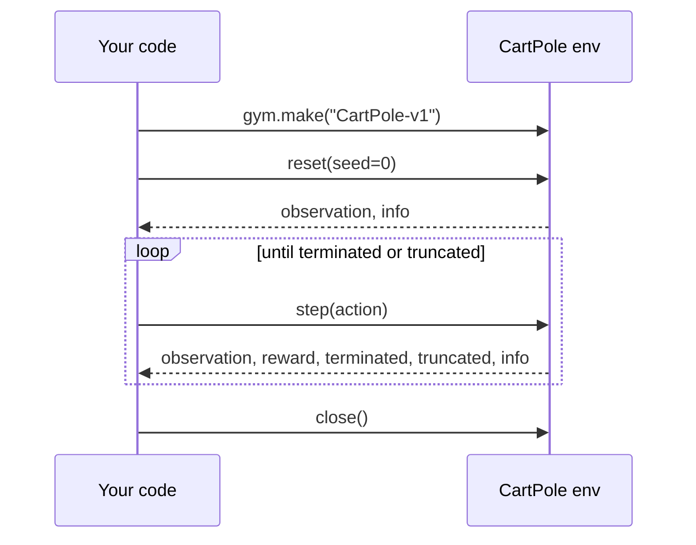

{:class="cover"}

---

By the end of this lesson you will be able to install Gymnasium, create an environment with `gym.make`, and run a random agent through full episodes.

---

## Setting up

Let's get Gymnasium installed and run something. Open a terminal and make a fresh virtual environment, which keeps this project's packages separate from everything else on your machine.

```bash
python3 -m venv rl-gym
source rl-gym/bin/activate          # macOS and Linux
# rl-gym\Scripts\activate           # Windows

pip install "gymnasium[classic-control]" stable-baselines3
```

The `[classic-control]` part installs pygame, which CartPole needs to draw itself. Stable-Baselines3 brings PyTorch with it, which is a big download, so you can stop after `gymnasium[classic-control]` for now and add SB3 when you reach lesson 12.

> **Teachers**: Do the PyTorch install before the lesson, on a good connection, or have learners install only `"gymnasium[classic-control]"` today (a small download). On school machines where learners cannot install packages, ask IT to prepare a shared virtual environment in advance.

Check the install with a short script:

```python
import gymnasium

print(gymnasium.__version__)
```

You should see `1.4.0` or a newer 1.x number. This course was tested on 1.4.0.

## CartPole: the Hello World of RL

CartPole balances a pole on a cart that slides left and right. At each step the agent pushes the cart left or right, and gets +1 reward for every step the pole stays up. It is simple enough to understand at a glance and rich enough to show real learning.

Let's run it with a random agent first, so we can see the API before worrying about intelligence.

```python
import gymnasium as gym

print("Gymnasium version:", gym.__version__)

env = gym.make("CartPole-v1")
env.action_space.seed(0)          # makes the random actions repeatable

for episode in range(3):
    obs, info = env.reset(seed=episode)
    episode_reward = 0.0
    done = False

    while not done:
        action = env.action_space.sample()
        obs, reward, terminated, truncated, info = env.step(action)
        episode_reward += reward
        done = terminated or truncated

    print(f"Episode {episode + 1}: reward = {episode_reward:.1f}")

env.close()
```

Output from our test run:

```
Gymnasium version: 1.4.0
Episode 1: reward = 18.0
Episode 2: reward = 14.0
Episode 3: reward = 12.0
```

A random agent drops the pole within a couple of dozen steps. That is exactly what we expect. The point is that the plumbing works: we created an environment, reset it, stepped it and read the results.



## What gym.make does

`gym.make("CartPole-v1")` looks up the string in Gymnasium's registry, builds the environment and wraps it in a few safety wrappers. The name follows the pattern `Name-vN`. The version number lets the community fix an environment without changing how old code behaves, which is why CartPole has both `v0` and `v1`. Always use the version you meant: the ids in this course all exist in Gymnasium 1.4.0.

## What reset and step return

```python
obs, info = env.reset(seed=42)
obs, reward, terminated, truncated, info = env.step(action)
```

{: .no-snakie }

`reset()` returns two things: the first observation and an `info` dictionary. `step()` returns five. The old `done` flag has become two flags, `terminated` and `truncated`; the next lesson explains why. For now, the episode is over when either one is `True`.

## Choosing how to render

You choose the render mode when you create the environment, and it cannot be changed afterwards:

| render_mode | What `env.render()` gives you |
| --- | --- |
| `None` (default) | Nothing. Fastest, so use it for training |
| `"human"` | A pygame window you can watch. `render()` returns nothing |
| `"rgb_array"` | A NumPy image array |
| `"ansi"` | A text string, for environments that support it |
{:class="table table-single"}

Not every environment supports every mode. CartPole offers `human` and `rgb_array`; it has no text mode. Text mode is common in grid-style environments, so let's try it on FrozenLake, plus an image frame from CartPole.

```python
import gymnasium as gym

env = gym.make("CartPole-v1", render_mode="rgb_array")
obs, info = env.reset(seed=0)
frame = env.render()
print("Frame shape:", frame.shape, "dtype:", frame.dtype)
env.close()

env = gym.make("FrozenLake-v1", render_mode="ansi", is_slippery=False)
obs, info = env.reset(seed=0)
print(env.render())
for action in (2, 2, 1):  # right, right, down
    obs, reward, terminated, truncated, info = env.step(action)
print(env.render())
print("observation:", obs)
env.close()
```

CartPole's frame is `(400, 600, 3)`: 400 pixels high, 600 wide, three colour channels, `uint8`. FrozenLake prints a 4 by 4 grid in text, with your cell highlighted in red (the highlight is an ANSI colour code, so it shows as `S` or `F` with a red background in most terminals). After right, right, down the observation is `6`, which is cell number `row * 4 + col`, row 1 and column 2.

To watch a window, use `render_mode="human"` on a machine with a display. We cannot show a window in this lesson, but the loop is the same: create the environment with that mode and the window updates on every `step()`.

> **Note**: This is a good habit to carry forward. Train with no render mode, and add `"human"` only when you want to watch.

## Try it Yourself

1. In the first program, change `render_mode` to `"rgb_array"` and print `env.render().shape` after each reset. What do the three numbers mean?
2. Make `MountainCar-v0` instead of CartPole. Print the observation after `reset()`. How many numbers are there, and how many actions does the car have?
3. Run the three-episode loop with `seed=episode` but without the `env.action_space.seed(0)` line. Run it twice. Which numbers stay the same and which change?
4. Challenge: write a loop that runs 100 random episodes of CartPole and prints the shortest, longest and average reward.

## Common Issues

- **Problem**: `ModuleNotFoundError: No module named 'gymnasium'`
- **Solution**: Activate your virtual environment, then check `which python` (macOS and Linux) or `where python` (Windows) points inside it.
- **Why**: You can have several Pythons. If you installed Gymnasium into one and run another, the import fails.

- **Problem**: `DependencyNotInstalled: pygame is not installed, run pip install "gymnasium[classic-control]"`
- **Solution**: Run that pip command.
- **Why**: Plain `pip install gymnasium` leaves out pygame, which CartPole needs for `render_mode="rgb_array"` and `"human"`. Without a render mode, CartPole runs fine.

- **Problem**: `NameNotFound: Environment CartPol doesn't exist` (or `VersionNotFound` for a wrong version number).
- **Solution**: Check the spelling and the `-vN`. Print `list(gym.registry)` to see every available id.
- **Why**: `gym.make` looks the exact string up in a registry.

## Check your understanding


? How many values does `env.reset()` return in Gymnasium 1.x?
- [ ] One: the observation
- [x] Two: the observation and an info dictionary
- [ ] Five
> `reset()` returns `(observation, info)`. Five values belong to `step()`.

? When do you choose the render mode?
- [ ] On every call to `env.render()`
- [x] When you create the environment with `gym.make`
- [ ] After the first `reset()`
> `render_mode` is fixed at construction time.

? Which render mode gives you a NumPy image array?
- [ ] `"ansi"`
- [ ] `"human"`
- [x] `"rgb_array"`
> `"rgb_array"` returns a frame such as the `(400, 600, 3)` CartPole image.

? Why does the loop test `terminated or truncated`?
- [x] The episode is over when either flag is True
- [ ] Only one of them can ever be True
- [ ] To count the steps
> An episode can end because the task ended or because a limit was reached, and the loop must stop for either.

