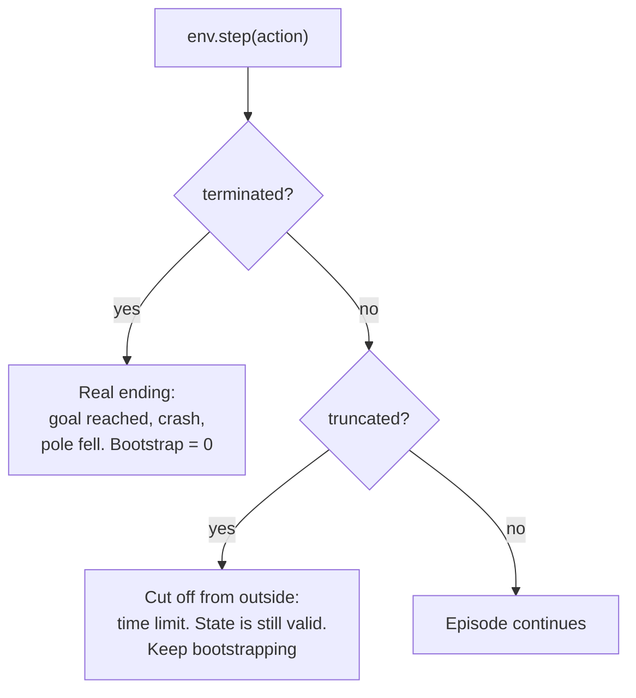

{:class="cover"}

---

By the end of this lesson you will be able to explain the difference between `terminated` and `truncated`, and use each one correctly in a Q-learning update.

---

## The old way: one flag

In the previous course the BurgerBot simulator returned a single `done` flag, which was `True` in two quite different situations:

- The robot hit an obstacle or reached the goal. The episode is truly over.
- The episode reached `MAX_STEPS = 150`. We simply stopped it, and the robot was in a perfectly good state.

Mixing those two up causes a subtle training problem. Let's see why.

## The bootstrap problem

Q-learning updates a value using what the agent expects to earn from the next state onwards:

```python
td_target = reward + gamma * max(q_table[next_state])
```
{: .no-snakie }

The `gamma * max(...)` part is called the **bootstrap**: we use our estimate of the next state's value to improve our estimate of this one.

- When an episode truly ends (the pole falls, the robot crashes, the goal is reached) there is no next state, so there is no future reward. The bootstrap should be **zero**.
- When an episode is only cut off by a time limit, the robot is still in a valid state with plenty of future reward available. The bootstrap should **continue**.

If you treat a time-out as a real ending you tell the agent "nothing is worth anything from here", which is false. A robot that is doing well when the clock runs out gets punished for its good position. Run the numbers:

```python
GAMMA = 0.99
reward = 1.0
best_next_q = 95.0      # the agent believes this next state is worth 95

if_terminated = reward
if_truncated = reward + GAMMA * best_next_q

print(f"Genuine ending, target = {if_terminated:.2f}")
print(f"Time-limit ending, target = {if_truncated:.2f}")
```

```
Genuine ending, target = 1.00
Time-limit ending, target = 95.05
```

Same step, same state, but a target 95 times larger. That is the difference a correct flag makes.

## The new way: two flags



Gymnasium splits the old flag:

- **`terminated`** is `True` when the environment's own rules end the episode: goal reached, robot crashed, pole fell past its limit. Bootstrap from zero.
- **`truncated`** is `True` when something outside the task's rules stops it: a step limit, a time budget. The state is still valid, so keep bootstrapping.

For *stopping the loop* you still use `terminated or truncated`. For *learning* you use them separately: only `terminated` should switch the bootstrap off, which is exactly what the tabular Q-learning code in lesson 5 does.

## Seeing both in CartPole

A random agent never survives long enough to hit CartPole's time limit, so it only ever sees `terminated`:

```python
import gymnasium as gym

env = gym.make("CartPole-v1")
obs, info = env.reset(seed=0)
env.action_space.seed(0)

episodes_ended = 0
for step in range(1000):
    action = env.action_space.sample()
    obs, reward, terminated, truncated, info = env.step(action)
    if terminated or truncated:
        episodes_ended += 1
        kind = "TERMINATED (pole fell)" if terminated else "TRUNCATED (time limit)"
        print(f"Step {step}: {kind}")
        obs, info = env.reset()

env.close()
print("episodes ended:", episodes_ended)
```

The last lines of our output were `Step 975: TERMINATED (pole fell)` and `episodes ended: 45`. Not one `TRUNCATED` appeared, because CartPole's limit is 500 steps and a random agent lasts about twenty.

To see a time-out you need an agent that balances. Here is a hand-written rule: push towards the side the pole is leaning, with a little help from its angular speed.

```python
import gymnasium as gym

env = gym.make("CartPole-v1")
obs, info = env.reset(seed=0)

for step in range(1200):
    action = 1 if obs[2] + 0.5 * obs[3] > 0 else 0
    obs, reward, terminated, truncated, info = env.step(action)
    if terminated or truncated:
        kind = "TERMINATED (pole fell)" if terminated else "TRUNCATED (time limit)"
        print(f"Step {step}: {kind}")
        obs, info = env.reset()

env.close()
```

Output:

```
Step 499: TRUNCATED (time limit)
Step 999: TRUNCATED (time limit)
```

The pole never fell. The environment simply stopped the episode after 500 steps. Treating *that* as a failure would be wrong, and now you can tell the two apart.

## What this means for BurgerBot

The hand-built simulator set `done` in three cases. In Gymnasium terms:

| Event | terminated | truncated |
| --- | --- | --- |
| Robot crashes into an obstacle or wall | True | False |
| Robot reaches the goal | True | False |
| 150 steps pass | False | True |
{:class="table table-single"}

You will build exactly this logic into `BurgerBotEnv` in lesson 8. Libraries such as Stable-Baselines3 read the two flags and handle them properly for you, which is one more reason to use a standard API.

> **Teachers**: This is the idea learners most often get wrong. A quick unplugged check: ask them to say which flag a robot vacuum sets when its battery dies (truncated, the task was not over) and when it falls down the stairs (terminated, the episode really ended).

## Try it Yourself

1. Run the random CartPole loop and count the `TERMINATED` events. Then run the hand-written rule and count the `TRUNCATED` ones. Why is one of those counts always zero for the random agent?
2. Change the hand-written rule to always push left (`action = 0`). Which flag fires, and after how many steps?
3. In the lesson 5 code, change `update_q(..., terminated)` to pass `terminated or truncated`. Predict whether the agent will do better or worse, then test it.

## Common Issues

- **Problem**: `ValueError: too many values to unpack (expected 4)` or `not enough values to unpack`.
- **Solution**: Use `obs, reward, terminated, truncated, info = env.step(action)` with five names.
- **Why**: Gymnasium's `step()` returns five values. The old Gym returned four.

- **Problem**: `reset()` gives you a tuple where you expected an array, such as `'tuple' object has no attribute 'shape'`.
- **Solution**: Write `obs, info = env.reset()`.
- **Why**: `reset()` returns two values, so `obs = env.reset()` stores the whole tuple.

## Check your understanding


? A BurgerBot crashes into an obstacle. Which flag should be True?
- [x] `terminated`
- [ ] `truncated`
- [ ] Neither
> A crash is a real ending defined by the task's rules, so it is `terminated`.

? An episode ends because it reached 150 steps. Which flag should be True?
- [ ] `terminated`
- [x] `truncated`
> A step limit is imposed from outside the task. The robot's state is still valid.

? In Q-learning, when should the bootstrap term `gamma * max(q_next)` be dropped?
- [x] Only when the episode terminated
- [ ] Whenever the episode ends for any reason
- [ ] Never
> A time-out leaves the agent in a valid state with future reward, so the bootstrap should stay.

? How do you decide when to stop the episode loop?
- [ ] When `terminated` is True
- [x] When `terminated or truncated` is True
> Either flag means the environment needs a reset.

