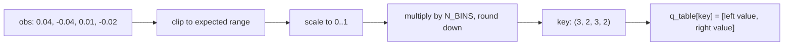

{:class="cover"}

---

By the end of this lesson you will be able to run a tabular Q-learning agent on a Gymnasium environment by binning its continuous observations.

---

This is a bridge lesson. You already know Q-learning: the update rule, epsilon-greedy exploration and the dictionary Q-table. You now know the Gymnasium API. Let's put them together and run your old algorithm on `CartPole-v1`.

There is one catch. CartPole's observation is four continuous numbers, and a dictionary needs keys you can match exactly. You solved this in the previous course by turning ultrasonic readings into "near", "medium" or "far". We do the same thing here, with four numbers instead of one.

## Binning CartPole

CartPole gives you four numbers per step: cart position, cart velocity, pole angle (radians) and pole angular velocity. We clip each into a sensible range, then slice that range into `N_BINS` equal buckets. The four bucket numbers become the Q-table key.



With 6 bins per number there are `6 x 6 x 6 x 6 = 1,296` possible keys, but the agent only ever visits a small share of them, so we create Q-table rows lazily when a key is first seen.

## The complete program

Save this as `cartpole_q.py`. You will recognise `choose_action`, `update_q` and the training loop. The differences from the previous course are the ones you learned in lessons 2 and 3: `reset()` returns two values, `step()` returns five, and only `terminated` switches the bootstrap off.

```python
import random

import gymnasium as gym
import numpy as np

# Discretisation settings
N_BINS = 6
CLIP_LOW = np.array([-2.4, -3.0, -0.25, -3.0])
CLIP_HIGH = np.array([2.4, 3.0, 0.25, 3.0])


def discretize(obs):
    """Turn CartPole's four floats into a tuple of four bin numbers."""
    clipped = np.clip(obs, CLIP_LOW, CLIP_HIGH)
    scaled = (clipped - CLIP_LOW) / (CLIP_HIGH - CLIP_LOW)
    bins = np.floor(scaled * N_BINS).astype(int)
    bins = np.clip(bins, 0, N_BINS - 1)
    return tuple(int(b) for b in bins)


# Q-learning settings
ALPHA = 0.1
GAMMA = 0.99
EPSILON_START = 1.0
EPSILON_MIN = 0.01
DECAY_RATE = 0.995
NUM_EPISODES = 500

q_table = {}


def get_q(state):
    """Return the Q-values for a state, creating a row of zeros if unseen."""
    if state not in q_table:
        q_table[state] = [0.0, 0.0]   # value of push left, push right
    return q_table[state]


def choose_action(state, epsilon):
    if random.random() < epsilon:
        return random.randint(0, 1)
    return int(np.argmax(get_q(state)))


def update_q(state, action, reward, next_state, terminated):
    current_q = get_q(state)[action]
    if terminated:
        td_target = reward                 # real ending: no future reward
    else:
        td_target = reward + GAMMA * max(get_q(next_state))
    get_q(state)[action] += ALPHA * (td_target - current_q)


random.seed(0)
env = gym.make("CartPole-v1")
epsilon = EPSILON_START
recent_rewards = []

for episode in range(1, NUM_EPISODES + 1):
    obs, info = env.reset(seed=episode)
    state = discretize(obs)
    episode_reward = 0
    done = False

    while not done:
        action = choose_action(state, epsilon)
        next_obs, reward, terminated, truncated, info = env.step(action)
        next_state = discretize(next_obs)

        # Only `terminated` counts as a real ending. A time-out (`truncated`)
        # still bootstraps, as lesson 3 explained.
        update_q(state, action, reward, next_state, terminated)

        state = next_state
        episode_reward += reward
        done = terminated or truncated

    epsilon = max(EPSILON_MIN, epsilon * DECAY_RATE)
    recent_rewards.append(episode_reward)

    if episode % 50 == 0:
        avg = sum(recent_rewards[-50:]) / 50
        print(f"Episode {episode:4d}  avg(50)={avg:6.1f}  epsilon={epsilon:.3f}  states={len(q_table)}")

env.close()
print(f"\nFinal Q-table: {len(q_table)} states visited")
```

We fixed `random.seed(0)` and used `reset(seed=episode)`, so you should see the same numbers we did:

```
Episode   50  avg(50)=  22.8  epsilon=0.778  states=57
Episode  100  avg(50)=  24.5  epsilon=0.606  states=80
Episode  150  avg(50)=  29.4  epsilon=0.471  states=84
Episode  200  avg(50)=  35.8  epsilon=0.367  states=97
Episode  250  avg(50)=  48.4  epsilon=0.286  states=138
Episode  300  avg(50)=  60.5  epsilon=0.222  states=154
Episode  350  avg(50)=  81.0  epsilon=0.173  states=165
Episode  400  avg(50)=  65.7  epsilon=0.135  states=167
Episode  450  avg(50)=  72.5  epsilon=0.105  states=169
Episode  500  avg(50)=  91.6  epsilon=0.082  states=178

Final Q-table: 178 states visited
```

## Reading the result

A random agent scores about 20 on CartPole, and the best possible is 500. Going from about 23 to about 92 in 500 episodes, with a 178-row table, is real learning, but it is slow and wobbly: the average dipped at episode 400 even though epsilon was shrinking. Tabular learning on a binned continuous problem is like that. Each bucket mixes many slightly different situations, so the table cannot be exact.

That is the honest limit of the table, and it is why the second half of the course moves to neural networks. For now, notice what did *not* change: the loop and the update rule are the ones from the previous course. Only `discretize()` and the number of actions (2, not 4) are new. That is the standard API doing its job.

## Try it Yourself

1. Set `N_BINS = 10` and run again. In our test it reached about 101 at episode 500 with 365 states. Does it for you? What happens to `len(q_table)`?
2. Set `N_BINS = 3`. In our test the average stayed near 44 with only 31 states. Why can't a table this coarse balance the pole?
3. Set `NUM_EPISODES = 2000` and `DECAY_RATE = 0.998` and print every 250 episodes. In our test the 50-episode average climbed into the 100s. Is it steady?
4. Challenge: run the same agent on `MountainCar-v0`. You need new clip limits and `get_q` must hold three actions. Does it learn? Why might that environment be harder for a table?

## Common Issues

- **Problem**: The average reward stays around 20 and never improves.
- **Solution**: Make epsilon decay more slowly (`DECAY_RATE = 0.999`) and give it more episodes.
- **Why**: With too little exploration the agent never visits enough buckets to build a useful table.

- **Problem**: The Q-table gets huge and learning slows down.
- **Solution**: Reduce `N_BINS`.
- **Why**: The number of possible keys is `N_BINS ** 4`. Ten bins is 10,000 keys, and each key needs visits before it is useful.

- **Problem**: Your numbers differ from the output shown.
- **Solution**: Check that you kept `random.seed(0)`, `reset(seed=episode)` and the same constants.
- **Why**: Both Python's `random` module and the environment have their own random number generators, and both must be seeded. Lesson 6 covers this.

## Check your understanding


? Why must CartPole's observation be discretised for a dictionary Q-table?
- [ ] Gymnasium forbids floats
- [x] The observation is four continuous floats, and a table needs keys that repeat exactly
- [ ] CartPole has too many actions
> Continuous values almost never repeat exactly, so we bucket them into bin numbers.

? In `update_q`, which flag is passed to switch the bootstrap off?
- [ ] `truncated`
- [x] `terminated`
- [ ] `terminated or truncated`
> A time-out is not a real ending, so only `terminated` removes the future-reward term.

? With `N_BINS = 6`, how many possible Q-table keys are there for CartPole?
- [ ] 24
- [x] 1,296
- [ ] 6
> Four numbers with six bins each: 6 x 6 x 6 x 6.

? What changed from the previous course's training loop?
- [ ] The update rule
- [x] The Gymnasium return values and the discretize function
- [ ] The epsilon decay formula
> The algorithm is the same. Only the interface and the observation handling are new.

