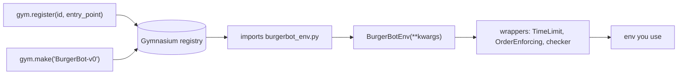

{:class="cover"}

---

By the end of this lesson you will be able to register a custom environment with `gym.register`, create it with `gym.make`, and read its text rendering.

---

## Why register?

In lesson 2 you made CartPole with `gym.make("CartPole-v1")`. That string was looked up in Gymnasium's registry, which returned a ready-to-use environment.

Right now `BurgerBotEnv` is just a class. You can call `BurgerBotEnv()` directly, and that is fine when everything is in one file. Registering gives your environment an id, and an id gives you three things:

- `gym.make("BurgerBot-v0")` builds it, and Gymnasium adds its standard safety wrappers.
- A step limit can be attached once, at registration, instead of inside every script.
- Tools that create environments from a string, such as `gym.make_vec` in the next lessons, can find it.



## Registering BurgerBot

Keep `burgerbot_env.py` from lesson 8 in the same folder, and save this as `register_burgerbot.py`:

```python
import gymnasium as gym
from gymnasium.utils.env_checker import check_env

# "module:ClassName" - Python imports burgerbot_env.py the first time
# gym.make needs it, so the file must sit beside this script.
gym.register(
    id="BurgerBot-v0",
    entry_point="burgerbot_env:BurgerBotEnv",
    max_episode_steps=150,
)

env = gym.make("BurgerBot-v0", render_mode="ansi")
print("id:", env.spec.id, " max_episode_steps:", env.spec.max_episode_steps)
print("outer type:", type(env).__name__)
print("inner type:", type(env.unwrapped).__name__)
check_env(env.unwrapped)
print("check_env passed")

obs, info = env.reset(seed=0)
print(env.render())
env.action_space.seed(0)
for step in range(1, 11):
    obs, reward, terminated, truncated, info = env.step(env.action_space.sample())
    if terminated or truncated:
        print(f"Episode ended at step {step}")
        break
print(env.render())
env.close()

# Keyword arguments pass through to __init__
short = gym.make("BurgerBot-v0", max_steps=5)
short.reset(seed=0)
for i in range(1, 8):
    obs, reward, terminated, truncated, info = short.step(3)   # 3 = stop
    if truncated:
        print("max_steps=5: a robot that only waits is truncated at step", i)
        break
short.close()

# max_episode_steps can also be overridden in gym.make
tiny = gym.make("BurgerBot-v0", max_episode_steps=3)
tiny.reset(seed=0)
for i in range(1, 8):
    obs, reward, terminated, truncated, info = tiny.step(3)
    if truncated:
        print("max_episode_steps=3: truncated at step", i)
        break
tiny.close()
```

Our output (the `check_env` call may also print a `WARN` about render fps, which is harmless for a text renderer):

```
id: BurgerBot-v0  max_episode_steps: 150
outer type: TimeLimit
inner type: BurgerBotEnv
check_env passed
> . . O . . .
. O . . . O .
. . . . . . .
O . . O . . .
. . . . . O .
. O . . . . .
. . . . . . G
Episode ended at step 8
. . > O . . .
. O . . . O .
. . . . . . .
O . . O . . .
. . . . . O .
. O . . . . .
. . . . . . G
max_steps=5: a robot that only waits is truncated at step 5
max_episode_steps=3: truncated at step 3
```

Three things to notice:

- `gym.make` returned a `TimeLimit` wrapper around your class, because we passed `max_episode_steps`. Your own object is underneath, reachable as `env.unwrapped`.
- The entry point is `"module:ClassName"`. The module is the file name without `.py`. If the file is not in the same folder, or not on Python's path, `gym.make` cannot import it.
- Keyword arguments to `gym.make` go to `BurgerBotEnv.__init__`, which is how `max_steps=5` took effect. The wrapper's `max_episode_steps` is a second, outer limit: the episode ends at whichever comes first.

> **Note**: `gym.register` runs once per Python session. If you register the same id twice you get a warning that it is being overwritten. Put it at the top of your training script, or in the `__init__.py` of a package of environments.

## How render modes work

You pick the render mode when you create the environment. After that `env.render()` takes no arguments and returns different things depending on the mode:

| render_mode | What `render()` returns |
| --- | --- |
| `"ansi"` | A text string, like our grid |
| `"rgb_array"` | A NumPy array of shape `(height, width, 3)` |
| `"human"` | Nothing. A window updates itself on every step |
| `None` | Nothing. The fastest choice for training |
{:class="table table-single"}

BurgerBot declares `metadata = {"render_modes": ["ansi"]}`, so asking for any other mode gives a warning. You would not see the `human` window here, since it needs a display, but you can always read the `ansi` text in a terminal or a log file.

## Reading the grid

```
. . > O . . .
. O . . . O .
. . . . . . .
O . . O . . .
. . . . . O .
. O . . . . .
. . . . . . G
```

The arrow is the robot and points the way it faces: `^` north, `>` east, `v` south, `<` west. `O` is an obstacle, `G` is the goal and `.` is empty floor. In the grid above the robot is in front of the obstacle at the end of row 0, facing it. A forward step there crashes.

## Try it Yourself

1. Print `gym.spec("BurgerBot-v0")`. What fields does it list?
2. Run `gym.make("BurgerBot-v0", max_steps=500)` with a robot that only waits. It is still stopped at step 150. Which limit is responsible, and why?
3. Add `"rgb_array"` to `metadata["render_modes"]` and make `render()` return a `(7 * 32, 7 * 32, 3)` `uint8` array in that mode, painting each cell a colour (robot, obstacle, goal, floor). Run `check_env` on it.
4. Challenge: save the `rgb_array` frame to a PNG with the Pillow library and look at it. Does the picture match the text grid?

## Common Issues

- **Problem**: `NameNotFound: Environment BurgerBot doesn't exist`
- **Solution**: Call `gym.register(...)` before `gym.make(...)`, in the same program. If the register call lives in another file, import that file first.
- **Why**: `gym.make` looks the id up in the registry at that moment. If nothing has registered it yet, the lookup fails.

- **Problem**: `ModuleNotFoundError: No module named 'burgerbot_env'` when you call `gym.make`.
- **Solution**: Run the script from the folder that holds `burgerbot_env.py`.
- **Why**: The entry point string is imported lazily, using Python's normal search path.

- **Problem**: `gym.make("BurgerBot-v0", max_steps=50)` raises `TypeError`.
- **Solution**: The keyword must match a parameter of `BurgerBotEnv.__init__` exactly.
- **Why**: Gymnasium passes your keywords straight to the constructor.

## Check your understanding


? What does the entry point string `"burgerbot_env:BurgerBotEnv"` mean?
- [x] Import the module `burgerbot_env` and use the class `BurgerBotEnv`
- [ ] Use the file `burgerbot_env` from the cloud
- [ ] Rename the class to `burgerbot_env`
> The format is `module:ClassName`.

? What does `env.render()` return when the render mode is `"ansi"`?
- [ ] A NumPy array
- [x] A string
- [ ] Nothing
> ANSI mode returns text you can print.

? How do you reach your own `BurgerBotEnv` object after `gym.make` has wrapped it?
- [ ] `env.inner`
- [x] `env.unwrapped`
- [ ] `env.base()`
> `unwrapped` strips off every wrapper.

? You registered with `max_episode_steps=150` and the class also has `max_steps=150`. What happens?
- [ ] Gymnasium raises an error
- [x] Both limits exist and the episode ends at the first one reached
- [ ] The larger one is ignored at registration
> They are two independent limits. Keep them in sync or pick one.

