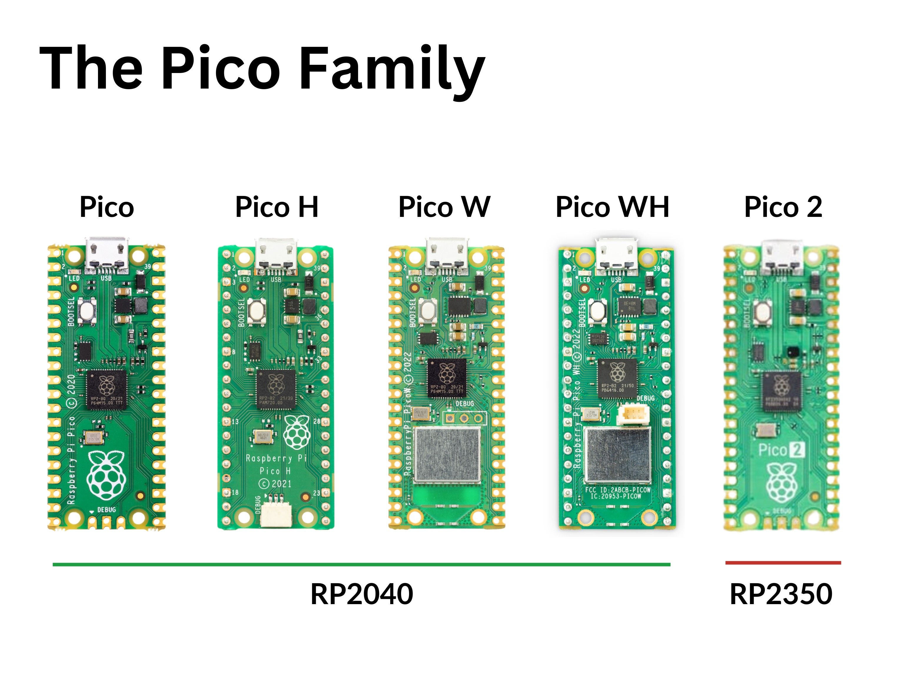
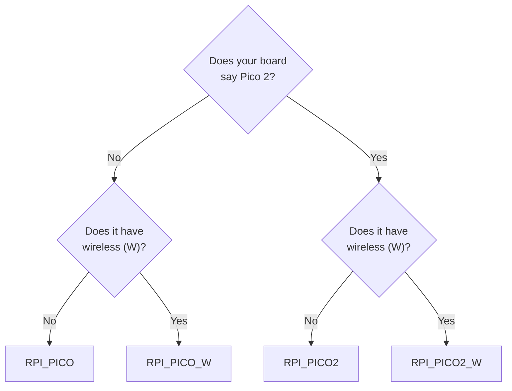

{:class="cover"}

---

By the end of this lesson you will be able to identify your Pico model and choose the matching MicroPython firmware file.

MicroPython firmware is built for one specific board. A file made for the original Pico will not run on a Pico 2, because they use different chips. So the very first job is to work out exactly which Pico is on your desk.

{:class="img-fluid rounded-3 w-100 card-shadow card-hover"}

## The Pico family

There are two generations. The original Pico, Pico H, Pico W and Pico WH use the **RP2040** chip. The Pico 2 range uses the newer, faster **RP2350** chip. Within each generation, the letters on the name tell you what is different:

- **W** means wireless: Wi-Fi and Bluetooth.
- **H** means the header pins come pre-soldered, so you can plug straight into a breadboard. Headers do not change the firmware at all.

| Name | Chip | RAM | Flash | Wireless | Header pins |
|---|---|---|---|---|---|
| Pico | RP2040 | 264 kB | 2 MB | No | No |
| Pico H | RP2040 | 264 kB | 2 MB | No | Yes |
| Pico W | RP2040 | 264 kB | 2 MB | Yes | No |
| Pico WH | RP2040 | 264 kB | 2 MB | Yes | Yes |
| Pico 2 | RP2350 | 520 kB | 4 MB | No | No |
| Pico 2 W | RP2350 | 520 kB | 4 MB | Yes | No |
{:class="table table-single"}

Raspberry Pi also sell pre-soldered versions of the Pico 2 and Pico 2 W. They use the same chip as the table above, so they use the same firmware.

**Real-world example:** a robot that you want to control from your phone needs Wi-Fi or Bluetooth, so you would pick a Pico W or Pico 2 W. A line-following robot that only reads sensors works fine on the cheapest Pico.

## Reading the name on your board

The model name is printed in white on the underside of the board, along with a small label for the pins. Look for "Pico", "Pico W" or "Pico 2" there. If you cannot read it, check the packaging or the shop page you ordered from.

## Which firmware file do I download?

Firmware lives at [micropython.org/download](https://micropython.org/download/). Each board has its own page. Pick the page that matches your board name exactly:

| Your board | Download page on micropython.org |
|---|---|
| Pico or Pico H | Raspberry Pi Pico (`RPI_PICO`) |
| Pico W or Pico WH | Raspberry Pi Pico W (`RPI_PICO_W`) |
| Pico 2 | Raspberry Pi Pico 2 (`RPI_PICO2`) |
| Pico 2 W | Raspberry Pi Pico 2 W (`RPI_PICO2_W`) |
{:class="table table-single"}

On each page, download the file at the top of the list marked as the latest release. It ends in `.uf2` and has the board name, a date and a version number in its name, for example `RPI_PICO_W-` followed by a date and `-v` and the version.

The Pico 2 page also offers a RISC-V firmware. The RP2350 chip can run either its ARM cores or its RISC-V cores, but you want the normal ARM firmware to start with, so ignore the file with `RISCV` in its name.

> **Teachers**: Mixed classes often end up with a mix of old Picos and newer Pico 2 boards. Label each board with its model in marker pen before the lesson, and put the correct firmware files on a shared drive so learners on a restricted network do not have to hunt for them.

## Try it Yourself

1. Find your Pico and write down its exact name from the underside of the board.
2. Use the flow chart above to decide which download page you need, then open it in your browser and find the latest `.uf2` file. Do not download it yet unless you are following on to the next lesson.
3. Challenge: the Pico W and the Pico 2 W both have Wi-Fi. What is different about them, and why can you not swap their firmware files?

## Common Issues

- **Problem**: I am not sure which model I have, so I do not know which file to download.
- **Solution**: Read the white printed name on the underside of the board, or check the packaging or your order.
- **Why**: The right firmware file depends on the exact model, so it is worth a minute to be sure.

- **Problem**: I installed the Pico firmware on a Pico W and Wi-Fi code fails.
- **Solution**: Install the `RPI_PICO_W` file instead. The wireless chip needs the firmware built for it.
- **Why**: The Pico W firmware includes the code that talks to the wireless chip. The plain Pico file does not.

## Check your understanding


? Which chip does the Pico W use?
- [x] RP2040
- [ ] RP2350
- [ ] ESP32
> The Pico, Pico H, Pico W and Pico WH all use the RP2040. The Pico 2 range uses the RP2350.

? What does the letter H mean in Pico H?
- [ ] It has more memory
- [ ] It has Wi-Fi
- [x] It has header pins already soldered on
> Headers do not change which firmware file you need.

? You have a Pico 2 W. Which download page should you use?
- [ ] RPI_PICO
- [ ] RPI_PICO_W
- [ ] RPI_PICO2
- [x] RPI_PICO2_W
> Each board has its own page, and the firmware is built for that exact board.

