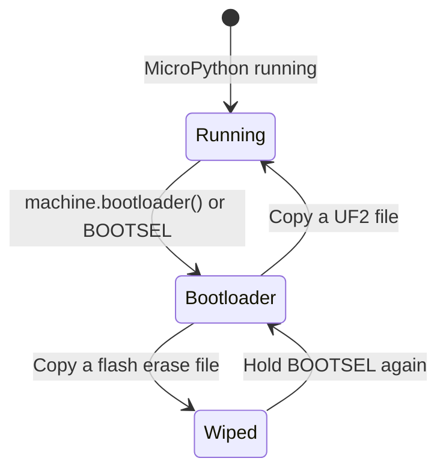

{:class="cover"}

---

By the end of this lesson you will be able to update the MicroPython firmware on a Pico, and know when and how to wipe it clean.

MicroPython is updated regularly with fixes and new features. You do not have to update all the time, but it is worth knowing how, and what to do if a Pico gets into a muddle.

## Updating MicroPython

Updating is exactly the same as installing. Download a newer UF2 file from your board's page on micropython.org, put the Pico in BOOTSEL mode, and drag the file onto the drive. Or use Thonny's installer and pick the newer version. If MicroPython is already running, `machine.bootloader()` gets you into BOOTSEL mode without the button.

**Back up first.** An update replaces MicroPython itself, and your own files such as `main.py` normally survive it. Do not rely on that: copy anything important to your computer before you update.

## Changing board

If you move from a Pico to a Pico W, or to a Pico 2, you are still just copying a different UF2 file. Always use the file that matches the board in your hand.

## Wiping the Pico clean

Sometimes a Pico gets properly stuck: a program that never stops, a damaged filesystem, or files you want gone. A full wipe erases the whole flash memory, firmware and files included. MicroPython's documentation describes this as a factory reset: you follow Raspberry Pi's instructions for resetting flash memory, then copy the MicroPython UF2 file to the board again.

Because a wipe erases everything, you will need to re-install MicroPython afterwards and copy your Python files back. Look in Raspberry Pi's documentation for the flash reset instructions, and take care to use the file that matches your Pico generation.

Before you reach for a wipe, try the gentler fixes in Common Issues first.

> **Teachers**: A wipe deletes every learner's saved code on that board. If Picos are shared between classes, ask learners to copy their files to their own computer first, and label each board with its owner. A spare, already-flashed Pico is a handy swap while you sort a stuck one.

## Try it Yourself

1. Look at your board's page on micropython.org and note the newest version available. Compare it with the version in your REPL banner. Are you up to date?
2. Copy your `main.py`, if you have one, to your computer. Then reinstall the same firmware and check the file is still on the Pico.
3. Challenge: keep a small card with each of your Picos listing the model, the firmware version, and the date you installed it.

## Common Issues

- **Problem**: My program runs forever and Thonny cannot stop it.
- **Solution**: Put the Pico in BOOTSEL mode and reinstall MicroPython, or follow the flash reset instructions for a full wipe.
- **Why**: Reinstalling replaces the firmware, and a wipe removes the stuck program as well.

- **Problem**: I updated and now my code does not work.
- **Solution**: Install an older version (Thonny's installer has a version list, and micropython.org has older releases) and check the release notes for what changed.
- **Why**: New releases occasionally change behaviour, so pinning a version keeps a classroom project stable.

- **Problem**: I wiped my Pico and the REPL is gone.
- **Solution**: That is expected. Install MicroPython again with either method.
- **Why**: A wipe removes the firmware that provides the REPL.

## Check your understanding


? How do you update MicroPython on a Pico?
- [x] Copy a newer UF2 file onto it in BOOTSEL mode
- [ ] Type `update()` at the REPL
- [ ] Buy a new Pico
> Updating is the same process as installing.

? What does a full wipe remove?
- [ ] Only the firmware
- [ ] Only your files
- [x] The firmware and your files
> You must reinstall MicroPython and copy your files back.

? Why might you install an older version?
- [x] A new release changed behaviour your project relied on
- [ ] Old versions run faster on every board
- [ ] The Pico can only run old versions
> New releases occasionally change behaviour, so pinning a version keeps a project stable.

