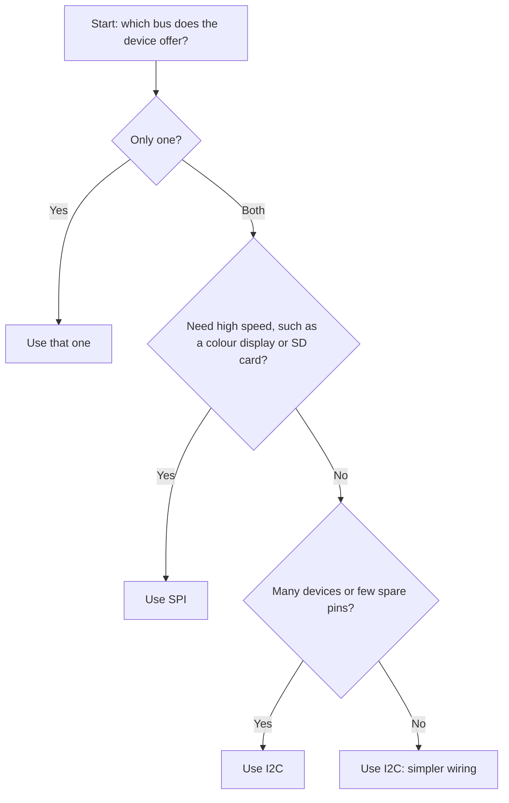

{:class="cover"}

---

By the end of this lesson you will be able to choose between I2C and SPI for a device by looking at its speed, pin count and distance needs, and work out how much bandwidth a display needs.

## Making the Right Choice

You've mastered both I2C and SPI. Now comes the important question: which should you use for your next project? This lesson provides practical guidance for choosing between protocols based on your specific needs.

## Side-by-Side Comparison

| Feature | I2C | SPI |
|---------|-----|-----|
| **Wires** | 2 (SDA, SCL) | 4+ (SCLK, MOSI, MISO, CS per device) |
| **Speed** | 100-400 kHz (standard/fast) | 1-60+ MHz |
| **Device addressing** | Software (0x76, etc.) | Hardware (chip select pins) |
| **Max devices** | 112 usable addresses, fewer in practice (bus capacitance) | Limited by available CS pins |
| **Communication** | Half-duplex (one direction at a time) | Full-duplex (simultaneous send/receive) |
| **Protocol overhead** | More (addressing, ACK/NACK) | Less (just data transfer) |
| **Wiring complexity** | Simple (2 wires total) | Complex (1 CS per device) |
| **Pull-up resistors** | Required | Not required |
| **Distance** | Short runs (tens of cm); slower speeds go further | Very short at high speed |
| **Error detection** | Built-in ACK/NACK | None (application level) |
| **Multi-controller** | Supported (but complex) | Not supported |
| **Power consumption** | Set mostly by the chip's own sleep modes | Set mostly by the chip's own sleep modes; fast clocks add a little |
{:class="table table-single table-narrow"}

## Decision Framework

### Use I2C When

**1. You need many devices on limited pins**

```python
# 10 sensors using just 2 GPIO pins
i2c = I2C(0, scl=Pin(9), sda=Pin(8), freq=400000)

sensors = [
    (0x76, "BME280"),
    (0x68, "MPU6050"),
    (0x3C, "OLED"),
    (0x48, "ADS1115"),
    # ... and as many more as you have different addresses
]

for addr, name in sensors:
    data = i2c.readfrom(addr, 1)
    print(f"{name}: {data}")
```
{: .no-snakie }

**Why I2C wins**: Only 2 wires for everything. SPI would need 10 chip select pins plus 3 shared signals (13 total GPIO).

**2. Devices are spread across your project**

```
Robot example:
- Front distance sensor (30cm away)
- Back distance sensor (30cm away)
- Main control board
- Display module
```

**Why I2C wins**: I2C runs at lower speeds, so it tolerates longer wires better than SPI at 10 MHz or more. Run a slow bus (100 kHz) across your chassis, and keep the total wire length short, because each extra centimetre adds capacitance the pull-ups must overcome.

**3. Speed isn't critical**

```python
# Reading temperature sensor every second
while True:
    temp = read_bme280()  # Takes ~10ms via I2C
    print(f"Temp: {temp}°C")
    time.sleep(1)  # Update rate: 1 Hz
```
{: .no-snakie }

**Why I2C wins**: 400 kHz I2C is plenty fast for 1 Hz updates. No need for SPI's complexity.

**4. You want simpler wiring**

```python
# I2C: Just 2 wires
i2c = I2C(0, scl=Pin(9), sda=Pin(8))

# vs SPI: 4+ wires per device
spi = SPI(0, sck=Pin(2), mosi=Pin(3), miso=Pin(4))
cs1 = Pin(5, Pin.OUT)
cs2 = Pin(6, Pin.OUT)
cs3 = Pin(7, Pin.OUT)
```
{: .no-snakie }

**Why I2C wins**: Fewer connections = less to wire, debug, and troubleshoot.

**5. Battery life is important**

```python
# What saves battery is the sensor's sleep mode, and I2C sensors
# usually have one. Forced mode takes one reading, then sleeps.
bme = bme280.BME280(i2c)
bme.read()  # forced mode in our driver: wake, measure, sleep
```
{: .no-snakie }

**Why I2C often wins here**: the chips you meet on I2C (like the BME280) tend to have good low-power modes, and you need fewer pins. The clock speed itself makes little difference to battery life.

### Use SPI When

**1. You need high speed data transfer**

```python
# Updating a TFT display
spi = SPI(0, baudrate=40000000)  # 40 MHz

for frame in range(60):
    # Send 240x320 pixels x 16 bits = 153,600 bytes
    display.write_frame(frame_buffer)  # about 31ms at 40 MHz (roughly 30 frames a second at best)
    # Would take over 3 seconds at 400 kHz I2C!
```
{: .no-snakie }

**Why SPI wins**: about 100 times the transfer rate. Essential for colour displays and video.

**2. Full-duplex communication is needed**

```python
# Radio module: send and receive simultaneously
spi = SPI(0, baudrate=10000000)

tx_data = b'\x01\x02\x03'
rx_data = bytearray(3)

# Send and receive at the same time
spi.write_readinto(tx_data, rx_data)
```
{: .no-snakie }

**Why SPI wins**: True full-duplex. I2C can only send OR receive, not both simultaneously.

**3. You're working with memory devices**

```python
# SD card: transfer large files quickly
spi = SPI(0, baudrate=25000000)  # 25 MHz

# Read a 512-byte block in about 0.2ms of clock time
data = sd_card.read_block(block_num)

# About 11ms at 400 kHz I2C
```
{: .no-snakie }

**Why SPI wins**: SD cards, flash memory, and EEPROMs need fast transfer. SPI is the standard.

**4. Devices are close together**

```
PCB design:
- All components within 5cm
- Controller in center
- Sensors around edges
```

**Why SPI wins**: When everything is close (PCB layout), SPI's short-distance limitation doesn't matter, and you get speed benefits.

**5. The device only speaks SPI**

Many memory chips, radio modules and fast ADCs are only sold with an SPI interface, so the decision is made for you. Check the datasheet before you pick pins.

## Real-World Scenarios

### Scenario 1: Weather Station

**Requirements**:
- BME280 sensor (temperature, humidity, pressure)
- OLED display
- RTC (real-time clock)
- SD card for logging
- All on one board

**Best choice**: Mixed approach

```python
# I2C for sensors and display (close together, speed not critical)
i2c = I2C(0, scl=Pin(9), sda=Pin(8))
bme280 = BME280(i2c, 0x76)
rtc = DS3231(i2c, 0x68)
oled = SSD1306_I2C(i2c, 0x3C)

# SPI for SD card (needs speed for logging)
spi = SPI(0, baudrate=10000000, sck=Pin(2), mosi=Pin(3), miso=Pin(4))
sd_card = SDCard(spi, cs=Pin(5))
```
{: .no-snakie }

**Why**: Use I2C where it makes sense (simpler wiring for sensors), SPI where needed (fast SD card writes).

### Scenario 2: Robot Sensor Network

**Requirements**:
- 8x distance sensors
- 2x IMU sensors
- 1x compass
- Spread across 40cm robot chassis

**Best choice**: I2C

```python
i2c = I2C(0, scl=Pin(9), sda=Pin(8))

# All on same bus
sensors = {
    'front': VL53L0X(i2c, 0x29),
    'back': VL53L0X(i2c, 0x30),  # a second VL53L0X needs its address changed at start-up
    # ... more sensors
    'imu1': MPU6050(i2c, 0x68),
    'imu2': MPU6050(i2c, 0x69),
    'compass': QMC5883L(i2c, 0x0D)
}
```
{: .no-snakie }

**Why**: I2C handles many devices easily, tolerates longer wires across chassis, and sensors don't need high speed.

### Scenario 3: High-Speed Data Acquisition

**Requirements**:
- Read 8 analog channels
- 10,000 samples per second per channel
- Real-time processing

**Best choice**: SPI

```python
spi = SPI(0, baudrate=20000000)  # 20 MHz
adc = FastADC(spi, cs=Pin(5))    # a fast SPI ADC chip (any model with 8+ channels)

# Rapid sampling
for channel in range(8):
    value = adc.read_channel(channel)  # a few microseconds each over SPI
    process_data(value)
```
{: .no-snakie }

**Why**: 8 channels x 10,000 samples a second is 80,000 samples a second. Each I2C transaction needs several bytes plus an address, so 400 kHz I2C cannot keep up, but SPI at 20 MHz can.

### Scenario 4: Portable Environmental Monitor

**Requirements**:
- Battery powered
- Multiple sensors (temp, humidity, air quality)
- Run for weeks on battery
- Small OLED display

**Best choice**: I2C

```python
i2c = I2C(0, scl=Pin(9), sda=Pin(8), freq=100000)  # 100 kHz is plenty for slow sensors

# All I2C devices in low-power modes
bme280 = BME280(i2c)
bme280.set_mode(MODE_SLEEP)  # Wake only when needed

sgp30 = SGP30(i2c)
oled = SSD1306_I2C(i2c)

# Wake, read, sleep cycle
while True:
    bme280.set_mode(MODE_FORCED)
    temp = bme280.read()
    bme280.set_mode(MODE_SLEEP)
    time.sleep(60)  # Sleep 1 minute
```
{: .no-snakie }

**Why**: Fewer wires, and sensors with sleep modes that you can put to sleep between readings, let the whole system run for weeks.

## Mixed I2C/SPI Systems

Many real projects use both protocols:

```python
from machine import I2C, SPI, Pin

# I2C bus for sensors (simple, many devices)
i2c = I2C(0, scl=Pin(9), sda=Pin(8), freq=400000)
temp_sensor = BME280(i2c, 0x76)
rtc = DS3231(i2c, 0x68)

# SPI bus for display and storage (speed critical)
spi = SPI(0, baudrate=20000000, sck=Pin(2), mosi=Pin(3), miso=Pin(4))  # SD cards top out around 25 MHz
display = ILI9341(spi, cs=Pin(5), dc=Pin(6))
sd_card = SDCard(spi, cs=Pin(7))

# Use each protocol for its strengths
while True:
    # Read sensors via I2C (slow is fine)
    temp = temp_sensor.read()

    # Update display via SPI (needs speed)
    display.show_temperature(temp)

    time.sleep(1)
```
{: .no-snakie }

## Decision Flowchart



## Common Device Defaults

Most devices are available in both I2C and SPI versions. Here's what's typical:

### Usually I2C

- Temperature/humidity sensors (BME280, SHT31)
- IMU sensors (MPU6050, BNO055)
- Small OLED displays (128x64)
- Real-time clocks (DS3231)
- Port expanders
- ADC converters (slow sampling)

### Usually SPI

- Large TFT displays (>240x320)
- SD cards and flash memory
- High-speed ADCs
- Radio modules (nRF24L01, LoRa)
- Camera modules
- High-resolution image sensors

### Available in Both

- BME280 (has I2C and SPI modes)
- OLED displays (128x64)
- Accelerometers
- Some GPS modules

**Pro tip**: If a device offers both, choose based on your system needs, not the device itself.

## Try It Yourself

Practice protocol selection:

1. **Analyze your current project**: Which protocol does it use? Could the other work better?

2. **Design a hypothetical system**:
   - Weather station with 5 sensors
   - Video display
   - SD card logging
   - Battery powered

   Which protocol for each component?

3. **Calculate data requirements**:

```python
# How fast do you really need?

# OLED 128x64 @ 10 FPS
pixels = 128 * 64
bytes = pixels / 8  # Monochrome
fps = 10
bytes_per_sec = bytes * fps
print(f"OLED needs: {bytes_per_sec} bytes/sec")
# Result: 10,240 bytes/sec = 81,920 bits/sec
# I2C @ 400 kHz can handle this!

# TFT 240x320 @ 30 FPS
pixels = 240 * 320
bytes = pixels * 2  # 16-bit color
fps = 30
bytes_per_sec = bytes * fps
print(f"TFT needs: {bytes_per_sec} bytes/sec")
# Result: 4,608,000 bytes/sec = 36,864,000 bits/sec
# Need SPI @ 40+ MHz
```

## Common Issues

- **Problem**: A display redraws far too slowly over I2C
- **Solution**: Work out the bytes per frame and compare with the bus speed (the bandwidth exercise below), then switch to an SPI version of the display or send only the parts that changed
- **Why**: 400 kHz I2C moves roughly 40,000 bytes a second, while SPI at 40 MHz moves about 5 million

- **Problem**: Two identical I2C modules clash on one bus
- **Solution**: Change one address with its jumper, or put each on a separate bus (I2C0 and I2C1)
- **Why**: I2C addresses must be unique on a bus, and a second hardware bus gives you a fresh address space

- **Problem**: You run out of GPIO pins with several SPI devices
- **Solution**: Swap some devices for I2C versions, or share a bus using only the chip select lines
- **Why**: Each SPI device uses one extra pin for chip select

## Check your understanding


? Which protocol suits a colour TFT display best?
- [ ] I2C
- [x] SPI
> A 240x320 colour frame is over 150,000 bytes, which needs SPI's speed.

? You have six sensors and only a couple of spare GPIO pins. Which bus is the better fit?
- [x] I2C, because one pair of pins serves every device
- [ ] SPI, because it is faster
> SPI needs one chip select pin per device on top of the shared lines.

? Can an I2C bus and an SPI bus be used in the same project?
- [x] Yes, many projects use I2C for sensors and SPI for displays or storage
- [ ] No, a board can only use one
> The Pico has separate hardware I2C and SPI blocks, so you can mix them freely.


> **Teachers**: This lesson works well as a paper design exercise with no hardware at all: give each group a shopping list of parts and ask them to choose a bus for each and draw the wiring. It is also a good moment to check pin budgets for shared Pico boards, since SPI uses up pins quickly.

## What You've Learned

In this lesson, you mastered:

- Key differences between I2C and SPI protocols
- When to choose I2C (many devices, simpler wiring, lower power)
- When to choose SPI (high speed, full-duplex, memory devices)
- Real-world scenario analysis
- Using both protocols in one project
- Calculating bandwidth requirements
- Making informed protocol decisions

You can now confidently choose the right protocol for any project based on technical requirements, not guesswork.

## What's Next

Theory and examples are great, but real projects always have surprises. In the next lesson, we'll cover common issues with both I2C and SPI, how to diagnose them, and proven solutions to get your projects working.
