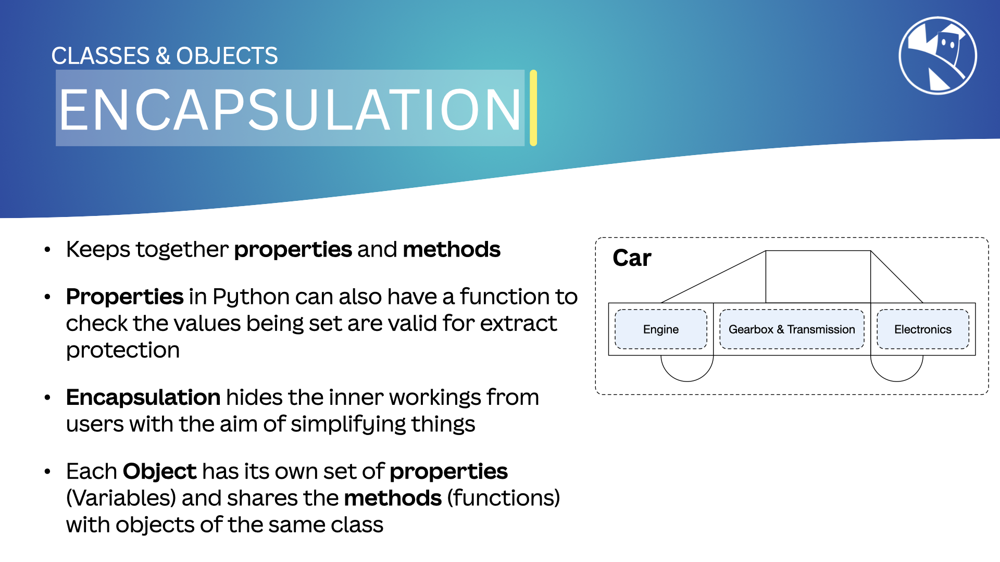
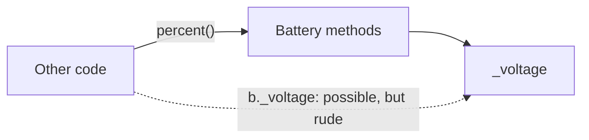

{:class="cover"}

---

By the end of this lesson you will be able to keep a class's data behind methods, use the underscore convention for internal names, and explain what MicroPython does and does not enforce.

## Why protect data?

Picture a robot with a battery reading. Other parts of the program need to know the battery percentage, but only the battery code should decide how that is calculated. If anything can write `robot.voltage = 99`, a bug in your display code can quietly break your low-battery cut-off.

**Encapsulation** means keeping an object's data inside the object and letting the outside world reach it through methods. The class stays in control of its own state.

{:class="img-fluid rounded-3 w-100 card-shadow card-hover"}

---

## Public and "protected" by convention

Python has no `private` keyword. Instead, it relies on a naming convention:

- `name`: public. Use it freely.
- `_name`: one leading underscore. It means "internal, please do not touch from outside".


class Battery:
    MIN_V = 3.0
    MAX_V = 4.2

    def __init__(self, voltage):
        self._voltage = voltage          # internal detail

    def set_voltage(self, voltage):
        # only accept sensible readings
        if self.MIN_V <= voltage <= self.MAX_V:
            self._voltage = voltage

    def percent(self):
        span = self.MAX_V - self.MIN_V
        pct = (self._voltage - self.MIN_V) / span * 100
        return int(pct)

b = Battery(3.7)
print(b.percent(), "%")
b.set_voltage(9.9)       # rejected: way out of range
print(b.percent(), "%")
b.set_voltage(4.2)
print(b.percent(), "%")



The outside code asks for `percent()` and never needs to know the voltage range or the formula. The class also *validates* writes through `set_voltage()`, so bad data cannot get in through the front door.

The underscore is a signal to other programmers, and tools like editors may hide `_names` from autocomplete. Nothing stops you reading `b._voltage`, though. It is a polite request, not a lock.

---

## The double underscore surprise

You will see tutorials that say a name starting with two underscores, like `__voltage`, is truly private and causes an `AttributeError` if you touch it from outside. On desktop Python, the name is rewritten ("mangled") to `_Battery__voltage` to make accidents harder.

**MicroPython does not do this.** Run this and see for yourself:


class Safe:
    def __init__(self):
        self.__code = 1234

s = Safe()
print(s.__code)



On MicroPython (we tested 1.26.1) this prints `1234`: the name is not mangled and nothing is hidden. The box above runs MicroPython in your browser, so you will see the same. Run the same lines in desktop Python and you would get an `AttributeError` instead. That difference is the whole point.

So what should you do?

- Use a **single underscore** for internal names. It means the same on every Python.
- Do not rely on a double underscore for protection or for security. If you do use it, remember it only affects how the name is stored on desktop Python.
- Never store secrets, such as a Wi-Fi password, in an attribute and think it is hidden.

---

## Class-level constants

Notice `MIN_V` and `MAX_V` at the top of `Battery`. Constants that belong to the class, written in CAPITALS, are a tidy way to avoid magic numbers scattered through your code. Another reason to love classes: change `MAX_V` in one place and every method follows.

---

## Try it Yourself

1. Add a `is_low()` method to `Battery` that returns `True` when `percent()` is below 20.
2. Make `set_voltage()` print `"ignored"` when it rejects a value, so you can see it working.
3. Create a `Motor` class with a `_speed` attribute and `set_speed()` and `get_speed()` methods that keep the speed between 0 and 100.
4. Challenge: access `b._voltage` from outside and change it to 12. What happens to `percent()`? What does this teach you about convention versus enforcement?

---

## Common Issues

- **Problem**: Your tutorial says `obj.__x` raises `AttributeError`, but on your Pico it works fine.
- **Solution**: Use a single underscore and treat it as a convention.
- **Why**: MicroPython does not implement name mangling, so double-underscore names are ordinary attributes.

- **Problem**: A value is changed from outside and the robot misbehaves.
- **Solution**: Route all changes through a method that checks the value.
- **Why**: Encapsulation only helps if code actually uses the method instead of poking the attribute directly.

---

## Check your understanding


? What does a single leading underscore, like `_voltage`, mean?
- [ ] Python blocks all outside access
- [x] It is a convention meaning "internal, please do not touch"
- [ ] The value is stored in flash
> Nothing enforces it. It is a signal to other programmers.

? On MicroPython, what happens when you read `s.__code` from outside the class?
- [ ] An `AttributeError` is raised
- [x] It works, because MicroPython does not mangle double-underscore names
- [ ] The Pico restarts
> The lesson ran this: MicroPython leaves the name as it is, so it is readable.

? Why validate values in a `set_voltage()` method?
- [x] The class stays in control of its own data
- [ ] Methods run faster than attributes
- [ ] It is needed for the code to run
> Funnelling writes through a method means bad values can be rejected.

