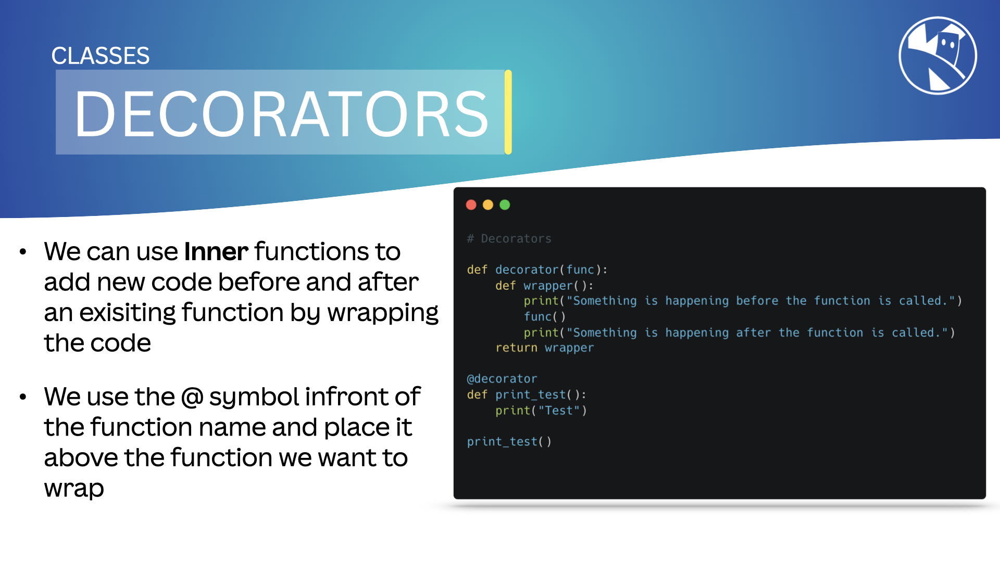
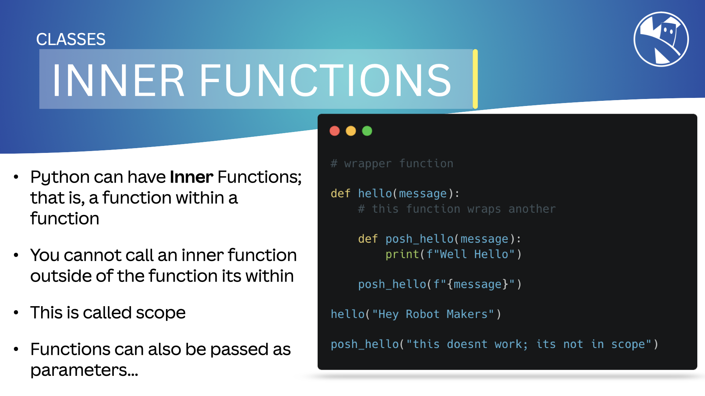
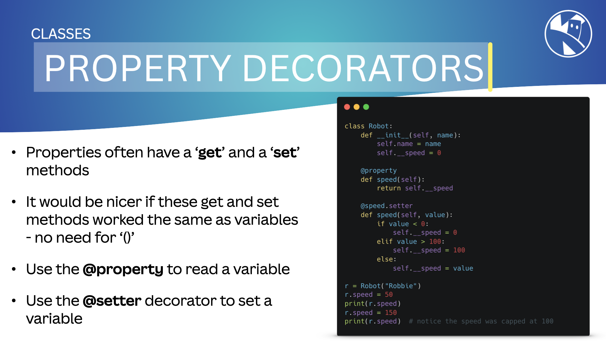
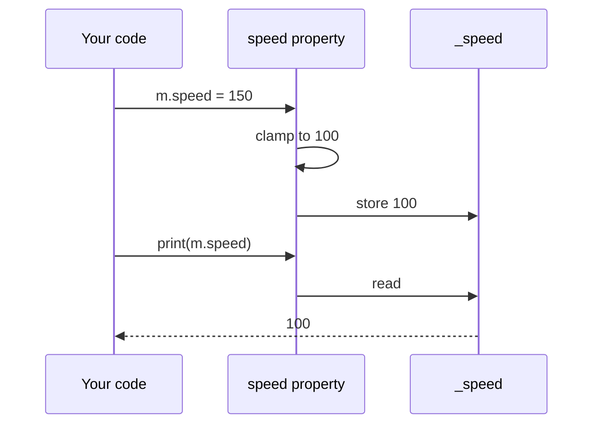

{:class="cover"}

---

By the end of this lesson you will be able to write a decorator that adds behaviour to a function, and use `@property` to control how a robot setting is read and written.

## Functions are values

In Python a function is just another value. You can store it in a variable, pass it to another function, or return it from one. That single fact is what makes decorators possible.

A **decorator** is a function that takes a function and returns a new, souped-up one. Say you want to time how long your sensor-reading function takes. You could paste timing code into every function, or you could wrap them.

{:class="img-fluid rounded-3 w-100 card-shadow card-hover"}

---

## Your first decorator


def shout(func):
    def wrapper():
        print("Before the call")
        func()
        print("After the call")
    return wrapper

def say_hello():
    print("Hello, makers!")

say_hello = shout(say_hello)
say_hello()



`shout` receives `say_hello`, builds a `wrapper` function that calls it between two prints, and hands the wrapper back. We then replace `say_hello` with the wrapper. The wrapper remembers `func` even after `shout` has finished, which is how the inner function keeps working.

{:class="img-fluid rounded-3 w-100 card-shadow card-hover"}

### The `@` shortcut

Writing `say_hello = shout(say_hello)` every time is clumsy. The `@` symbol does the same job on the line above the function:


def shout(func):
    def wrapper():
        print("Before the call")
        func()
        print("After the call")
    return wrapper

@shout
def say_hello():
    print("Hello, makers!")

say_hello()



---

## A useful decorator: timing

Real functions take arguments and return values, so a practical wrapper uses `*args` and `**kwargs` to pass everything through. MicroPython has no `time.perf_counter()`, so we use the Pico's millisecond counter instead. Save and run on your Pico:

```python
from time import sleep_ms, ticks_ms, ticks_diff

def timed(func):
    def wrapper(*args, **kwargs):
        start = ticks_ms()
        result = func(*args, **kwargs)
        print(func.__name__, "took", ticks_diff(ticks_ms(), start), "ms")
        return result
    return wrapper

@timed
def read_sensor(samples):
    total = 0
    for _ in range(samples):
        total += 42          # pretend reading
        sleep_ms(10)
    return total // samples

print(read_sensor(5))
```

The wrapper times the call, prints the duration and returns the original result, so nothing else in your program has to change. Put `@timed` above any function to measure it, and delete the line when you are done.

> **MicroPython note:** desktop Python programmers often add `@functools.wraps(func)` inside decorators to keep the original function's name. The `functools` module is not part of the standard Pico firmware, so we do not use it. Our `wrapper` works without it.

---

## Properties: guarded settings

The most common decorator in robot code is `@property`. It lets a method *look like* an attribute, so you can check values as they are set.


class Motor:
    def __init__(self):
        self._speed = 0

    @property
    def speed(self):
        return self._speed

    @speed.setter
    def speed(self, value):
        if value < 0:
            value = 0
        elif value > 100:
            value = 100
        self._speed = value

m = Motor()
m.speed = 50
print(m.speed)
m.speed = 150          # too high: clamped
print(m.speed)



From the outside it reads like a plain attribute (`m.speed = 50`), but behind the scenes the setter clamps the value. This is a lovely way to apply [encapsulation](05_encapsulation) without making users call `set_speed()`.

{:class="img-fluid rounded-3 w-100 card-shadow card-hover"}



Don't turn every attribute into a property. Use one only when you need to check, convert or compute something. A plain attribute is simpler and uses less RAM.

---

## Try it Yourself

1. Apply `@timed` to a function that loops a million times. Is it faster or slower than you expected?
2. Write a decorator `announce` that prints `"Starting <name>"` before the function runs.
3. Add a read-only property `is_stopped` to `Motor` that returns `True` when `speed` is 0.
4. Challenge: write a decorator `repeat(times)` that runs the function several times. (Hint: this needs a function inside a function inside a function.)

---

## Common Issues

- **Problem**: `TypeError` about the number of arguments when calling a decorated function.
- **Solution**: Make the wrapper take `*args, **kwargs` and pass them to `func`.
- **Why**: A wrapper with no parameters cannot accept the arguments the original function needed.

- **Problem**: A decorated function returns `None`.
- **Solution**: Add `return result` to the wrapper after calling `func`.
- **Why**: The wrapper replaces the original, so it must hand back the original's return value.

- **Problem**: An `AttributeError` when you assign to a property.
- **Solution**: Define a `@name.setter` method for the property.
- **Why**: A property with only a getter is read-only.

---

## Check your understanding


? What is a decorator?
- [ ] A comment that explains a function
- [x] A function that takes a function and returns an extended version
- [ ] A kind of class attribute
> The wrapper adds behaviour around the original without editing the original.

? Why does the timing decorator use `ticks_ms()` and `ticks_diff()`?
- [ ] Because `print` needs them
- [x] MicroPython has no `perf_counter`, and `ticks_diff` copes with the counter wrapping round
- [ ] They are faster than `sleep`
> The Pico firmware provides the `ticks` functions for timing.

? What does `@property` do?
- [x] Lets a method be read like an attribute, so you can check or compute values
- [ ] Makes an attribute private
- [ ] Saves RAM
> The getter runs when you read it, and a setter can validate values as they are assigned.

