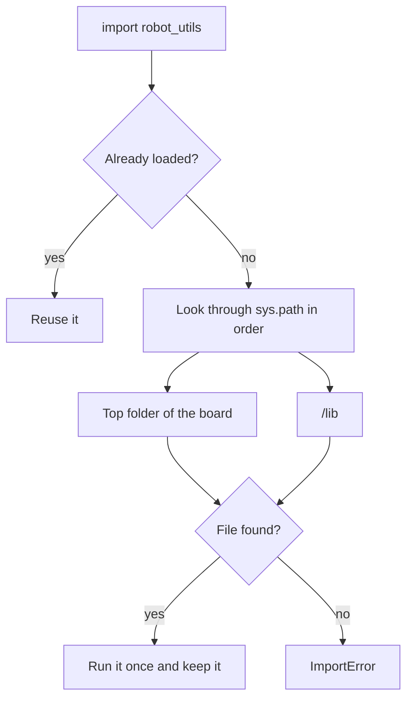

{:class="cover"}

---

By the end of this lesson you will be able to move code into your own module file, import it in three different ways, and explain where MicroPython looks for modules on the board.

## One file is not enough

Your robot program has grown to 400 lines. The motor class is at the top, the sensor code is in the middle and the main loop is somewhere near the bottom. Finding anything is a chore, and you cannot reuse the motor class in your next project without copying it.

A **module** is simply a `.py` file. Anything you define in it (functions, classes, variables) can be loaded by other files with `import`. You have already used modules: `machine` and `time` are modules that come with MicroPython.

---

## Make your own

On your Pico, save this file as **`robot_utils.py`** (in Thonny: *File > Save as*, choose *Raspberry Pi Pico*):

```python
# robot_utils.py
WHEEL_DIAMETER_MM = 65

def clamp(value, low, high):
    """Keep value between low and high."""
    return max(low, min(high, value))

class Counter:
    def __init__(self):
        self.count = 0

    def tick(self):
        self.count += 1
        return self.count

if __name__ == "__main__":
    # runs only when you run this file directly, not when it is imported
    print("clamp(150, 0, 100) =", clamp(150, 0, 100))
```

Run it directly and you will see the `clamp` line printed. Now save a second file as **`main.py`** (the name MicroPython runs automatically when the board powers up) that uses it:

```python
# main.py
import robot_utils

print(robot_utils.clamp(150, 0, 100))
laps = robot_utils.Counter()
laps.tick()
print("laps:", laps.tick())
print("wheel:", robot_utils.WHEEL_DIAMETER_MM, "mm")
```

Both files must be saved on the Pico, in the same folder. Running `main.py` on its own will not work from your computer's disk alone, because the Pico does the importing and it can only see its own files.

---

## Three ways to import

```python
import robot_utils                      # use as robot_utils.clamp(...)
from robot_utils import clamp           # use as clamp(...)
import robot_utils as ru                # use as ru.clamp(...)
```
{: .no-snakie }

Use `import module` when you want it obvious where a name came from. Use `from module import name` for one or two names you use constantly. Avoid `from module import *`: it dumps every name into your program, risks overwriting your own, and costs RAM for names you never use.

---

## What `import` really does

The first time MicroPython sees `import robot_utils`, it finds the file, runs it from top to bottom, and keeps the result in a table of loaded modules. Every later `import robot_utils` reuses that stored copy. This has consequences:

- Code at the top of a module runs **once**, at the first import. A `print()` there appears only once.
- Changing the file while the program is running does not reload it. You need to restart (press the Stop/Restart button in Thonny, or soft-reset).
- `if __name__ == "__main__":` is true only when the file is run directly, so you can keep a quick test at the bottom of a module without it firing on import.

### Where does it look?



You can see the list for yourself:

```python
import sys
print(sys.path)
```

On a typical Pico this shows an empty string (meaning the top folder of the board), `.frozen` (modules built into the firmware) and `/lib`. The exact list varies by firmware version. Put your own modules in the top folder, and shared libraries you install in `/lib`.

---

## Standard library modules are smaller

Modules such as `time`, `math`, `json` and `random` exist on the Pico, but they are cut-down versions of the desktop ones. For example, `time.strftime` and `datetime` are missing and `time.localtime()` returns a plain tuple. When a desktop-Python snippet fails on `import`, look in the [MicroPython documentation](https://docs.micropython.org/) for the library, not Python's.


import math

print(math.sqrt(16))
print(math.pi)



> **Teachers**: Learners often confuse the files on their computer with the files on the board. Have them list the board's files in Thonny's Files pane (View > Files) before running. On shared kit, ask each learner to put their work in a named folder so one person's `main.py` does not overwrite another's, because a board runs whichever `main.py` is on it at power-up.

---

## Try it Yourself

1. Save `robot_utils.py` and `main.py` on your Pico and run `main.py`. Then add a `to_metres(mm)` function to the module and use it.
2. Add a `print("loading robot_utils")` at the top level of the module and import it twice in `main.py`. How many times does it print? Why?
3. Move the `Led` class from lesson 2 into its own `leds.py` and import it with `from leds import Led`.
4. Challenge: print `sys.path` and work out which entry your module is found through.

---

## Common Issues

- **Problem**: `ImportError: no module named 'robot_utils'`.
- **Solution**: Save `robot_utils.py` onto the Pico itself, in the top folder or `/lib`, and check the spelling.
- **Why**: MicroPython can only import files that are on the board's own filesystem.

- **Problem**: You edited the module but the program still behaves the old way.
- **Solution**: Stop and restart the program.
- **Why**: Modules load once and are then reused, so edits are not seen until the next run.

- **Problem**: `NameError: name 'clamp' is not defined` after `import robot_utils`.
- **Solution**: Write `robot_utils.clamp(...)`, or use `from robot_utils import clamp`.
- **Why**: A plain `import` keeps names inside the module's own namespace.

---

## Check your understanding


? What is a module in MicroPython?
- [ ] A special folder
- [x] A `.py` file whose functions, classes and variables other code can import
- [ ] A built-in command
> Any Python file can be imported by its name, without the `.py`.

? If you `import robot_utils` twice, how many times does its top-level code run?
- [x] Once
- [ ] Twice
- [ ] Every time the Pico loops
> The first import runs the file and stores the result. Later imports reuse it.

? Where must your module file live for `main.py` to import it on the Pico?
- [ ] On your computer's Desktop
- [x] On the Pico's own filesystem, in the top folder or `/lib`
- [ ] Anywhere on the internet
> The Pico does the importing, so the file has to be on the board.

