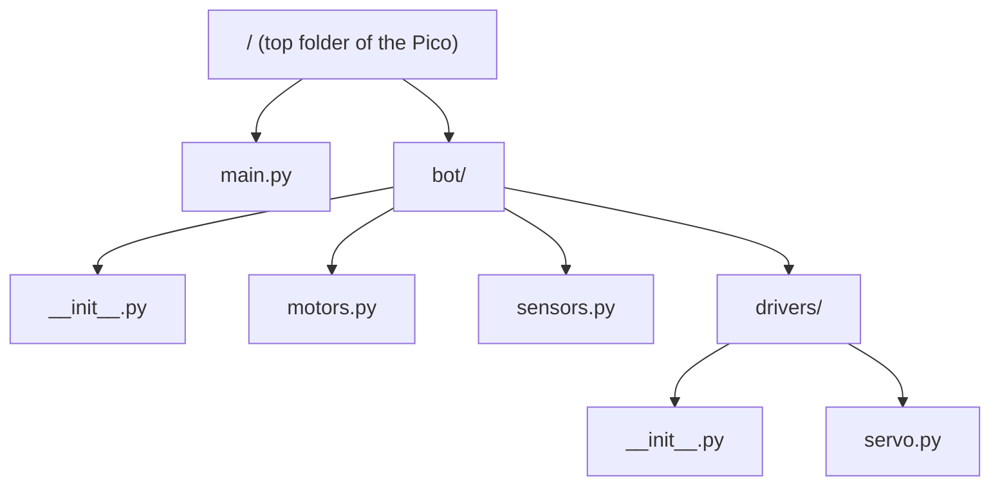

{:class="cover"}

---

By the end of this lesson you will be able to build a package folder with several modules, import from it using absolute and relative imports, and get it onto your Pico.

## From files to folders

A robot project soon has a dozen modules: motors, sensors, displays, networking. Dumping them all in the top folder gets as messy as one giant file. A **package** is a folder of modules, so related code lives together and gets a shared name.



Here `bot` is the package. It contains two modules and a sub-package, `drivers`.

---

## Build a package

Create this layout on your Pico, using Thonny's Files pane (right-click > *New directory*) or the `mpremote` tool from [lesson 13](13_mp_remote):

```text
main.py
bot/
    __init__.py
    motors.py
    sensors.py
```

Save the first module as `bot/motors.py`:

```python
# bot/motors.py
class Motor:
    def __init__(self, name):
        self.name = name

    def move(self, direction, power):
        print(f"{self.name} moving {direction} at {power}")
```

and the second as `bot/sensors.py`:

```python
# bot/sensors.py
class DistanceSensor:
    def read_cm(self):
        return 42         # a real driver would measure here
```

Then `bot/__init__.py`, which runs when the package is first imported. We use it to make the most-used names easy to reach:

```python
# bot/__init__.py
from .motors import Motor
from .sensors import DistanceSensor
```
{: .no-snakie }

The leading dot means "from the same package". It is a **relative import**, so the package keeps working even if you rename the folder.

Finally `main.py` in the top folder:

```python
# main.py
from bot import Motor, DistanceSensor

left = Motor("left")
eyes = DistanceSensor()
left.move("forward", 60)
print("distance:", eyes.read_cm(), "cm")
```
{: .no-snakie }

You can still import a single module directly, for example `from bot.motors import Motor`, or `import bot.sensors as sensors`.

---

## Do I need `__init__.py`?

Tutorials say a folder is only a package if it contains `__init__.py`. On desktop Python 3 that is no longer strictly true, and on the MicroPython version we tested (1.26.1) a folder without it can also be imported. Still, **always add `__init__.py`**: it is the clear signal that the folder is a package, it is the right place for the convenient imports above, and it works on every version.

Keep `__init__.py` small. Everything in it runs on first import, using RAM and time at startup.

---

## Getting the package onto the board

A package is more than one file, so copying it by hand gets tedious. With `mpremote` (lesson 13) it is one command from your computer, run in the folder that holds `main.py`:

```bash
mpremote cp -r bot/ :
```

That copies the whole `bot` folder to the top of the Pico. Without `mpremote`, create each folder and file in Thonny.

> **Teachers**: Learners often save package files on their computer and expect the Pico to see them. Check each learner's Files pane shows the `bot` folder on the *Raspberry Pi Pico* side before they run `main.py`. A shared class set of boards can keep each learner's work in a package named for them, such as `team_a/`, so projects stay separate.

---

## Packages versus a flat `/lib`

Libraries you install from the internet (next lesson) go in `/lib`, and you import them by their package name. Your own code can live beside `main.py`. A good habit:

| Where | What goes there |
| --- | --- |
| Top folder | `main.py`, `boot.py`, your own packages |
| `/lib` | Libraries installed with `mip`, shared between projects |

{:class="table table-single"}

---

## Try it Yourself

1. Build the `bot` package above and run `main.py`. Check you see the printed output.
2. Add a `leds.py` module with an `Led` class, import it in `__init__.py`, and use it from `main.py`.
3. Add the `drivers` sub-package with a `servo.py` module. Import it with `from bot.drivers.servo import Servo`.
4. Challenge: delete `__init__.py` from `bot/`. Does your import still work on your board? What does that tell you?

---

## Common Issues

- **Problem**: `ImportError: no module named 'bot'`.
- **Solution**: Check the `bot` folder is on the Pico (not just your computer) and that the name matches exactly.
- **Why**: Imports search the board's filesystem. A folder on your laptop is invisible to the Pico.

- **Problem**: `ImportError: can't import name Motor`.
- **Solution**: Check `Motor` really exists in `motors.py` and is spelt the same in `__init__.py`.
- **Why**: A name that is not defined in the module cannot be imported from it.

- **Problem**: Your edits to a package module do not take effect.
- **Solution**: Stop and restart the program (or soft-reset the board).
- **Why**: Modules, including those in packages, are loaded once and then reused.

---

## Check your understanding


? What is a package?
- [ ] A compressed file
- [x] A folder of related modules
- [ ] A single large module
> A package groups modules under one name, such as `bot.motors`.

? What does the dot in `from .motors import Motor` mean?
- [x] Import from the same package as this file
- [ ] Import from the internet
- [ ] A decimal point
> It is a relative import, so the package works even if the folder is renamed.

? Why should you keep `__init__.py` small?
- [ ] Large files are not allowed
- [x] It runs on first import, so heavy code slows start-up and uses RAM
- [ ] It must be exactly empty
> Everything in `__init__.py` runs when the package loads.

