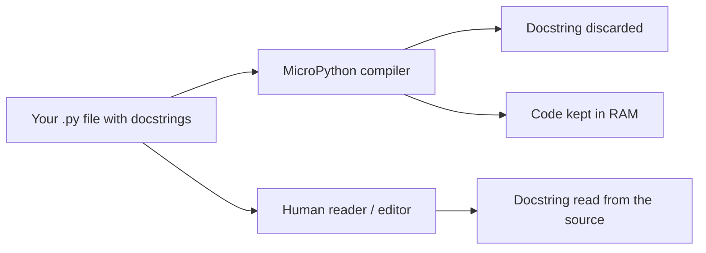

{:class="cover"}

---

By the end of this lesson you will be able to write clear docstrings for functions, classes and modules, and explain why `help()` and `__doc__` will not show them on MicroPython.

## Code you can read in six months

You wrote a `Motor` class three weeks ago. Now you are staring at `m.set(40, True)` and wondering what `True` means. Good documentation, written next to the code, answers that question.

A **docstring** is a string literal placed as the very first statement of a function, class or module. Triple quotes let it run over several lines.

```python
def clamp(value, low, high):
    """Return value limited to the range low to high."""
    return max(low, min(high, value))
```

That one-liner already tells the next reader what `clamp` does.

---

## What a good docstring says

Keep it short and useful. State what the function does, what each argument means (and its units), and what comes back. Units matter a lot in robotics:

```python
def drive(speed, seconds):
    """Drive forward.

    speed: motor power from 0 to 100 (percent).
    seconds: how long to drive, in seconds.
    Returns the distance travelled estimate in centimetres.
    """
    return speed * seconds * 0.5
```

For a class, describe what it represents on the first line, then list the things callers need to know:

```python
class Motor:
    """A DC motor on an H-bridge driver.

    Use forward(), backward() and stop(). Speed is 0 to 100.
    """

    def __init__(self, pin_a, pin_b):
        """pin_a and pin_b are the two GPIO numbers wired to the driver."""
        self.pin_a = pin_a
        self.pin_b = pin_b
```
{: .no-snakie }

Tips: write the first line as a single sentence that fits on one line, use triple double-quotes (`"""`) as PEP 257 recommends, and put a docstring at the very top of each module saying what it is for.

---

## The MicroPython catch

On desktop Python, the interpreter stores docstrings and `help(my_function)` or `my_function.__doc__` prints them. **MicroPython throws docstrings away** when it compiles your code, to save RAM. On the build we tested (1.26.1), asking for one fails. Run this on your Pico to see:

```python
def greet(name):
    """Return a friendly greeting."""
    return "Hello, " + name

print(greet("Kev"))

try:
    print(greet.__doc__)
except AttributeError:
    print("No __doc__ on this MicroPython: docstrings are not stored")

help(greet)
```

You will see the greeting, then the message from the `except` branch, and finally `help(greet)` only reports the object type (something like `object <function greet> is of type function`), with no description. The docstring is still perfectly valid Python and does no harm. It is simply not available at run time.



So who are docstrings for? **People reading the source**, and code editors on your computer, such as VS Code, which read the file itself and can show the text when you hover over a function. That is plenty of reason to write them. Just do not build a program that depends on reading `__doc__`.

---

## What `help()` and `dir()` are good for

Although `help(my_function)` is not useful, two things still are:

- `help()` with no argument prints a short guide to the board's firmware.
- `help("modules")` lists every module available on your board, a great way to discover what your firmware includes.
- `dir(obj)` lists the names an object has, such as every method of a class.

```python
import machine
print(dir(machine)[:8])
```
{: .no-snakie }

For real documentation of built-in modules, use the online [MicroPython documentation](https://docs.micropython.org/).

---

## Comments or docstrings?

- **Docstring**: *what* this thing does and how to use it.
- **Comment** (`# ...`): *why* a line is the way it is, such as `# the driver needs 10 ms to settle`.

Do not repeat the code in words (`# add one to x`). Explain things the code cannot say.

---

## Try it Yourself

1. Add a docstring to every function in your last project. Include units.
2. Run the `__doc__` experiment on your own board. What does your firmware print for `help(greet)`?
3. Add a module docstring at the top of `robot_utils.py` from lesson 7.
4. Challenge: write a docstring for a function that returns the distance from an ultrasonic sensor. Could someone use it without reading the code?

---

## Common Issues

- **Problem**: `AttributeError: 'function' object has no attribute '__doc__'`.
- **Solution**: Read the docstring in your editor or source file, and do not rely on `__doc__` in MicroPython code.
- **Why**: MicroPython does not store docstrings, to save memory.

- **Problem**: A docstring appears to cause a syntax error.
- **Solution**: Check the triple quotes are closed and the text is indented inside the function.
- **Why**: An unclosed `"""` swallows the rest of the file as one big string.

---

## Check your understanding


? What is a docstring?
- [ ] A comment starting with `#`
- [x] A string as the first statement of a function, class or module that documents it
- [ ] A special variable name
> Docstrings are string literals, normally in triple quotes, placed first in the body.

? On MicroPython, what happens when you ask for `my_function.__doc__`?
- [ ] It prints the docstring
- [x] It fails with an `AttributeError`, because docstrings are not stored
- [ ] It prints the function's source code
> MicroPython discards docstrings when compiling to save RAM.

? Who benefits from your docstrings if the Pico does not keep them?
- [x] People and editors reading your source file
- [ ] The Pico at run time
- [ ] Nobody
> They are documentation in the source, and editors that read the file can show them.

