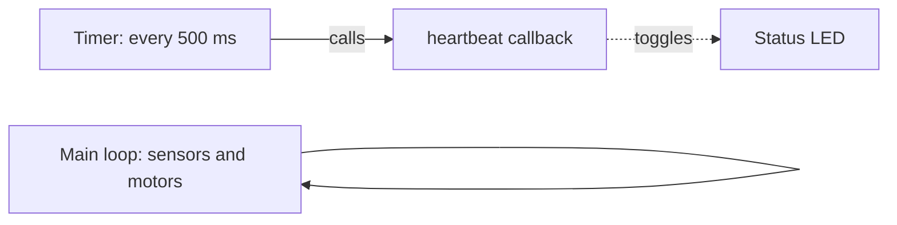

{:class="cover"}

---

By the end of this lesson you will be able to start a periodic timer and a one-shot timer, stop them, and keep the callback short by passing work to the main loop.

## Doing two things at once

Your robot needs to blink a heartbeat LED every half second while it reads sensors and drives around. With `sleep()` you cannot do both: while you are sleeping, nothing else happens. A **timer** solves this. You tell it "call this function every 500 ms", and then carry on with your program.



---

## A periodic timer

Wire an LED with a 330 ohm resistor from **GP15** to GND. Save and run:

```python
from machine import Pin, Timer
from time import sleep

led = Pin(15, Pin.OUT)

def heartbeat(timer):
    led.toggle()

blinker = Timer()
blinker.init(period=500, mode=Timer.PERIODIC, callback=heartbeat)

count = 0
while True:
    count += 1
    print("main loop is busy:", count)
    sleep(1)
```

The LED blinks twice a second, while the main loop prints once a second, independently. Let's see what's what:

- `period=500` is in **milliseconds**.
- `mode=Timer.PERIODIC` repeats forever. `Timer.ONE_SHOT` fires once.
- The callback receives the `Timer` object as its one argument, even if you do not use it.

To stop it, call `blinker.deinit()`.

---

## A one-shot timer

A one-shot timer is perfect for "do this once in a few seconds": a safety timeout, a delayed shutdown, turning off a buzzer after a beep.

```python
from machine import Pin, Timer
from time import sleep

buzzer = Pin(16, Pin.OUT)

def silence(timer):
    buzzer.value(0)
    print("buzzer off")

buzzer.value(1)                                   # start beeping
stopper = Timer()
stopper.init(period=2000, mode=Timer.ONE_SHOT, callback=silence)

for second in range(4):
    print("running", second)
    sleep(1)
```

Here a buzzer (a simple active one on GP16) switches itself off two seconds after it starts, whatever else the program is doing.

---

## Pico timers are different

If you have used an ESP32 or an older MicroPython tutorial, you may have written `Timer(0)` and `Timer(1)` to pick hardware timers. **On the Raspberry Pi Pico that fails.** The Pico port supports only *software* timers, identified by `-1`, which is the default if you write `Timer()` with no number. The MicroPython documentation says this is fine, as there is no limit on how many you create, as memory allows.

So for two jobs, you simply make two timers:

```python
from machine import Timer
from time import sleep

def fast(t):
    print("fast")

def slow(t):
    print("slow")

t1 = Timer()
t2 = Timer()
t1.init(period=500, mode=Timer.PERIODIC, callback=fast)
t2.init(period=1500, mode=Timer.PERIODIC, callback=slow)

sleep(5)
t1.deinit()
t2.deinit()
```

Keep every timer in a variable. A timer stops itself when MicroPython tidies it away, so a timer with no name can quietly stop.

You can also set the rate in hertz instead: `freq=2` means twice a second (give `freq` or `period`, not both).

### Soft or hard?

By default, timer callbacks run as **soft** interrupts: they are scheduled to run between bytecode instructions, so they can create objects, but they might be delayed a little, for instance by the garbage collector. Passing `hard=True` gives tighter timing but then the callback has the strict ISR rules from the [interrupts lesson](11_interrupts): no memory allocation, no `print()`. Start with the default.

---

## Keeping callbacks short

The same rules as interrupts apply. A callback that takes longer than the timer's period will pile up and make your robot sluggish. The usual pattern is a flag:

```python
from machine import Timer
from time import sleep

sample_due = False

def tick(timer):
    global sample_due
    sample_due = True

sampler = Timer()
sampler.init(period=100, mode=Timer.PERIODIC, callback=tick)

samples = 0
while samples < 10:
    if sample_due:
        sample_due = False
        samples += 1
        print("sample", samples)        # slow work stays in the main loop
    sleep(0.01)
```

The timer decides *when*; the main loop does the *work*.

> **Teachers**: Timers need only a Pico and one LED, so every learner can try them. Callbacks that run in the background can confuse learners who expect code to run line by line: have them predict the output before running. If a program keeps running after a lesson, remind learners to press Stop in Thonny so one board's timer does not keep an LED blinking on a shared bench.

---

## Try it Yourself

1. Change the heartbeat period to 100 ms, then 2000 ms. What changes?
2. Use `freq=4` instead of `period` to blink four times a second.
3. Start a one-shot timer that prints "time's up" after 3 seconds, while the main loop counts to 5.
4. Challenge: build a "watchdog": a one-shot timer that is restarted every time a button is pressed, and turns the LED on if no press happens for 5 seconds.

---

## Common Issues

- **Problem**: `ValueError: Timer doesn't exist` when you write `Timer(0)`.
- **Solution**: Use `Timer()` or `Timer(-1)` on the Pico.
- **Why**: The Pico port only supports software timers, not numbered hardware ones.

- **Problem**: The callback never runs, or the timer stops.
- **Solution**: Store the timer in a variable that lives as long as the program does.
- **Why**: The Pico's timer object stops itself when the garbage collector removes it, so an unnamed timer can disappear.

- **Problem**: `TypeError: function takes 0 positional arguments but 1 were given`.
- **Solution**: Give the callback one parameter, such as `def heartbeat(timer):`.
- **Why**: MicroPython passes the `Timer` object to every callback.

---

## Check your understanding


? What does `mode=Timer.ONE_SHOT` do?
- [ ] Repeats the callback forever
- [x] Calls the callback once after the period
- [ ] Stops the Pico
> `Timer.PERIODIC` repeats. `Timer.ONE_SHOT` fires a single time.

? How do you make a timer on the Raspberry Pi Pico?
- [ ] `Timer(0)` for the first, `Timer(1)` for the second
- [x] `Timer()` or `Timer(-1)`, as many as you need
- [ ] `Timer(25)`
> The Pico port only supports software timers, which use `-1`.

? Why keep timer callbacks short?
- [x] A slow callback delays the main program and other timers
- [ ] Callbacks cannot use `if`
- [ ] The timer would run out of battery
> Do the slow work in the main loop and just set a flag in the callback.

