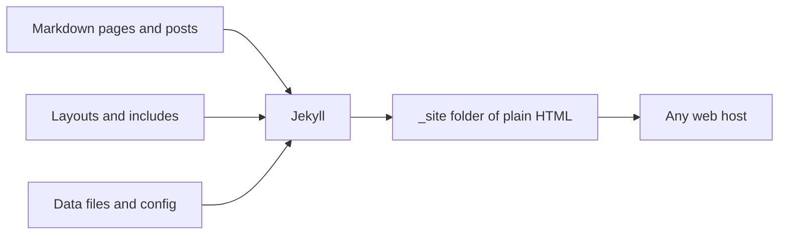

{:class="cover"}

---

Ahoy there makers! Every robot you build deserves a build log: the photos, the wiring notes, the "why did the left motor spin backwards?" moments. In this course we'll build a real website for exactly that, called **Maker's Log**, using Jekyll. No database, no server software, no monthly bill.

---

## Overview

**Jekyll** is a static site generator. You write pages in Markdown, wrap them in templates, and Jekyll builds a folder of plain HTML files that any web server can host. It was created by Tom Preston-Werner, one of the founders of GitHub, and it is open source under the MIT licence.

A **static site** is one where every visitor gets the same finished HTML file. A **dynamic site** (a typical WordPress or PHP site) builds each page on the server when you ask for it, using a database. Static pages are fast, hard to hack (there is no database to attack) and cheap to host, which makes them a great fit for build logs, portfolios and documentation.

This very website, kevsrobots.com, is built with Jekyll. When you see `web/_layouts/` and `web/_includes/` described in later lessons, those are the real folders the site is made from.

## Course Content

- **Getting going**: install Ruby and Jekyll, create a site and see it in your browser
- **Content**: posts, pages, front matter, Markdown, data files and Liquid
- **Customising**: configuration, layouts, includes, CSS and overriding a theme
- **Advanced features**: plugins, an Atom feed, SEO tags, a sitemap, drafts and permalinks
- **Deploying**: building for production and publishing on GitHub Pages
- **Real-world sites**: collections for a portfolio and data files for a parts list
- **Summary**: handy commands, tips and where to go next

## Key Results

After completing this course, you will:

- Explain what a static site generator does and when to choose one
- Install Ruby, Bundler and Jekyll, then create and preview a site locally
- Write posts and pages with front matter, and loop over data with Liquid
- Build your own layouts and includes, and override a theme
- Add the feed, SEO and sitemap plugins and check what they generate
- Publish your site on GitHub Pages with the right `baseurl`

## What you'll need

- A computer running Windows, macOS or Linux, with permission to install software
- An internet connection for downloading Ruby and gems
- A text editor, such as VS Code
- A terminal (Terminal, PowerShell or a Linux shell)
- A free GitHub account for lesson 6 (optional if you only want to build locally)

Prerequisites: if Markdown is new to you, try [Mastering Markdown for Documentation with Jekyll](/learn/markdown/) first. [Git for Beginners](/learn/git/) helps in lesson 6, and [Introduction to the Linux Command Line on Raspberry Pi OS](/learn/linux_intro/) is useful if the terminal feels strange.

## How the course works

**One project grows.** Each lesson adds to **Maker's Log**: first a post, then a parts list, your own layout, plugins, a projects section and finally a published site.

**Checked against the real tool.** Every file and command in this course was built and run with Jekyll 4.4.1 on Ruby 3.3. Your version may print slightly different messages, so when in doubt, the official docs at [jekyllrb.com](https://jekyllrb.com/docs/) are the final word.

**Where to type.** Commands starting with `bundle` or `jekyll` go in your terminal, inside your site folder. Files are shown with their path as a heading in the text.

**Examples with curly braces.** Jekyll treats double curly braces and percent tags as code to run. In these lessons the examples are shown safely, and you type them exactly as written.

**Quizzes.** Each lesson ends with a quick quiz. Your score is stored in your browser.

> **Teachers**: this course suits learners aged 13 and over who can type commands in a terminal, and works well as a half-term web project. Allow 30 to 45 minutes per lesson, and plan about an hour for lesson 2 because installing Ruby is the slowest step. Each learner needs one computer where they can install software, so check with your IT team first. If installs are blocked, learners can still write the Markdown, front matter and templates in lessons 3 to 5 as paper or text-editor exercises, but they will not be able to preview the site. Lesson 6 needs a GitHub account for each learner or group; check your school's rules on account age, and on whether published pages are allowed to be public.

Ready? Let's find out why a static site is such a good home for a build log.

---

## Try it Yourself

1. Open kevsrobots.com in your browser, right-click and choose **View page source**. Notice that the page is plain HTML: there is no sign of Markdown or templates.
2. List three kinds of website that would suit a static site, and one that would not.
3. Challenge: sketch the pages your own Maker's Log should have, such as Home, Parts, Projects and About, ready for lesson 2.

---

## Check your understanding


? What does Jekyll produce when it builds your site?
- [ ] A database that a server queries for every visit
- [x] A folder of plain HTML, CSS and other files
- [ ] A program that must run on the web host
> Jekyll pre-compiles everything into the `_site` folder, so the host only has to serve files.

? Why are static sites considered hard to attack?
- [x] There is no database or server-side code running for each visitor
- [ ] They are always hidden behind a password
- [ ] They cannot contain JavaScript
> With nothing to run on the server, there is far less for an attacker to exploit.

? Which of these is a good fit for a static site?
- [ ] A shop where stock levels change every second
- [x] A robot build log with photos and notes
- [ ] A chat room with live messages
> Content that changes only when you publish suits a static site; live, per-visitor content does not.

