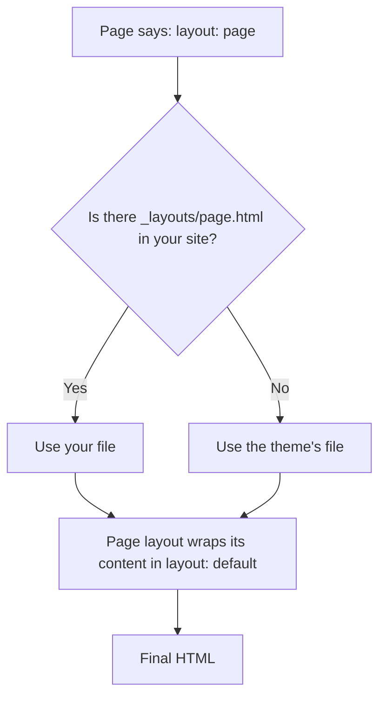

{:class="cover"}

---

By the end of this lesson you will be able to set site-wide options in `_config.yml`, write your own layout and include, and link a stylesheet and a script from them.

---

## Settings: _config.yml

`_config.yml` is where site-wide facts live. Anything in it is available to every page as `site.<name>`. Replace the generated file with this smaller one:

```yaml
title: Maker's Log
description: >-
  A build log for my robots: what worked, what melted.
baseurl: ""
url: "https://example.com"

theme: minima
plugins:
  - jekyll-feed
```

`title` and `description` are yours to use in templates. `url` is your domain, and `baseurl` is a sub-folder if your site lives in one (we need that in lesson 6). The `theme` line chooses the look. `minima` is the default theme that `jekyll new` installs from the Gemfile. Remember to stop and restart `jekyll serve` after editing this file.

## Where Jekyll looks for a layout

A **layout** is an HTML template with a `{{ content }}` placeholder where each page's body goes. A theme ships with its own layouts, but Jekyll always checks **your** site first. That is how you override a theme without touching its files.



Let's use that. We'll write our own `default.html`, the outer shell that every other layout is wrapped in.

## Your own layout

Create `_layouts/default.html`:


```html
<!DOCTYPE html>
<html lang="en">
<head>
  <meta charset="utf-8">
  <meta name="viewport" content="width=device-width, initial-scale=1">
  <title>{{ page.title }} | {{ site.title }}</title>
  <link rel="stylesheet" href="{{ '/assets/css/robot.css' | relative_url }}">
</head>
<body>
  
  <main>
    {{ content }}
  </main>
  <footer>Built with Jekyll on {{ site.time | date: "%d %B %Y" }}</footer>
</body>
</html>
```


There are four Liquid ideas in there. `page.title` is the page's own front matter. `site.title` comes from `_config.yml`. `site.time` is when the build ran, and the `date` filter formats it. `relative_url` adds the `baseurl` to a path, so links keep working if the site moves into a sub-folder.

## An include

The navigation will be the same on every page, so we put it in one place. Create `_includes/nav.html`:


```html
<nav>
  <a href="{{ '/' | relative_url }}">Home</a>
  <a href="{{ '/parts/' | relative_url }}">Parts</a>
  <a href="{{ '/about/' | relative_url }}">About</a>
</nav>
```


The `` line in the layout pulls it in. Now one edit changes the menu everywhere.

## CSS and JavaScript

A file with no front matter is copied to `_site` exactly as it is, so a stylesheet is just a file. Create `assets/css/robot.css`:

```css
body { font-family: sans-serif; max-width: 40rem; margin: 0 auto; padding: 1rem; }
nav a { margin-right: 1rem; color: #d6336c; }
footer { margin-top: 2rem; color: #666; font-size: 0.8rem; }
```

JavaScript works the same way: put a file such as `assets/js/site.js` in the folder and link it from the layout with a `<script src="{{ '/assets/js/site.js' | relative_url }}"></script>` tag before `</body>`.

We built this exactly. After the build, `_site/about/index.html` started with our own `<head>`, then the nav links `/`, `/parts/` and `/about/`, then the minima `page` layout's article, and finally the footer. The about page still used `layout: page` from the theme, and our `default.html` wrapped it, because local files win over the theme.

On this site, kevsrobots.com, the same idea is used at a bigger scale: `web/_layouts/default.html` holds the shared page shell, and it pulls in pieces from `web/_includes/` such as the top bar, navigation and footer.

> **Teachers**: learners can easily break a layout and then see every page broken at once, which is a great, safe lesson in why layouts matter. Ask them to commit working versions with Git (see the [Git course](/learn/git/)) so they can roll back. Remind them that colours and fonts should stay readable, including for classmates with colour-vision differences.

## Try it Yourself

1. Change the nav link colour in `robot.css`, save, and refresh. Do you need to restart the server?
2. Add a link to Projects in `nav.html`. Where does it appear?
3. Add `<p>Built by YOUR NAME</p>` to the footer in the layout, then check two different pages.
4. Challenge: create `_includes/footer.html`, move the footer markup into it and replace it in the layout with an include tag.

## Common Issues

- **Problem**: Your CSS changes do nothing.
- **Solution**: Hard refresh the browser (Ctrl+Shift+R) and check the stylesheet path in the page source.
- **Why**: Browsers cache stylesheets, and a wrong path means the file never loads.

- **Problem**: The page shows an include error such as a missing file.
- **Solution**: Check the file is in `_includes/` and the name in the tag matches exactly.
- **Why**: Jekyll only looks for includes in the `_includes` folder.

- **Problem**: Your edit to `_config.yml` has no effect.
- **Solution**: Stop the server with Ctrl+C and run `bundle exec jekyll serve` again.
- **Why**: The configuration is read once when the server starts.

- **Problem**: Links and the stylesheet break when the site is published in a sub-folder.
- **Solution**: Wrap paths in the `relative_url` filter, as the examples above do.
- **Why**: A path starting with `/` points at the root of the domain, not the folder your site lives in.

## Check your understanding


? You create `_layouts/default.html` while using the minima theme. Which file does Jekyll use?
- [ ] The theme's, always
- [x] Yours, because local files take priority over the theme's
- [ ] Both, merged together
> Jekyll checks your site's folders before the theme's.

? What does the content placeholder do in a layout?
- [ ] It names the page
- [x] It marks where each page's body is inserted
- [ ] It loads the stylesheet
> The layout is a shell, and each page's rendered body fills the content slot.

? Why use the `relative_url` filter on links?
- [x] So links keep working if the site is hosted under a sub-folder
- [ ] To make links open in a new tab
- [ ] To make pages load faster
> It adds the `baseurl` to the path.

