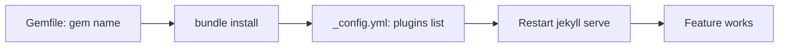

{:class="cover"}

---

By the end of this lesson you will be able to add Jekyll plugins correctly, and check the feed, SEO tags and sitemap they create.

---

## Plugins in two places

A **plugin** adds a feature to Jekyll. Plugins are Ruby gems, so adding one is a two-step job, and forgetting either step is the classic first mistake:

1. List the gem in your `Gemfile`, inside the `jekyll_plugins` group, and run `bundle install`.
2. List its name under `plugins:` in `_config.yml`.



We'll add three useful ones: `jekyll-feed`, `jekyll-seo-tag` and `jekyll-sitemap`. `jekyll new` already put `jekyll-feed` in your Gemfile. Open it and make the plugin group look like this:

```ruby
group :jekyll_plugins do
  gem "jekyll-feed", "~> 0.12"
  gem "jekyll-seo-tag"
  gem "jekyll-sitemap"
end
```

Run `bundle install`, then update the `plugins:` list in `_config.yml`:

```yaml
plugins:
  - jekyll-feed
  - jekyll-seo-tag
  - jekyll-sitemap
```

Restart the server. We built the site with exactly this setup, and the build output included these new files: `feed.xml`, `sitemap.xml` and `robots.txt`.

## What each plugin gives you

**jekyll-feed** creates `/feed.xml`, an **Atom** feed that feed readers use to tell people about new posts. To let readers discover it, add this inside the `<head>` of your layout:


```html

```


**jekyll-seo-tag** adds the meta tags that search engines and social sites read: a proper title, description, canonical address and Open Graph tags. Add this to the same `<head>`, replacing the plain `<title>` line from last lesson:


```html

```


In our build, the About page's head then contained `<title>About | Maker’s Log</title>`, a description taken from `_config.yml`, and `<link rel="canonical" href="https://example.com/about/" />`. Notice the canonical link uses the `url` from your config, so set `url` to your real address before you publish.

**jekyll-sitemap** writes `/sitemap.xml` listing every page and post, and a `robots.txt` that points search engines to it. Our sitemap listed addresses such as `https://example.com/about/` and `https://example.com/robots/2026/11/24/first-robot.html`.

## Drafts, future dates and permalinks

Three more features control what gets published:

- **Drafts**: put unfinished posts in a `_drafts/` folder, with no date in the file name. They are skipped normally, and shown with `bundle exec jekyll serve --drafts`. Jekyll dates them with today's date.
- **Future posts**: a post dated tomorrow is hidden until then. Build with `--future` to see it. The build prints `Skipping: ... has a future date` when it hides one.
- **Permalinks**: add `permalink: /log/:year/:month/:title/` to `_config.yml` and the first post builds to `_site/log/2026/11/first-robot/index.html`. Short, tidy addresses are friendlier than the default.

> **Teachers**: plugins download code from the internet, so some school networks will block `bundle install`. Try it on one machine first. Remind learners that gems are other people's code, so only install well-known ones. If your pupils will publish with GitHub Pages in the next lesson, note that GitHub's own build only supports certain plugins (see lesson 6).

## Try it Yourself

1. Add the three plugins, rebuild, and open `_site/feed.xml` in a text editor. Find your post's title in it.
2. Make a file in `_drafts/` called `pico-pinout-notes.md`, build with `--drafts` and find the output.
3. Change the `permalink` setting and rebuild. What happens to the link on the Home page?
4. Challenge: set a post's date to tomorrow, build normally, then with `--future`. Explain the difference.

## Common Issues

- **Problem**: `Dependency Error: ... you don't have jekyll-sitemap or one of its dependencies installed`.
- **Solution**: Add the gem to the `jekyll_plugins` group in the Gemfile and run `bundle install`.
- **Why**: With a Gemfile in your folder, Jekyll only loads gems that Bundler knows about, even if the gem is installed on the computer.

- **Problem**: The plugin is in the Gemfile but nothing changes.
- **Solution**: Also add its name to `plugins:` in `_config.yml`, then restart the server.
- **Why**: The Gemfile installs the code, and the config switches it on.

- **Problem**: The canonical link shows an empty or wrong address.
- **Solution**: Set `url:` in `_config.yml` to your real site address.
- **Why**: The SEO plugin builds full addresses from `url` and `baseurl`.

## Check your understanding


? Which two files must mention a plugin for it to work?
- [ ] `index.md` and `about.md`
- [x] The `Gemfile` and `_config.yml`
- [ ] `_site` and `_posts`
> The Gemfile installs the gem and the config's plugins list activates it.

? Where does jekyll-feed put your feed?
- [x] `/feed.xml`
- [ ] `/rss.html`
- [ ] `/posts/index.xml`
> It generates `feed.xml` at the root of the site.

? A post is dated tomorrow. What happens in a normal build?
- [ ] It is published with a warning banner
- [ ] The build fails
- [x] It is skipped, unless you build with `--future`
> Jekyll hides future-dated posts by default.

