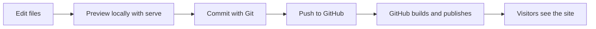

{:class="cover"}

---

By the end of this lesson you will be able to build your site for production, publish it on GitHub Pages, and keep it up to date.

---

## What deploying really means

Because Jekyll produces a folder of plain files, deploying is simply **putting the contents of `_site` on a web server**. That is why static sites are so easy to host: any server that can send files will do.



To build by hand, use production mode:

```bash
JEKYLL_ENV=production bundle exec jekyll build
```

Setting `JEKYLL_ENV` changes `jekyll.environment` from `development` (the default) to `production`. We tested a template with an `if` on that value: it printed "Analytics off (development)" in a normal build and "Analytics on" in the production build. It is the usual way to switch things like analytics scripts on only for the live site. On Windows PowerShell you set the variable on its own line first (`$env:JEKYLL_ENV="production"`), then run the build.

Then copy everything inside `_site` to any host that serves static files. That is the whole manual method.

## Publishing on GitHub Pages

GitHub Pages hosts a site straight from a repository, and it runs Jekyll for you. These steps follow GitHub's current documentation. If you are new to Git, do the [Git for Beginners](/learn/git/) course first.

**1. Set the address.** For a project site, the address will be `https://<username>.github.io/<repository>/`. In `_config.yml`, set:

```yaml
url: "https://<username>.github.io"
baseurl: "/<repository>"
```

The `baseurl` is the sub-folder your site lives in. Because our layouts use the `relative_url` filter, every link and the stylesheet pick it up automatically. For local testing with this setting, run `bundle exec jekyll serve --baseurl ""`, as the Jekyll docs suggest.

**2. Push the site to a new repository.** Create an empty repository on GitHub, then in your site folder:

```bash
git init
git add .
git commit -m "First version of Maker's Log"
git branch -M main
git remote add origin https://github.com/<username>/<repository>.git
git push -u origin main
```

The `.gitignore` that `jekyll new` created already keeps `_site` out of the repository, which is what you want because GitHub builds it for you.

**3. Turn on Pages.** In the repository, click **Settings**, then **Pages** in the sidebar. Under **Build and deployment**, set **Source** to either:

- **Deploy from a branch**: choose your branch and the `/(root)` folder (or `/docs`), then **Save**. This is the simplest option, and every push rebuilds the site.
- **GitHub Actions**: you control the build with a workflow, which GitHub describes as the choice if you want more control over the build.

Wait a minute or two and your site appears at the address from step 1.

**A plugin catch.** With the branch method, GitHub builds the site for you, and the GitHub docs state that GitHub Pages cannot build sites using unsupported plugins. Check your plugins against GitHub's "Dependency versions" page. If one is not supported, build locally and publish the static files, or use GitHub Actions.

> **Teachers**: a GitHub Pages site is public by default, so remind learners never to publish names, faces, school details or contact information. Use a class or club account where learners are under the age GitHub requires, and agree the account owner before the lesson. If GitHub is blocked on your school network, finish with `JEKYLL_ENV=production bundle exec jekyll build` and show the `_site` folder instead.

## Keeping it healthy

- **Update gems**: run `bundle update` now and then, and rebuild locally before you push to check that nothing broke.
- **Check for problems**: `bundle exec jekyll doctor` examines the site. On our site it replied "Your test results are in. Everything looks fine."
- **Use Git as your backup**: each commit is a snapshot you can return to, and GitHub holds a second copy.

## Try it Yourself

1. Run a production build and a development build. Compare the two `_site` folders. What differs?
2. Set `baseurl` to `"/maker-log"`, build, and open `_site/about/index.html`. Find the changed paths in the nav links.
3. Push your site to GitHub and turn on Pages using **Deploy from a branch**.
4. Challenge: add a new post, push it, and time how long until it appears on the live site.

## Common Issues

- **Problem**: The page loads on GitHub Pages but the styling is missing.
- **Solution**: Set `baseurl: "/<repository>"` and use the `relative_url` filter on the stylesheet link.
- **Why**: The stylesheet link began with `/`, which points at the domain root rather than your repository's folder.

- **Problem**: The Pages build fails because of a plugin.
- **Solution**: Check the plugin is supported by GitHub Pages, or switch the Source to GitHub Actions.
- **Why**: The branch method only builds with the plugins GitHub supports.

- **Problem**: You get a 404 on your new site.
- **Solution**: Check Pages is switched on, the branch is right, and that you have a home page (`index.markdown`).
- **Why**: Pages only publishes once a source is chosen, and it needs a file to serve at the root.

- **Problem**: Local links break after you set a `baseurl`.
- **Solution**: Browse to `/<repository>/` locally, or run with `--baseurl ""`.
- **Why**: Jekyll now serves the site under that sub-folder, even on your own computer.

## Check your understanding


? What do you actually upload to a plain web host?
- [ ] The whole source folder including `_posts`
- [x] The contents of the `_site` folder
- [ ] Only the `Gemfile`
> `_site` holds the finished HTML, CSS and other files.

? What is `baseurl` for?
- [ ] The title of the site
- [x] The sub-folder the site lives in, such as the repository name on GitHub Pages
- [ ] The branch to publish from
> A project site lives at username.github.io/repository, so the repository name is the `baseurl`.

? Why might a plugin stop working on GitHub Pages with Deploy from a branch?
- [x] GitHub only builds with the plugins it supports
- [ ] Plugins only work offline
- [ ] The plugin is too old to read Markdown
> GitHub states it cannot build sites using unsupported plugins. Use Actions or build locally.

