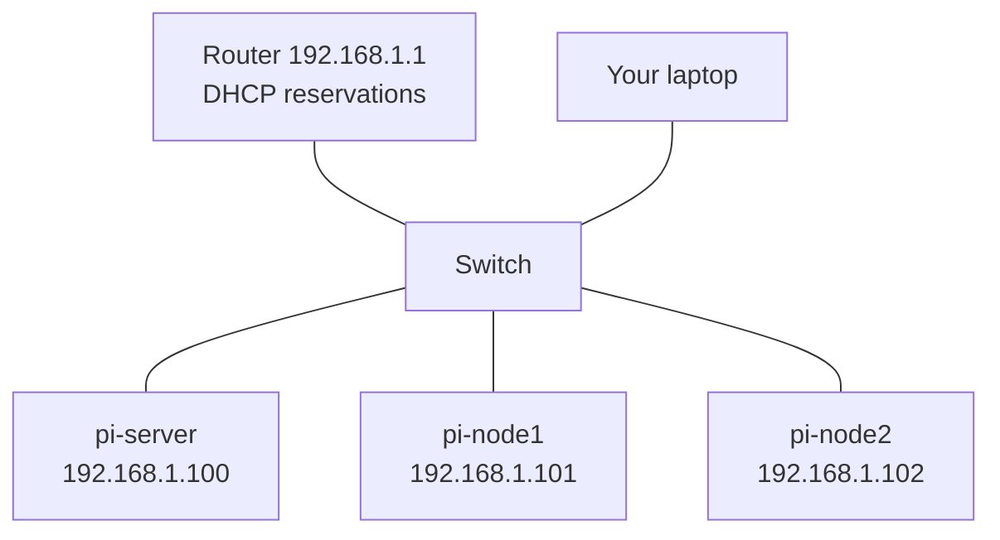

{:class="cover"}

---

By the end of this lesson you will be able to give every node a fixed IP address and a unique name, check that the nodes can reach each other, and list the ports K3s needs open.

---

## Why networking comes first

Workers find the server by its address, and the server talks back to every node. If the server's address changes after a reboot, your workers lose it. So before installing anything we make the addresses boring and permanent.



---

## Option A: DHCP reservation (recommended)

Log in to your router and look for a setting called DHCP reservation, static lease or address reservation. Tell it to always give a particular IP address to a particular Pi, matched by its MAC address. Find a Pi's MAC address with:

```bash
ip link show eth0
```

The `link/ether` value is the MAC address. Fill in a plan like this, using your own addresses:

| Hostname | Address |
|---|---|
| `pi-server` | `192.168.1.100` |
| `pi-node1` | `192.168.1.101` |
| `pi-node2` | `192.168.1.102` |
{:class="table table-single"}

Pick addresses outside your router's normal DHCP pool, or reserve them inside it, so nothing else is given the same address. Reboot each Pi and check the address with `hostname -I`.

---

## Option B: a static address on the Pi

If your router cannot reserve addresses, set one on the Pi. Raspberry Pi OS Bookworm and later use NetworkManager. First find your connection name:

```bash
nmcli connection show
```

Then, using that name (often `Wired connection 1`) and your own addresses:

```bash
sudo nmcli connection modify "Wired connection 1" \
  ipv4.method manual \
  ipv4.addresses 192.168.1.100/24 \
  ipv4.gateway 192.168.1.1 \
  ipv4.dns 192.168.1.1
sudo nmcli connection up "Wired connection 1"
```

Take care: a typo can lock you out until you attach a monitor. Do one Pi at a time, and keep your SSH session in a second window to test.

On Ubuntu Server the equivalent is a netplan file in `/etc/netplan/`. A static wired setup looks like this, and you apply it with `sudo netplan apply`:

```yaml
network:
  version: 2
  ethernets:
    eth0:
      dhcp4: false
      addresses:
        - 192.168.1.100/24
      routes:
        - to: default
          via: 192.168.1.1
      nameservers:
        addresses:
          - 192.168.1.1
```

---

## Hostnames and a hosts file

If you set hostnames in Imager they are already right. If not:

```bash
sudo hostnamectl set-hostname pi-node1
```

Every node must have a **unique** name. If two nodes share a hostname, K3s will reject the second one (we will meet that error in lesson 7). To reach nodes by name from your laptop even without mDNS, add them to your laptop's hosts file (`/etc/hosts` on Linux and macOS):

```text
192.168.1.100 pi-server
192.168.1.101 pi-node1
192.168.1.102 pi-node2
```

---

## Test the connection

From each Pi, ping the others by address:

```bash
ping -c 3 192.168.1.101
```

You should see replies with a time in milliseconds, and "0% packet loss" in the summary.

---

## Ports K3s needs

You do not need to change anything if no firewall is running, which is the default on Raspberry Pi OS. If you add one, these are the ports from the K3s documentation:

| Port | Used for | Between |
|---|---|---|
| TCP 6443 | The Kubernetes API and K3s supervisor | Workers to server, and your laptop to server |
| UDP 8472 | Flannel VXLAN (pod traffic between nodes) | All nodes |
| TCP 10250 | Kubelet (logs, `kubectl exec`, metrics) | All nodes |
{:class="table table-single"}

Never expose the VXLAN port to the internet. K3s also uses `10.42.0.0/16` for pods and `10.43.0.0/16` for services by default, so make sure your home network does not already use those ranges.

> **Teachers**: School networks often block reservations, isolate devices from each other, or filter `.local` names. The simplest classroom setup is a small unmanaged switch per group with one Pi or a laptop providing DHCP, giving each group a private network. Ask your network team before connecting a cluster to the school LAN.

---

## Try it Yourself

1. Reserve an address for each node and confirm it with `hostname -I` after a reboot.
2. From your laptop, `ssh` to every node by its hostname.
3. Challenge: run `ip route` on a node and find the default gateway. Does it match your plan?

---

## Common Issues

- **Problem**: A node's address changes after a reboot.
- **Solution**: Add a DHCP reservation in your router, or set a static address.
- **Why**: Without a reservation the router hands out whichever address is free, and workers store the server's address.

- **Problem**: You lose SSH access after setting a static address.
- **Solution**: Connect a monitor and keyboard, then correct the address, gateway and prefix length.
- **Why**: A wrong gateway or `/24` prefix puts the Pi on a network your laptop cannot reach.

---

## Check your understanding


? Why do workers need the server to keep the same address?
- [ ] Pods cannot use DHCP
- [x] Workers are told the server's address when they join
- [ ] The router deletes unknown addresses
> The join command contains the server's address, so it must stay stable.

? Which port must workers be able to reach on the server?
- [ ] 80
- [x] 6443
- [ ] 22
> TCP 6443 is the Kubernetes API and the K3s supervisor port.

? Which command sets a hostname?
- [x] `sudo hostnamectl set-hostname pi-node1`
- [ ] `sudo ip set hostname pi-node1`
- [ ] `nmcli hostname pi-node1`
> `hostnamectl` changes the system hostname.

